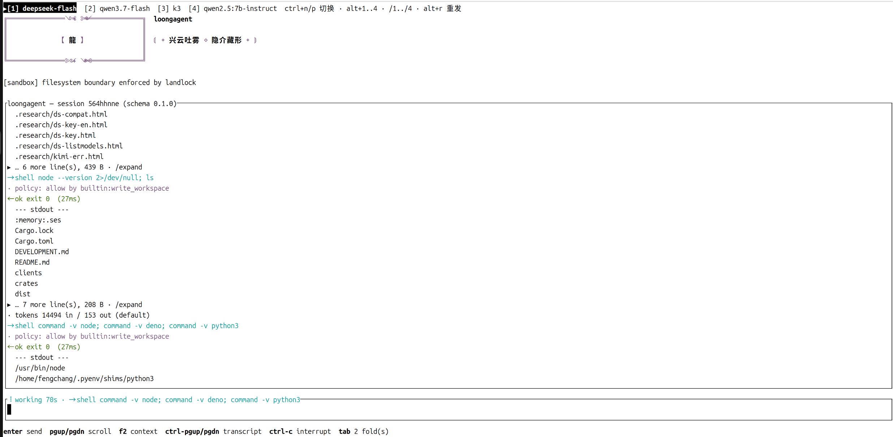

# loongagent

一个装在你自己机器上的编码 agent。单个二进制，**会话原文（JSONL 日志）就是唯一真相**，
每一次权限决定都是一条可审计的事件，模型、记忆、会话全部留在本机 —— 不依赖任何服务器也能用。

- **本地版**：`loongagent tui --local`，模型可以是本机 ollama，也可以是你自己的 API key；
  配置、密钥、会话都在 `~/.loongagent/` 下，别人碰不到。
- **控制面（已实现）**：企业侧用**签名 pack** 下发 profile：包由 Ed25519 签发、本地按固定公钥
  验签，验不过就用不了，模型/端点/密钥不进用户配置。**但本机的 org 层文件
  `/etc/loongagent/profile.toml` 不签名**，它只是一个管理员拥有的文件，不能叫防篡改。
  两条路共用同一个内核，本地版不需要它。



*状态栏 `[1] deepseek-flash [2] qwen3.7-flash [3] k3 [4] qwen2.5:7b-instruct`：
云端模型和本机 ollama 模型并排，`alt+1..4` 或 `/1../4` 一键切。下面每一行工具调用都带着
`policy: allow by builtin:write_workspace`，顶部的 `[sandbox] filesystem boundary enforced by landlock`
说明进程边界是真在生效，不是声明。*

---

## 本地版的三个特色

| 特色 | 一句话 | 状态 |
|---|---|---|
| **R 模式**（record，默认回滚路径） | 不调用任何模型：检索层 + 确定性 digest 全部工作。没装小模型也完整可用 | 已实现 |
| **S 模式 · semantic local**（可选装） | 在 R 之上，L2 归纳、L3、L4 交给**本机 ollama 小模型**生成；开启后不再丢消息，只清工具输出，`recall` 能回到原文 | 已实现（ADR-0017 P5） |
| **控制面**（企业下发） | 签名 pack + 固定公钥；验签在 pack 进入 org 层之前；模型 id、端点、token 都不出现在用户配置里 | **已实现**（本机 org 文件 `profile.toml` 不签名；SSO/审计/密钥轮换未做） |

三层的关系是「同一套存储、同一套引用语义、同一个 API，只改变**谁生成理解层**」：

```
L1 原文/物化  ── 永远开启（这是"不丢原文"的兑现）
   ├── R 模式：确定性 digest、关键词/实体索引，不碰模型
   └── S 模式：小模型补充 L2/L3/L4，模型不可达时按段降级回 digest，不是整段失效
```

细节在 [docs/context/README.md](docs/context/README.md) 与
[ADR-0017](docs/decisions/0017-layered-context.md)。

---

## 快速开始

### 1. 编译

只要 Rust stable 和一个 C 编译器（`bundled` 的 SQLite 与 `ring` 需要编译 C，不是可选项）。
工具链在 `rust-toolchain.toml` 里钉的是 `stable`。

**Linux / macOS**

```bash
cargo build --release --locked -p loongagent
# -> target/release/loongagent
```

**Windows**（PowerShell，一条命令；会先检查 Rust target 和 C 编译器，再把产物收进 `dist\windows\`）

```powershell
powershell -ExecutionPolicy Bypass -File scripts\build-windows.ps1
# -> dist\windows\loongagent.exe

# 或者裸的 cargo（需要 VS Build Tools 的「使用 C++ 的桌面开发」）
cargo build --release --locked -p loongagent    # -> target\release\loongagent.exe

# 想用 MinGW-w64 而不是 MSVC：
rustup target add x86_64-pc-windows-gnu
powershell -ExecutionPolicy Bypass -File scripts\build-windows.ps1 -Target gnu
```

Windows 的前置条件、两种工具链的差别、以及**目前还没有的 OS 沙箱边界**，都写在
[docs/runbooks/windows-build.md](docs/runbooks/windows-build.md) 里。

### 2. 装进 PATH

**Linux / macOS** —— 推荐用 `cargo install`，`--version` 会带上 commit，升级后不会出现
"PATH 里是旧的、target 里是新的"：

```bash
cargo install --path crates/cli --locked        # -> ~/.cargo/bin/loongagent
export PATH="$HOME/.cargo/bin:$PATH"            # 写进 ~/.bashrc / ~/.zshrc 常驻

# 或者手工放一份：
install -m 755 target/release/loongagent /usr/local/bin/loongagent
```

`./scripts/install-local.sh` 做的就是前者（顺带装上 `loongagent-control`）。

**Windows**

```powershell
# 只在当前窗口生效
$env:Path = "$PWD\dist\windows;$env:Path"

# 永久（用户级；不要用 setx，长 PATH 会被截断）
[Environment]::SetEnvironmentVariable(
  'Path',
  "$PWD\dist\windows;" + [Environment]::GetEnvironmentVariable('Path','User'),
  'User')
```

重开一个终端，`loongagent --version` 能打印出来就够了。

### 3. 跑起来

```bash
loongagent tui --local                 # 在当前目录开一个本地会话
loongagent tui --local --cwd ~/proj    # 指定工程目录
loongagent tui --local --new           # 另起一个新会话（默认续最近一个）
loongagent resume --local              # 重新打开最近一个
loongagent sessions --all              # 列出所有工程下的会话
```

第一次跑且没有任何模型时，会**先弹配置向导**再进会话 —— 因为你总得有一个模型才能说话。
会话结束后它会把 `session <id>` 和 `reopen: loongagent resume <id>` 打出来。

不想每次都打 `--local` 的话，在 `~/.loongagent/local.toml` 里加一行（用 `loongagent local edit` 改）：

```toml
mode = "local"     # 之后 `loongagent tui` 和 `resume` 都是本地模式
```

> 这一行只能写在 `local.toml` 这类本地层里：受管的 `profile.toml` 写 `mode = "local"` 会被拒绝，
> 否则一个仓库配置就能把整台机器从公司的策略里"切出去"。

其他几个界面（同一个内核、同一份会话）：

| 命令 | 用途 |
|---|---|
| `loongagent web --local` | 浏览器界面，只监听 loopback，URL 片段里带 token |
| `loongagent repl --local` | 行模式，不需要 TTY（管道、CI、脚本都能用） |
| `loongagent run --local "…"` | 无界面跑一轮 |
| `loongagent sessions` / `resume [ID]` / `fork [ID]` / `delete ID` | 列出 / 重开 / 分叉 / 删除（含整条分支） |

---

## 配置模型

### 向导：`loongagent local add`

```bash
loongagent local add              # 列出服务商（本机 ollama 排第一），粘 key，现场探测
loongagent local add ollama       # 直接指定某一个服务商
loongagent local                 # 看配了什么、在状态栏里是几号槽位
loongagent local edit             # 手动改 local.toml（文件注释就是文档）
loongagent local delete 2         # 按序号 / 名字 / 服务商删
loongagent local ping             # 每个已配置模型真打一次，确认真能通
```

向导会**现场探测**：能用 `/models` 列模型的就列出来给你选，key 不对会直接告诉你，
并且会指出"你可能拿的是隔壁那个产品的 key"（Kimi Code 编程套餐 / Moonshot 开放平台、
Zhipu / Z.ai 这类同名不同站的坑）。

服务商目录（`provider = "<这里>/<模型 id>"`，base_url 由目录提供，不用你填）：

| provider | 说明 |
|---|---|
| `ollama` | **本机**，`http://127.0.0.1:11434/v1`，不需要 key |
| `deepseek` | DeepSeek |
| `kimi-code` / `kimi-code-intl` | Kimi Code 编程套餐（国内 / 海外，key 不通用） |
| `moonshot` / `moonshot-intl` | Moonshot 开放平台（中国区 / 全球区） |
| `dashscope` | 阿里云百炼 / Qwen |
| `zhipu` / `zai` | 智谱 GLM / Z.ai GLM |
| `openai` | OpenAI |

密钥按约定名（如 `LOONG_DEEPSEEK_KEY`，也认 `DEEPSEEK_API_KEY`）从
`~/.loongagent/env` 或环境变量读取，**永远不写进配置文件**；`~/.loongagent/env` 在 Unix 上是 `0600`。

### 本机 ollama

```bash
ollama pull qwen2.5:7b-instruct          # 聊天模型
loongagent local add ollama              # 向导里选中它；或直接写下面那段 toml
```

### 手动写 `local.toml`

`loongagent local edit` 打开的就是这个文件。`[[models]]` 的**顺序 = 能力从低到高 = 状态栏 1、2、3…**，
第一个是启动默认（把最便宜的放第一个，升级就只按一次键）：

```toml
mode = "local"                        # 不加 --local 也是本地模式

[[models]]
name = "qwen2.5:7b-instruct"          # 槽位 1：本机 ollama，零边际成本
provider = "ollama/qwen2.5:7b-instruct"

[[models]]
name = "deepseek-flash"               # 槽位 2：便宜云（模型 id 以你服务商的 /models 为准）
provider = "deepseek/deepseek-flash"

[[models]]
name = "k3"                           # 槽位 3：强模型
provider = "kimi-code/k3"

[router]
default = "qwen2.5:7b-instruct"       # 启动默认；不写就是第一个
```

`name` 只是你和路由用的**显示名**（状态栏里显示的就是它），真正决定打到哪里的是 `provider`。
换模型通常只改 `provider` 这一行；需要自建端点时才写 `base_url` / `kind`（见
[DEVELOPMENT.md](DEVELOPMENT.md)）。

### 验证

```bash
loongagent local                  # 分层记忆开没开、配了几个模型、谁是默认
loongagent local ping             # 每个模型打一次
loongagent config show            # 每个设置最终生效的值，以及是哪一层给的
```

---

## 开启分层记忆（semantic / S 模式）

摘要模型只认 **ollama 原生接口**（不是 OpenAI 兼容 shim）—— 这是实测后的设计决定：
兼容层会忽略 `think:false`，把预算全烧在推理轨迹上。所以只有 `ollama/` 一种写法。

```bash
# 1. 先把摘要模型拉到本机（默认就是它）
ollama pull qwen2.5:7b-instruct

# 2. 打开 S 模式：不带模型名会在已装列表里让你选
loongagent local semantic on ollama/qwen2.5:7b-instruct

# 3. 看状态：开关、模型、base_url、以及模型是不是真的在
loongagent local semantic

# 非默认端口 / 别的机器上的 ollama
loongagent local semantic on ollama/qwen2.5:7b-instruct --base-url http://127.0.0.1:11434

# 只要确定性派生（等于显式打开 R 模式，一个模型都不调）
loongagent local semantic on --record

# 关掉，回到老的压缩路径
loongagent local semantic off
```

写进 `local.toml` 的就是这两段，可以手改：

```toml
[context_engine]
enabled = true
mode = "semantic"        # 或 "record"

[summarizer]
enabled = true
kind = "ollama"
base_url = "http://127.0.0.1:11434"
model = "qwen2.5:7b-instruct"
```

几句实话：

- **生效范围是 `--local`**：`local.toml` 只被本地模式读取。命令写完会**用同一套分层再解析一次**，
  如果企业层把语义引擎强制关掉了，它会当场报错，而不是让你以为开了。
- **模型拉不下来 = 退回 R 模式**，不是坏掉：那一段回退成确定性 digest，并在 F2 面板和
  `loongagent context status` 里显示为 degraded。没装模型时整个系统依然完整 ——
  "记账与组织"从来不需要模型。
- **计算字段和引用不可被模型改写**：摘要只能补 `rejected` / `why` / `open_questions` / `conclusion`，
  每条摘要都必须带引用的 `seq` 区间，`loongagent context verify` 可以校验。
- 摘要模型在 CPU 上就够快（实测 3B 一次完整归纳约 1–3 秒，0.6B 更快，**延迟不是约束**），
  但**质量差别是真的**：`why` 字段的忠实度实测 7B 7/7、3B 6/7、0.6B 3/7，所以默认是
  `qwen2.5:7b-instruct`。能算的字段由程序算，模型只答 `why` / `open_questions` / `conclusion`，
  见 [docs/context/rollout.md](docs/context/rollout.md) §14。

---

## 快捷键与常用命令

**切模型**（状态栏里的模型就是 `[[models]]` 的顺序，截图里是 4 个槽位）：

| 键 | 作用 |
|---|---|
| `alt+1` … `alt+9` | 直接跳到第 N 个槽位（最常用） |
| `/1` … `/9` | 同上；给会吞掉 Alt 的终端（tmux、部分 Windows 终端）兜底 |
| `ctrl+n` / `ctrl+p` | 下一个 / 上一个模型，循环 |
| `alt+r` 或 `/r` | 用**当前选中的模型**重发上一条 prompt（对比两个模型最省事） |

**会话内**：

| 命令 / 键 | 作用 |
|---|---|
| `/help` | 这个会话能做什么（skills、命令、MCP prompt 由服务端列） |
| `/expand` | 展开最后一条工具输出（截图里的 `▸ … 6 more line(s) · /expand`） |
| `F2` | 上下文面板：下一次请求实际会带什么（按类别/条目、token、哪些被清了、哪些被钉住），以及分层记忆的状态 |
| `/new` `/clear` `/reset` | 新开一个会话（旧日志保留） |
| `/copy` | 复制整个会话（OSC 52 + 同时落一个文件路径） |
| `/yolo` | 关掉审批提示（沙箱不受影响，照旧生效） |
| `/logo` `/mouse` | 开关 logo / 把鼠标还给终端 |
| `/exit` `/quit` `/q`，`ctrl-d` | 退出 |
| `ctrl-c` | **有任务在跑 = 中断这一轮**（会话不结束）；空闲 = 退出 |
| `PgUp/PgDn`、滚轮、`ctrl-PgUp/PgDn`、`tab` | 滚动 / 翻折叠 |

`/name args` 形式（不是上面这些内置命令的）会当作 **skill / 命令**发给服务端，
它们来自仓库的 `.loongagent/skills/`、`.loongagent/commands/`、profile 的 `skill_dirs`、
**已安装的插件**（见下一节）和 MCP prompt。

> 中断这件事在 Linux 上是给 server 子进程发 `SIGINT`；Windows 上没有 `kill`，改成给
> 子进程组发 `CTRL_BREAK_EVENT`。用户看到的行为一致：这一轮停下，会话还在。

---

## 文件都在哪

| 路径 | 内容 |
|---|---|
| `~/.loongagent/local.toml` | **本地模式**的唯一配置（含 `[context_engine]`/`[summarizer]`）；`$LOONGAGENT_HOME` 可整体挪走 |
| `~/.loongagent/env` | 密钥（Unix 上 `0600`），或直接用环境变量 |
| `~/.loongagent/projects/<工程>/<会话 id>.jsonl` | 会话原文：一行一个事件，**这是真相**（最早那个会话固定叫 `session.jsonl`） |
| `~/.loongagent/plugins/<名字>/` | 用户级插件：一份 checkout + `.loongagent-plugin.toml`（见下一节） |
| `<工程>/.loongagent/` | 工程层：`profile.toml`（只能收紧权限，不能放宽）、`hooks.toml`、`mcp.toml`、`skills/`、`commands/`、`plugins/` |
| `<会话>.sqlite` / `<会话>.context.db` | 事件索引 / 分层记忆，都是派生物：可丢弃、可从日志重建（`loongagent context rebuild`） |
| Windows 上 | `~` 是 `%USERPROFILE%`；机器级配置在 `%PROGRAMDATA%\loongagent\` |

```bash
loongagent sandbox self-test    # 让一个受约束的子进程去写工作区外，必须被拒绝才算数
loongagent context status       # 分层记忆：模式、摘要模型、L1–L4 计数、后台 worker 是否 degraded
cat <session>.jsonl             # 全部真相
```

---

## 插件：一键装别人的 skills

```bash
loongagent plugin add superpowers      # 内置目录里的名字，不用记 URL
loongagent plugin list                 # 装了什么、来自哪个 commit、占多少 context
loongagent plugin update superpowers   # 拉最新 commit
loongagent plugin remove superpowers   # 卸载（删掉那份 checkout）
```

也支持 `owner/repo`、完整 git URL、本地目录，以及 `@分支或tag`；默认装到用户级
（`~/.loongagent/plugins/`，每个工程都生效），`--project` 装到本工程
（`<工程>/.loongagent/plugins/`，同名时覆盖用户级并在 `plugin list` 里说明）。
两层都装了同一个名字时，`update` / `remove` 要带 `--project` 或 `--user` 指明是哪一份，
不带就把两处路径都打出来让你选 —— 否则那份被盖住的就再也删不掉了。

**只装 skills。** 插件里的 hooks、subagents、MCP servers 一律不动：hooks 和 MCP server
会执行代码，它们的开关是「每个仓库显式 trust」（`loongagent hooks trust` / `mcp trust`），
装内容不该变成绕过它的路。插件带了 `hooks/` 时 `plugin list` 会明说。

插件可以声明 `bootstrap`（superpowers 声明的是 `using-superpowers`）：这些 skill 的**正文**
会进每次会话的 system prompt。这是它那个 `SessionStart` hook 在本地的原生替代 —— 同一件事，
走已经存在的 skills 加载器，不跑任何第三方脚本、不需要按仓库 trust。实测 superpowers 的
15 个 skill 原样可用：目录里的描述约 1.1k tokens，bootstrap 约 0.75k，`plugin add` /
`plugin list` 会把这些数字打出来；单个 skill 可以用 `disable_skills` 关掉。装完发现会让
catalogue 坏掉（比如和工程里的 skill 重名）会**自动回滚**，不会留给下一次会话去踩。

> 只装一个目录、不装整个插件的场景：`loongagent plugin add ./my-skills`。

---

## 控制面（已实现）

设计已经定了（[ADR-0012](docs/decisions/0012-control-plane.md)、
[ADR-0016](docs/decisions/0016-pack-distribution.md)）：控制面签发 profile pack，
本地固定公钥、验签后才用；包里有占位符（`api_key = "env:…"`）而**永远没有钥匙**。
本地版不需要它，两条路共用同一个内核，随时可以切。

```bash
# 目前能跑的形态（签名已实现：pack 由 Ed25519 签发、本地固定公钥验签，验不过就用不了）
loongagent setup --url https://control.your-firm.internal --public-key <hex>
loongagent profiles          # 有哪些 profile
loongagent use default       # 选一个
```

**还没做完**：**本机 org 层文件 `/etc/loongagent/profile.toml` 没有签名**，它只是一个管理员
拥有的文件，不能叫防篡改（防篡改的是控制面下发、验签通过后才生效的签名 pack）；把同一套
签名信封用到 policy / context 载荷上（[ADR-0016](docs/decisions/0016-pack-distribution.md)
明确这两类载荷还没写）；Windows 上的控制面布局。落地步骤见
[docs/runbooks/control-plane.md](docs/runbooks/control-plane.md)。

---

## 文档

全部设计文档都在 **[docs/README.md](docs/README.md)** 里按主题列好了；下面的表格只留索引
收不到的东西——它只管 `docs/` 下的文档。

| 想了解 | 看 |
|---|---|
| 工具链、crate 地图、日常命令 | [DEVELOPMENT.md](DEVELOPMENT.md) |

---

## 状态，说实话

**能用**：内核循环、分层配置、会话与 JSONL 日志（含派生 SQLite 索引）、上下文账本、
压缩、权限 + Landlock 沙箱、hooks（shell/HTTP/MCP 三种）、MCP（工具与 prompt，stdio）、
skills/commands、**插件**（`plugin add superpowers` 一键装 skills，见上）、
六个内置工具（`read_file` / `write_file` / `edit` / `glob` / `grep` / `shell`，
记忆打开时再加一个 `recall`）、四个界面（tui / web / repl / run）、流式回答、
以及可选的**分层记忆**（R 模式 + S 模式、后台增量、`recall`/`expand`、F2 可见性）、
**控制面**（签名 pack 由固定公钥验签后才进 org 层，`loongagent-control` 二进制、
runbook 和 [ADR-0016](docs/decisions/0016-pack-distribution.md) 的「分发已经存在」
都在；身份/SSO、审计、密钥轮换还没做完）。
Linux 与 **Windows** 都能构建运行，命令面一致。测试 736 个通过、11 个忽略。
<!-- test-counts: 736 passed, 11 ignored -->

**没做完，也不假装**：subagents、插件的索引/搜索与逐插件开关（现在用
`disable_skills`）、第三方内容的签名与信任分级
（[ADR-0018](docs/decisions/0018-plugin-install-and-bootstrap.md) 留给 WASM 那一层）、
LSP 代码工具、`grep`/`glob` 的
`.gitignore` 感知、MCP 的 HTTP 传输、多用户会话（同一时刻一个浏览器驱动会话）、
`memory.*` 事件回写日志、`recall` 在真实长会话上的验证，以及
**Windows 上的 OS 强制边界** —— Landlock 是 Linux 的，那里 `sandbox self-test`
会如实报告自己不可用，边界退回策略而非内核。

- **成本还没有计价**：`usd_micros` 目前恒为 0，也还没有 tokenizer（账本按约 4 字符估算 token）。
- **`cargo clippy` 还不是 gate**：代码没有做过 lint sweep；加一个首次运行就会失败的 gate
  比没有更糟，它是格式化之后的下一步。
