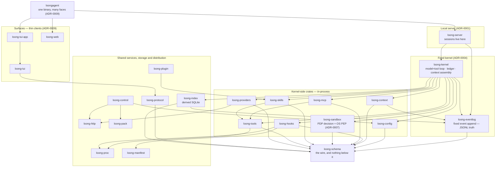

# Subsystem design

- **Up:** [04 System overview](../04-system-overview.md)
- **Authority:** [ADR-0004](../decisions/0004-microkernel-extension-model.md)
- **Code:** `crates/kernel/src/lib.rs`
- **Verify:** `./scripts/check.sh`

[`04-system-overview.md`](../04-system-overview.md) is the one-read picture; this
directory is one document per mechanism or flow, each owning its topic and linking down.

## The workspace in layers

The arrows point from a dependent crate to a crate it uses. The groups describe
roles, not a strict order: `loong-control` → `loong-config` and `loong-plugin` →
`loong-skills` cross between groups, and the kernel, context and index all read
the event log. The fixed kernel is the loop, ledger and context assembly in
`loong-kernel`, plus the event append in `loong-eventlog`; the crates around it are
in-process even where the kernel always calls one of them. The complete allowed
set, crate by crate, is [`../crate-map.md`](../crate-map.md), generated from
`scripts/layering_rules.py`.

## Subsystem documents

| Document | Owns | Code |
|---|---|---|
| [kernel-loop.md](kernel-loop.md) | A turn: the step loop, the model and tool calls, the approval seam, and the ways a turn ends. | `crates/kernel/src/turn.rs`, `crates/kernel/src/turn/loop.rs` |
| [context-ledger.md](context-ledger.md) | What the model is shown: the ledger's categories and lifetimes, the budget, compaction, and `recall`. | `crates/kernel/src/ledger.rs`, `crates/kernel/src/turn/compaction.rs` |
| [tools-permissions.md](tools-permissions.md) | The uniform tool interface, action classes, the PDP's allow/ask/deny, and the two enforcers. | `crates/tools/src/lib.rs`, `crates/sandbox/src/` |
| [events-storage.md](events-storage.md) | The schema, the JSONL log as truth, the derived SQLite index, and the two tree levels. | `crates/schema/protocol.toml`, `crates/eventlog/src/lib.rs`, `crates/index/src/lib.rs` |
| [config-routing.md](config-routing.md) | Layered configuration, signed packs and local trust, the model router, and the provider interface. | `crates/config/src/`, `crates/manifest/src/lib.rs`, `crates/providers/src/` |
| [extension-model.md](extension-model.md) | The four extension kinds, their loaders, the hooks/MCP trust gates, and the kernel/edge boundary; pack trust detail lives in `config-routing.md`. | `crates/hooks/src/`, `crates/skills/src/`, `crates/mcp/src/`, `crates/plugin/src/`, `crates/pack/src/lib.rs` |
| [sessions-lineage.md](sessions-lineage.md) | Session lifecycle: fork, delete, resume, retry, steer, and the export/import boundary; event-tree mechanics live in `events-storage.md`. | `crates/server/src/lib.rs`, `crates/kernel/src/turn/session.rs`, `crates/eventlog/src/lib.rs` |
| [surfaces.md](surfaces.md) | The surfaces: the local server, the CLI as composition root, TUI and web, ACP decided not built, and the JSON-RPC they share. | `crates/cli/src/main.rs`, `crates/server/src/lib.rs`, `crates/web/src/lib.rs` |
| [control-plane.md](control-plane.md) | The control plane: local, managed and unbuilt gateway modes; the pack endpoint; the pinned key; what is not built. | `crates/control/src/`, `crates/pack/src/lib.rs` |
| [security-trust.md](security-trust.md) | The trust boundaries: what is trusted, who signs or owns it, what enforces it, and the honest gaps. | `crates/sandbox/src/`, `crates/manifest/src/lib.rs`, `crates/config/src/secret.rs` |

A row is added by the task that writes the document; a mechanism with no row has no page in this layer to own it yet.

## Reading paths

**Newcomer.** Read §2 and §3 of [04 System overview](../04-system-overview.md) for
the shape and the four things the kernel owns, then [kernel-loop.md](kernel-loop.md)
for one turn, [context-ledger.md](context-ledger.md) for what the model is shown, and
[tools-permissions.md](tools-permissions.md) for what may run. Then read
[ADR-0004](../decisions/0004-microkernel-extension-model.md) for why the kernel is
fixed and everything else is an edge.

**Maintainer.** Start at [`../crate-map.md`](../crate-map.md) to see which crate may
depend on which. Read [kernel-loop.md](kernel-loop.md),
[context-ledger.md](context-ledger.md) or [tools-permissions.md](tools-permissions.md)
before changing the code it names, then run that document's `Verify` command; a
change to a mechanism's behaviour means updating its document in the same change.

**Debugger.** Take the ending from the turn's outcome, then read
[kernel-loop.md](kernel-loop.md) §"How a turn ends". A stopped turn leaves a
`turn.interrupted` event; a parked one leaves `approval.requested`; a refused one
leaves a `hook.fired` or `skill.invoked` error. The test that pins the behaviour is
in `crates/kernel/src/turn/tests.rs`; the event names are in `crates/schema/protocol.toml`.

## The one rule

One document is the authority for a topic. A subsystem document owns a mechanism;
an ADR owns a decision; `04-system-overview.md` owns the current architecture.
When another document needs the same fact, it links here or to the document that
owns it rather than restating it.
