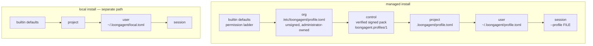
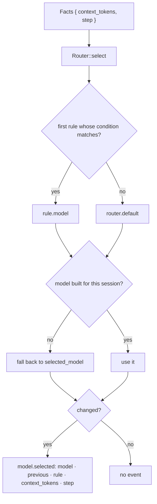

# Configuration and routing: layers, packs, and the model choice

- **Up:** [design/README.md](README.md) · [04 System overview](../04-system-overview.md)
- **Authority:** [ADR-0005](../decisions/0005-routing-philosophy.md) · [ADR-0008](../decisions/0008-configuration-layering.md) · [ADR-0016](../decisions/0016-pack-distribution.md)
- **Code:** `crates/config/src/`, `crates/manifest/src/lib.rs`, `crates/providers/src/`
- **Verify:** `cargo test -p loong-config -p loong-manifest -p loong-providers` · `./scripts/check.sh`

Configuration is one stack of layers, and every key declares how it merges, so a lower layer
cannot loosen a higher one. Two things are easy to confuse and this document keeps them
apart: a **pack** from the control plane is signed and verified before it becomes the
`control` layer, while the **local org file** the config crate reads is unsigned and
administrator-owned. Routing is a small ordered rule table over two facts about the session,
and providers sit behind one `Model` trait so the loop does not know which vendor answered.

## 1. The stack, in order

`Layer` is ordered `Builtin < Org < Control < Project < User < Session`
(`crates/config/src/layer.rs`), and `resolve_with` sorts the layers it was given into that
order. ADR-0008's stack is built-in defaults < org < project < user < session; ADR-0016 adds
`Control` **immediately above** `Org`, so a managed install's verified policy wins over a
stale local org file.

| Layer | Where it comes from | Owner |
|---|---|---|
| `Builtin` | `LayerValues::builtin_defaults`: investigate allow, write-workspace allow, out-of-bounds ask | the code |
| `Org` | `/etc/loongagent/profile.toml` (`%PROGRAMDATA%\loongagent\profile.toml` on Windows) | administrator; **unsigned** |
| `Control` | not a file: values from a verified pack, via `pack_layer` | the control plane; **signed and verified** |
| `Project` | `<workspace>/.loongagent/profile.toml` | the repository, committed |
| `User` | `~/.loongagent/profile.toml` | the person |
| `Session` | `--profile FILE`, plus this run's facts | this invocation |

Local is the default. `local_layer_paths` returns project, `local.toml` and session — **no
org file, no pack**. `--centered` selects managed; `--local` states the default and conflicts
with it. Both lists live in `crates/config/src/paths.rs`; `Args::layers` is where they diverge.

## 2. Precedence is a property of the key

`kind_of` assigns every known key one of four kinds; the table gives the groups and
representative keys, and `kind_of` is the exact list. The merge (`crates/config/src/merge.rs`)
follows the kind, never the value's shape:

| Kind | Keys | Rule |
|---|---|---|
| **free-override** | `model`, `base_url`, `profile`, `models`, `router.default`, `router.rules`, `mode`, `context_engine.mode`, `control.profile` | the most local layer that sets it wins |
| **narrow-only** | `budget_tokens`, `keep_newest_tokens`, `max_steps`, `compact_at_percent`, `max_context_size`, `reserved_context_size`, `context_engine.enabled`, `summarizer.enabled`, `context_engine.episode_events`, `context_engine.l4_max_tokens`, `summarizer.window_calls`, `summarizer.window_tokens`, `permissions` | strictest wins, whatever the layer order |
| **add-only** | `skill_dirs`, `disable_skills` | union across layers; a lower layer may switch off an entry by identity |
| **reference** | `api_key` | merged by precedence like free-override, but the value must be a reference (`env:NAME`, `file:PATH#KEY`, `keychain:…`, `gateway:…`); a literal is refused |

For narrow-only, numbers are strictest when **smallest** — a smaller budget, fewer steps —
with one deliberate exception: `reserved_context_size` is strictest when **largest**,
because reserving more room for the answer is the conservative choice. Verdicts rank `allow <
ask < deny`; the higher rank is stricter. The two `enabled` switches travel as 0/1 numbers, so
`0` (off) is the stricter value and a firm can force a facility off. `models.*` is
free-override, but its `budget_tokens` and `max_context_size` are merged by minimum, so a
local redefinition cannot lose or widen what an organisation declared.

A key set by the `control` layer is **locked** against every lower layer. A lower layer that
tries to change a free-override or reference key is an error naming the pack; a narrow-only
key may still be narrowed and an add-only key may still be added to. That is what makes
"engineers pick a profile, not a vendor" a property rather than advice.

Every resolved key carries provenance: the winning layer, the artifact (`<defaults>`, a file
path, or the pack's issuer/version), and the layers that lost. `config show` and `config
explain` print it; the PDP uses the same row for its rule (`permission_with_source` →
`builtin` or `profile:<layer>`). An unknown key is an error, not a silent no-op, and every
profile struct is `deny_unknown_fields`.

## 3. The project layer and the mode guard

The project layer is the one a repository controls, so it may not set `model`, `base_url`,
`api_key`, `mode` or `summarizer.base_url` / `summarizer.model`, and may not define
`[[models]]` — a repository must not choose where prompts go, where a session is summarised,
or whether an install is managed. Its `skill_dirs` must resolve inside the workspace.

`mode` remains accepted only in `local.toml` or a session file (`mode_is_legitimate`) and is
refused elsewhere. It no longer selects the stack — the flag/default does — so a repository
still cannot switch an install out of its firm's policy.

## 4. Profiles and the signed pack

A **profile** is a named bundle (`NamedProfile`): a name, a description the user is shown
instead of a model list, the models it offers, and the `Router` between them. A pack
(`ProfilePack`) carries several profiles plus `default_profile` and `warnings`. The payload is
TOML, parsed by `profiles_from_payload`; it must define at least one profile and every
profile at least one model; the only adapter kind is `openai-compat`; and every model the
router names must be one the profile defines. `ProfilePack::pick` takes the user's chosen
name, else the pack's default, else the first profile — and refuses an unknown chosen name
instead of silently running something else.

The pack travels in the envelope from `crates/pack`: `artifact`, `payload_schema`, `version`,
`issuer`, `scope`, `issued_at_ms`, `key_id`, `payload`, `signature`. The signature is Ed25519
(via `ring`) over the canonical JSON of every field except `signature`, so the version, issuer,
scope and payload are covered. `key_id` is the first eight bytes of the public key's
SHA-256. Verification (`Envelope::verify`) refuses an empty signature, a payload schema this
build does not know, a key id that does not match the **pinned** public key, and a signature
that does not verify. The control plane additionally refuses to publish an envelope whose
artifact is not `loongagent.profiles`.

The private key lives at the control plane. The client pins the public key in `control.toml`;
when a machine file and a user file both exist, the machine file wins for address and key and
the user file may supply only the token reference (on an unmanaged install the user file is the
whole configuration). A fetched pack is cached only after verification, and an unreachable
control plane falls back to that last verified cache (`from_cache` in `control.synced`). A pack
carries no expiry, so a machine that never reconnects keeps the last pack it verified.

`pack_layer` turns the chosen profile into `models`, `router.default` and `router.rules` for
the `control` layer. It deliberately does **not** set `control.profile`: which profile to run
is the one profile-related key the user owns. The CLI (`Args::settings_with_pack`) resolves the
layers once without the pack to learn `control.profile`, then again with the pack layer in place.

## 5. The trust distinction, stated exactly

- **Packs are signed and verified.** A pack can occupy the `control` layer only after
  `Envelope::verify` succeeds against a public key pinned out of band. Its cache is verified
  on load. Lower layers cannot rewrite a free-override or reference key it set; a narrow-only
  one may still be narrowed.
- **The local org file is not signed.** `Layer::Org` is a plain `profile.toml` at
  `/etc/loongagent/profile.toml`, owned by an administrator. `crates/config/src/lib.rs`
  says so in its module contract: "this crate reads the org layer's *local* file, and that
  file has no signature." Its protection is file ownership and the machine setup, not
  cryptography; it must not be called tamper-resistant. The control layer ranks above it so a
  verified pack cannot be shadowed by a stale local copy.

## 6. Manifest trust: repository content that can execute

`.loongagent/hooks.toml` and `.loongagent/mcp.toml` name commands. `crates/manifest/src/lib.rs`
records and checks a **change-detection hash, not a signature**: FNV-1a over the file bytes,
written as `{hash} {name}` lines in `.loongagent/hooks.trusted` or `.loongagent/mcp.trusted`,
and re-armed when any byte changes. `HookSet::active` / `McpSet::active` keep the specs
**inert until a human trusts the exact bytes**; `check` returns `Absent`, `Trusted` or
`Untrusted { changed }`, `record` writes the hashes, and a missing source is an error.

The security property comes from the human answering again, not collision resistance. Hooks
hash `hooks.toml` plus every shell script its specs name; MCP hashes only `mcp.toml`, so a
command or script it references is not covered. Neither file is covered by the pack signature.

## 7. Routing: two facts, ordered rules, a visible fallback

A condition is built by `parse_condition`: one of `context_tokens` or `step`, one of `>=`,
`<=`, `==`, `>`, `<` (checked longest first), and a `u64`. An unknown fact or a missing
comparison is an error naming what exists, because a rule that never fires is worse than no
rule. `Router::select` scans in order and returns the first match with the rule that fired;
with no match it returns `router.default`.

The kernel computes the facts at every step: `ledger.total_tokens()` and the 1-based step
number. A model this session did not build falls back to `selected_model`, not to the router's
default. If the choice changed, `Kernel::record_model_selected` writes `model.selected` with the
model, previous, rule (the condition text or the default) and the estimate.

A person can also choose: `Kernel::select_model` refuses an unknown name, records
`model.selected` with the rule `"chosen by the user"` and `step: 0` (the choice happens before
a step is counted), and sets `router.default` so the next call does not route back. Rules still
outrank it, so an escalation still fires. The "why did this model run?" answer is the same
whether a rule or a person chose.

ADR-0005 splits routing by mode: local mode is a manual picker with no router, gateway mode
routes where the key and the bill are. The code implements the profile's router table on every
call — the **pre-gateway form** ADR-0016 §6 describes. In local mode no pack exists, so a
router appears only if the user's profile declares one, and the model gateway is not built.

## 8. Providers behind one trait

`crates/providers/src/lib.rs` is the whole interface the kernel sees: `Model` has `complete`,
`complete_streaming` (the same call with an `on_delta` callback) and `context_window`. The first
two return `Result<CompletionResponse, ModelError>`; streaming defaults to one whole-answer delta
and `context_window` to `None`.

**First-run probe.** `crates/providers/src/probe.rs` asks a vendor's own `/models` route
(`probe_models`, or `probe_models_url` for a native path), and keeps a refused key distinct
from an unreachable vendor.

`CompletionRequest` is `{messages, tools}`; `CompletionResponse` is `{text, tool_calls, usage}`;
`ChatMessage` is tagged `system` / `user` / `assistant` / `tool`, with calls on the assistant
message and `call_id` + `output` on the tool one. `ModelError` has `Transport`/`Protocol`; it ends the turn.

`OpenAiCompat` is the only real adapter (`ADAPTER_KINDS` is `["openai-compat"]`). It speaks the
Chat Completions protocol over HTTP/HTTPS through `loong-http`: `stream: false` for `complete`,
and `stream: true` with `stream_options.include_usage` for `complete_streaming`. The streamed
path reassembles text fragments and fragmented tool calls into exactly the response the plain
path would have produced; a server that ignores `stream` and sends a whole `message` counts as
one large fragment. `context_window` reports the built window, or `None` when nobody said.

Streaming is a **preview, never the record**. Deltas reach `on_delta` and become transient
`model.delta` notifications; the returned `CompletionResponse` is what the kernel consumes, and
the final `message.appended` is what the log keeps. `ScriptedModel` is the deterministic test
double, and `provider = "vendor/model"` is expanded by `crates/config/src/catalog.rs` into an
endpoint, a model id and a key reference — explicit `base_url`, `model` or key still wins.

## 9. Known gaps

- **The gateway is not built.** The router in this document is local and profile-driven;
  gateway mode's server-side routing policy and intent schema are still deferred by ADR-0005.
- **The local org file is unsigned by design.** Do not read the `control` layer's guarantee
  into it; only the verified pack is signed.
- **The client verifier checks schema, key id and signature, not `artifact` or `scope`.**
  The control plane refuses to publish the wrong artifact, but `Envelope::verify` alone would
  accept another artifact id carrying the profiles schema.
- **MCP trust covers the manifest only.** A server's command and arguments in `mcp.toml` are
  hashed as part of that file, but a referenced script or binary is not, unlike a hook's
  shell script.
- **No task class, cost or capability facts.** A rule can read only `context_tokens` and
  `step`; the intent-based gateway routing ADR-0005 describes is not expressible here.
- **`model.selected.rule` differs from its schema comment.** The schema says the field is
  empty when the default applied; the kernel writes `"the router's default"`.
- **A pack may still carry a literal secret.** `check_pack_secret` accepts it with a warning
  (ADR-0008's amendment); local configuration files refuse a literal outright.

## 10. Where to read next

- [ADR-0005](../decisions/0005-routing-philosophy.md) — routing follows the keys; why local
  mode is a picker and gateway mode routes server-side.
- [ADR-0008](../decisions/0008-configuration-layering.md) — the layers, the four merge kinds,
  `config explain`, and secrets as references.
- [ADR-0016](../decisions/0016-pack-distribution.md) — the envelope, Ed25519, the pinned key,
  and the locked `control` layer.
- [tools-permissions.md](tools-permissions.md) §3 — where the resolved permission ladder
  becomes the PDP's rule string.
- `crates/config/src/tests.rs` — the layer, merge and mode-guard behaviour pinned by tests. The install sequence is [pack-install.md](flows/pack-install.md).
