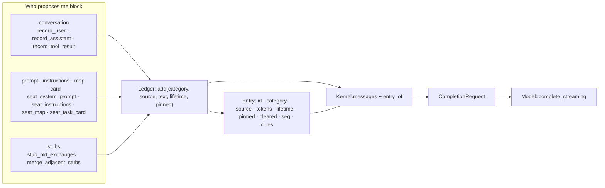

# Context ledger: what the model is shown

- **Up:** [design/README.md](README.md) · [04 System overview](../04-system-overview.md)
- **Authority:** [ADR-0006](../decisions/0006-context-engine.md) · [ADR-0017](../decisions/0017-layered-context.md)
- **Code:** `crates/kernel/src/ledger.rs`, `crates/kernel/src/context_engine.rs`, `crates/kernel/src/turn/compaction.rs`, `crates/kernel/src/turn/recall.rs`, `crates/context/src/`
- **Verify:** `cargo test -p loong-kernel -p loong-context` · `./scripts/check.sh`

The **context ledger** is the kernel's account of what the model is being
shown: one `Entry` per block, each with a category, a source, a token count, a
lifetime and a pin flag. It is not a second copy of the conversation — an
`Entry` carries provenance and cost, not text; the text lives in
`Kernel.messages`. That separation is the point: the ledger answers "why is this
in my context, and what is it costing?" from data the kernel owns, so neither
the model nor a plugin can answer it for us.

ADR-0006 §1 calls the ledger the *only* write path to the model. In code it is
not an API the proposer calls: every function that pushes a `ChatMessage` —
`record_user`, `record_assistant`, `record_tool_result`, `seat_system_prompt`,
`seat_instructions`, `seat_map`, `seat_task_card` — adds its entry in the same
call, and replay rebuilds the same pairs from the log. §6 names the two blocks
still outside that lockstep.

## 1. Proposal → ledger → model

`Kernel.entry_of` is the join: a `Vec<Option<u64>>` parallel to `messages`, so a
pass can find the entry describing the message it is about to change. The
lockstep is by construction in those functions, not by a type that forbids a
seventh writer.

## 2. Entries: category, source, lifetime

| Category | Eviction priority | Written today by | Typical source |
|---|---|---|---|
| `SystemPrompt` | 0 — last to go | `seat_system_prompt` | `system` |
| `Tools` | 30 | nothing yet | — |
| `Rules` | 40 | `seat_instructions`, `seat_task_card`, pinned | `AGENTS.md`, `AGENTS.local.md`, `task-card` |
| `CognitiveMap` | 45 | `seat_map`, after the first `Ledger::add` and then `Ledger::replace` | `context-engine:L4` |
| `Memory` | 50 | nothing yet | — |
| `McpTools` | 70 | nothing yet | — |
| `Retrieval` | 80 | nothing yet — `Kernel::recall_tool` deliberately does not add one (§5) | — |
| `History` | 100 — first to go | `record_user`, `record_assistant`, `record_tool_result`, replay | `user`, `assistant`, `tool:c1` |
| `Stub` | 90 | `stub_old_exchanges`, `merge_adjacent_stubs` | `stub` |

Higher priority is evicted first (`Category::eviction_priority`). The order is
a property of the category, so the entries with no writer still have a decided
place; `retrieval_is_evicted_before_rules` pins it.

An `Entry` also records where it came from: `seq` is the event interval it was
recorded from (`Ledger::locate`), and `clues` are the words that lead back to it
(`Ledger::set_clues`). A stub needs both — an interval to recall and words to
search with. A block without a recorded interval has `seq: None`, and a stub made
from it says so instead of inventing a range.

`Lifetime` (`Turn`, `Session`, `Persistent`) is reported to `context.explain`
but no behaviour depends on it: clearing is decided by category and source,
dropping by the exchange boundary.

`estimate_tokens` counts characters and rounds up at four characters per token
until a real tokenizer is wired in. Every budget number in this document is that
estimate.

## 3. The budget, and what eviction would do

Two ceilings bound one request, and the stricter wins (`Kernel::input_ceiling`):

- **the budget** — `KernelConfig.budget_tokens`, stored as `Ledger::new`'s
  `budget`, reached at `compact_at_percent` of itself (default 80). `None` means
  unbounded.
- **the window** — the selected model's `context_window`, reached when the room
  left for the answer drops below `reserved_context_size` (default 16 Ki, and a
  reserve larger than half a window is capped at half).

With no explicit budget, `Kernel::effective_budget` derives one from the selected
model's window: a quarter of it, floored at 32,000 and capped at 100,000. A window
with no budget therefore still has a reachable ceiling; only a model that declares
no window, with no profile budget, leaves the context unbounded, and the CLI says
so rather than leaving a silent `None`. An explicit `budget_tokens` always wins. What is measured is
`ledger.total_tokens()` — the ledger's share of the prompt about to be sent,
not the whole request (§6 names what it does not count). It is not a cumulative
spend: twenty calls in one turn are twenty measurements, not twenty terms in a
sum.

`Ledger::evict_to_budget` drops whole non-pinned entries by that priority and
sets `still_over_budget` when only pinned entries remain; no kernel path calls it
— compaction does (§4).

## 4. Compaction: clear, then stub, then drop only without the engine

`Kernel::compact_if_needed` runs at every step boundary, after `refresh_memory`
and `age_tool_outputs`, and does nothing when `ledger.total_tokens()` is at or
under the ceiling.

**Aging, before any phase.** `Kernel::age_tool_outputs` does not wait for the
ceiling. Whenever `Ledger::tool_output_tokens()` — the uncleared `History`
entries whose source starts `tool:` — passes `keep_newest_tokens`, it clears the
older ones, settling at **half** the line that triggered it so the next reads have
room before it is crossed again. The ceiling stays the backstop.

**L0 — clear stale tool output.** `Ledger::clear_tool_outputs` clears only
unpinned, uncleared `tool:` entries outside the newest `keep` tokens, and only
when the marker is shorter than the body (a marker that grows the context is not
a clear). `keep` is the smallest of `keep_newest_tokens`, half the ceiling and
half the room the history leaves under it; why that third term exists, and the
no-room case, are in [flows/context-compaction.md](flows/context-compaction.md) §1.
The newest entry is always kept. Nothing is removed: the body becomes
`[output of … cleared to save context — re-run the command if you need it again]`
and `Entry.cleared` is set.

**L1 — stub old exchanges, with the engine on.** When clearing did not reach the
ceiling, `Kernel::stub_old_exchanges` replaces the oldest whole exchanges with
one `ChatMessage::System` stub. Whole is the unit: an exchange starts at a user
message and ends before the next one, so a call never splits from its result.
`Kernel::rounds_that_fit` keeps at least the newest exchange — the turn being
answered — and as many more as `keep_newest_tokens` allows. The stub carries the
request, the changed files, the commands and their verdict, the clue words, and
`recall seq a-b` (`Entry.seq`'s union over the messages it replaced). No model is
called and nothing is inferred. The original stays in the log, so
`dropped_messages` stays 0 and the event's `summary` counts the stubbed messages.
This is the rung a long session was missing: once every tool output is a marker,
clearing frees nothing more, and the turn died there as `compaction thrash`.

**L2 — merge adjacent stubs.** `Kernel::merge_adjacent_stubs` folds two stubs
with nothing kept between them into one: the interval is the union, the clues the
deduplicated union capped at twelve words. Without it the stub layer itself would
grow one line per pass.

**L3 — drop whole exchanges, only with the engine off.** `drop_oldest_exchange`
drains from after the pinned blocks up to (not including) the next user message,
and calls `Ledger::forget` on their ids; a single-turn conversation returns 0 and
stops. The condition is one line — `let may_drop = self.context_engine.is_none()`
— and it is ADR-0017's promise: with the engine on, an original stays reachable,
so it is stubbed, not dropped. `with_the_engine_on_a_long_session_never_drops_an_exchange`
and `with_the_engine_off_compaction_still_drops_exchanges` pin each side.

**The pinned resident tier.** Two blocks are pinned and never selected for any
pass: the L4 map (`Category::CognitiveMap`) and the **task card**
(`Category::Rules`, source `task-card`, pinned). The card holds the goal and the
constraints the person stated, read by `statement_is_a_constraint`'s marker list
and never inferred; it is seated only when there is a constraint to hold, and
rewritten only when its text changes. At `TASK_CARD_MAX_TOKENS` (800) it drops
completed detail, then the verification line, then folds constraints into a
reference — the goal is never cut.

## 5. `recall`: the retrieval tool

`RECALL_TOOL` is the string `recall`, offered only when the engine exists.
`Kernel::recall_tool` answers it:

- `expand: <id>` returns one summary with the original events it cites.
- `seq_from`/`seq_to` read one interval of the raw record: a stub's address.
- Otherwise a `query` selects summaries first; only when none match are raw
  events searched, and only that fallback applies `entity`/`tool`. **Any** term
  may match (`Store::recall_at`), ranked by how many hit — a `title` hit is worth
  two `content` hits — then newest first. One wrong word narrows, never zeroes.
- A summary shows `evidence [seq N]: …fragment…`, the window around the match
  (`excerpt_chars`, 240 default / 800 cap), so one call reads what was said
  instead of two. `RECALL_MAX_CHARS` (4,000) is spent on whole hits; the rest are
  counted, not cut. Zero matches answer `no match for: <words>`.

Enriched summaries also carry a `别名：` line (spec §7.1: synonyms, English
terms, the words the person used). It is stored in `content` so search scans it,
and skipped by `summary_body` when the body is rendered: an index is not a
claim about what happened ([data-model.md](../context/data-model.md) §5.5).

It is read-only: `Kernel::dispatch` answers it before the registry and without a
PDP ruling, recording `tool.call`/`tool.result`. Its answer is an ordinary tool
message, so it can itself be cleared and stubbed; that is what makes forgetting
reversible ([recall.md](../context/recall.md) §7).

## 6. What the model is actually sent

`CompletionRequest.messages` is `self.messages.clone()`, in this order: the
pinned system prompt (skills catalogue and any bootstrap bodies in the same
entry), the L4 map when the engine has one, then the conversation. The map is
its own `ChatMessage::System` rather than folded into the prompt so the
operator's text is never rewritten, and it is one entry refreshed in place, not
one per step. `tools` is `Registry::specs` — the built-ins plus the `skill` tool
and any `mcp__<server>__<tool>` tools — plus `recall` when memory is on.

Two blocks are outside the ledger's accounting, and both matter when reading a
token count:

- **Tool schemas**: sent in `CompletionRequest.tools`, counted by
  `context_explain` (`tools`), but with no `Category::Tools` entry, so
  `total_tokens()` undercounts by their size.
- **The nudge correction**: pushed into `Kernel.messages` with no event and no
  entry (`kernel-loop.md` §4).

Everything else the model sees is an entry, and the surface can read it:
`Kernel::context_explain` builds the wire `ContextExplain` with per-entry
category, source, tokens, lifetime, `pinned`, `cleared`, the per-category
totals, the message and tool counts, and the memory's own state.

## 7. What is reversible

| Action | The model's view after it | Where the original is |
|---|---|---|
| Clear a tool output (L0) | a marker naming the source and saying to re-run | the `tool.result` event, and with the engine on the store `recall` searches |
| Stub an exchange (L1/L2) | one `System` block with the request, the files, the commands, the clues and `recall seq a-b` | the messages are in the log; the stub's interval reads them back in one call |
| Drop an exchange (L3, engine off) | the messages are gone and their entries forgotten | the events are in the log; `recall` is unavailable, and reopening replays the compaction |
| Refresh the map or the card | same id, category, lifetime and pin; only the token count changes | the log's events they were derived from |
| Evict a whole entry | not on the live path: the entry is removed, no message is, so the ledger would stop accounting for a message still sent | — |

`Ledger::replace` cannot reclassify an entry: it can change how large an entry
is, never what it is. Pinned entries are skipped by clearing and by eviction. A
replayed session reproduces a compaction exactly — `replay_compaction` reads
`kept_tokens`, `cleared_tool_outputs` and `dropped_messages` from the event — so
"the log still has it" means recoverable by a person or by `recall`, not
magically restored to the prompt.

## 8. Where to read next

- [ADR-0006](../decisions/0006-context-engine.md) — the ledger decision, the
  eviction order and the compaction rules; §4's second half is revised by
  ADR-0017.
- [ADR-0017](../decisions/0017-layered-context.md) — layered, reversible memory
  (Chinese; *Proposed*), and why the exchange is never dropped with it on.
- [04 System overview](../04-system-overview.md) §3 item 3 — context assembly
  as one of the four kernel-owned things.
- [06 Context engineering](../06-context-engineering.md) — the memory design's
  entry point (Chinese); the per-layer detail is in
  [docs/context/](../context/README.md).
- `crates/kernel/src/turn/tests.rs` pins it: `old_exchanges_become_stubs_with_an_address`,
  `the_foreground_stops_growing_once_stubs_take_over`,
  `the_task_card_survives_every_compaction_pass`,
  `compaction_never_splits_a_tool_pair`. The flow is [context-compaction.md](flows/context-compaction.md).
