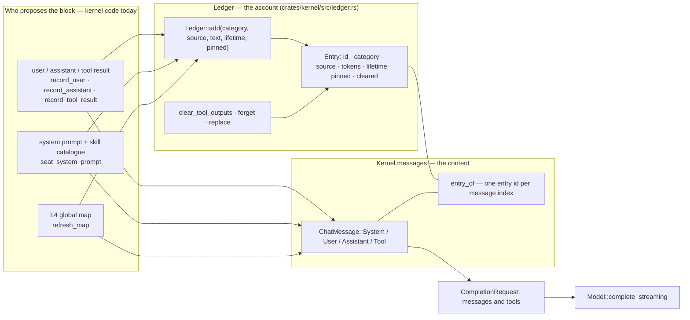

# Context ledger: what the model is shown

- **Up:** [design/README.md](README.md) · [04 System overview](../04-system-overview.md)
- **Authority:** [ADR-0006](../decisions/0006-context-engine.md) · [ADR-0017](../decisions/0017-layered-context.md)
- **Code:** `crates/kernel/src/ledger.rs`, `crates/kernel/src/context_engine.rs`, `crates/kernel/src/turn/compaction.rs`, `crates/kernel/src/turn/recall.rs`, `crates/context/src/`
- **Verify:** `cargo test -p loong-kernel -p loong-context` · `./scripts/check.sh`

The **context ledger** is the kernel's account of what the model is being
shown: one `Entry` per block, each with a category, a source, a token count, a
lifetime and a pin flag. It is not a second copy of the conversation — an
`Entry` carries provenance and cost, not text; the text lives in
`Kernel.messages`. That separation is the point: the ledger answers "why is this
in my context, and what is it costing?" from data the kernel owns, so neither
the model nor a plugin can answer it for us.

ADR-0006 §1 calls the ledger the *only* write path to the model: blocks are
proposed by rules, memory, MCP servers, skills and retrieval, and the kernel
appends them. In the code that is not an API the proposer calls. Every function
that pushes a `ChatMessage` into a live conversation — `record_user`,
`record_assistant`, `record_tool_result`, `seat_system_prompt`, `refresh_map` —
adds its entry in the same call, and the replay path rebuilds the same pairs
from the log. §6 names the two blocks still outside that lockstep; the proposal
door ADR-0006 describes for out-of-kernel contributors does not exist yet.

## 1. Proposal → ledger → model

`Kernel.entry_of` is the join. It is a `Vec<Option<u64>>` parallel to
`messages`, so clearing a tool output or dropping an exchange can find the entry
that describes the message it is about to change, and `context.explain` can go
the other way. The lockstep is by construction in those five functions, not by
a type that forbids a sixth writer.

## 2. Entries: category, source, lifetime

| Category | Eviction priority | Written today by | Typical source |
|---|---|---|---|
| `SystemPrompt` | 0 — last to go | `seat_system_prompt` | `system` |
| `Tools` | 30 | nothing yet | — |
| `Rules` | 40 | nothing yet | `AGENTS.md` (the design's example) |
| `CognitiveMap` | 45 | `refresh_map`, after the first `Ledger::add` and then `Ledger::replace` | `context-engine:L4` |
| `Memory` | 50 | nothing yet | — |
| `McpTools` | 70 | nothing yet | — |
| `Retrieval` | 80 | nothing yet — `Kernel::recall_tool` deliberately does not add one (§5) | — |
| `History` | 100 — first to go | `record_user`, `record_assistant`, `record_tool_result`, replay | `user`, `assistant`, `tool:c1` |

Higher priority is evicted first (`Category::eviction_priority`). The order is
a property of the category, so the entries with no writer still have a decided
place; `retrieval_is_evicted_before_rules` pins it.

`Lifetime` is `Turn`, `Session` or `Persistent`. Today the system prompt is
`Persistent`, user and assistant messages and the map are `Session`, and tool
results are `Turn`. It is mapped to a string for `context.explain` and the wire
`ContextExplain`, but no behaviour depends on it: clearing is decided by category
and source, dropping by the exchange boundary. Treat a tool result's `Turn`
lifetime as the stated intent, not as the switch that clears it.

`estimate_tokens` counts characters and rounds up at four characters per token
until a real tokenizer is wired in. Every budget number in this document is that
estimate.

## 3. The budget, and what eviction would do

Two ceilings bound one request, and the stricter wins (`Kernel::input_ceiling`):

- **the budget** — `KernelConfig.budget_tokens`, stored as `Ledger::new`'s
  `budget`, reached at `compact_at_percent` of itself (default 80). `None` means
  unbounded.
- **the window** — the selected model's `context_window`, reached when the room
  left for the answer drops below `reserved_context_size` (default 16 Ki, and a
  reserve larger than half a window is capped at half).

With both absent, nothing bounds the context and compaction never runs; the CLI
says so rather than leaving a silent `None`. What is measured is
`ledger.total_tokens()` — the ledger's share of the prompt about to be sent,
not the whole request (§6 names what it does not count). It is not a cumulative
spend: twenty calls in one turn are twenty measurements, not twenty terms in a
sum.

`Ledger::evict_to_budget` drops whole non-pinned entries by that priority order
and sets `still_over_budget` when only pinned entries remain. No kernel path
calls it today: compaction clears tool output and, with the engine off, drops
exchanges.

## 4. Compaction: clear first, drop only without the engine

`Kernel::compact_if_needed` runs at every step boundary, after `refresh_map`,
and does nothing when `ledger.total_tokens()` is at or under the ceiling. When
it does run it takes `keep = keep_newest_tokens.min(ceiling / 2)` (default
20,000 tokens) and works in a fixed order.

**Phase 1 — clear stale tool output.** `Ledger::clear_tool_outputs` walks
backwards to find where the newest `keep` tokens begin, and clears only entries
that are `Category::History`, whose source starts with `tool:`, are not pinned,
not already cleared, and sit outside that window. It always keeps the most
recent entry whatever the arithmetic says: one tool output larger than the whole
window must not be cleared the moment it arrives. Nothing is removed — the
message's body is replaced by
`[output of … cleared to save context — re-run the command if you need it again]`
and `Entry.cleared` becomes true. That marker is what tells the model the output
is recoverable rather than empty.

**Phase 2 — drop the oldest exchanges, only when the layered engine is off.**
`Kernel::drop_oldest_exchange` drains messages from after the system prompt up
to (not including) the next user message, and calls `Ledger::forget` on their
entry ids. A conversation that has no next user message is a single turn;
dropping it would throw away the prompt being answered, so the function returns
0 and the loop stops. The condition is one line —
`let may_drop = self.context_engine.is_none();` — and it is the whole of
ADR-0017's promise: with the engine on, an original stays reachable, so the
exchange survives and only its stale tool bodies are cleared. A test pins each
side: `with_the_engine_on_a_long_session_never_drops_an_exchange` and
`with_the_engine_off_compaction_still_drops_exchanges`.

The sequence at a step boundary is [flows/context-compaction.md](flows/context-compaction.md).
`compaction.applied` is written only when something actually changed; a single
long turn with nothing stale can leave the context over budget without an event.

## 5. `recall`: the retrieval tool

`RECALL_TOOL` is the string `recall`. `Kernel::tool_specs` adds it to the
request's tools only when `Kernel.context_engine.is_some()` — a tool the model
can call but that cannot answer teaches it that asking about the past is
useless. `Kernel::recall_tool` answers it:

- `expand: <id>` returns one summary together with the original events it
  cites, so a derived index is never mistaken for the record.
- Otherwise a `query` (all terms must appear) and a `level` select summaries;
  only when none match are raw events searched, and only that fallback applies
  the `entity` and `tool` filters. Summaries come first, with `seq` citations.
- The reply is capped at `RECALL_MAX_CHARS` (4,800 characters), and a truncated
  reply says it was truncated.

It is read-only by construction: it asks questions of what is already stored and
never materialises, digests or writes. That is why `Kernel::dispatch` answers it
before the registry lookup and without a PDP ruling, recording a `tool.call`
with `ActionClass::Investigate` and then a `tool.result`. Its answer becomes an
ordinary tool message, so its ledger entry is `History`/`Turn`. It deliberately
adds no `Category::Retrieval` entry: the same bytes would then count twice
against the context budget.

## 6. What the model is actually sent

`CompletionRequest.messages` is `self.messages.clone()`, in this order: the
pinned system prompt (skills catalogue and any bootstrap bodies in the same
entry), the L4 map when the engine has one, then the conversation. The map is
its own `ChatMessage::System` rather than folded into the prompt so the
operator's text is never rewritten, and it is one entry refreshed in place, not
one per step. `tools` is `Registry::specs` — the built-ins plus the `skill` tool
and any `mcp__<server>__<tool>` tools — plus `recall` when memory is on.

Two blocks are outside the ledger's accounting today, and both matter when
reading a token count:

- **Tool schemas.** They are sent in `CompletionRequest.tools`, and
  `Kernel::context_explain` reports how many there are (`tools`), but no code
  adds a `Category::Tools` entry, so `ledger.total_tokens()` does not include
  their tokens. Compaction therefore undercounts the request by the size of the
  tool schemas.
- **The nudge correction.** The one message pushed into `Kernel.messages`
  without a `message.appended` event or a ledger entry (`kernel-loop.md` §4).
  Compaction can undercount the prompt by that message too.

Everything else the model sees is an entry, and the surface can read it:
`Kernel::context_explain` builds the wire `ContextExplain` with per-entry
category, source, tokens, lifetime, `pinned`, `cleared`, the per-category
totals, the message and tool counts, and the memory's own state.

## 7. What is reversible

| Action | The model's view after it | Where the original is |
|---|---|---|
| Clear a tool output (phase 1) | a marker naming the source and saying to re-run | the `tool.result` event in the JSONL log, and with the engine on the derived store `recall` searches |
| Drop an exchange (phase 2, engine off) | the messages are gone and their entries are forgotten | the events are still in the log, and `recall` is not available; reopening replays the compaction, so the original does not silently return |
| Refresh the map | the entry keeps its id, category, lifetime and pin; only its token count changes | the log's events the map was derived from |
| Evict a whole entry | not on the live path: the entry is removed, no message is, so the ledger would stop accounting for a message still sent | — |

`Ledger::replace` cannot reclassify an entry: it can change how large an entry
is, never what it is. Pinned entries are skipped by clearing and by eviction. A
replayed session reproduces a compaction exactly — `replay_compaction` reads
`kept_tokens`, `cleared_tool_outputs` and `dropped_messages` from the event — so
"the log still has it" means recoverable by a person or by `recall`, not
magically restored to the prompt.

## 8. Where to read next

- [ADR-0006](../decisions/0006-context-engine.md) — the ledger decision, the
  eviction order and the compaction rules; §4's second half is revised by
  ADR-0017.
- [ADR-0017](../decisions/0017-layered-context.md) — layered, reversible memory
  (Chinese; *Proposed*), and why the exchange is never dropped with it on.
- [04 System overview](../04-system-overview.md) §3 item 3 — context assembly
  as one of the four kernel-owned things.
- [06 Context engineering](../06-context-engineering.md) — the memory design's
  entry point (Chinese); the per-layer detail belongs in `docs/context/README.md`
  when that layer is written.
- `crates/kernel/src/turn/tests.rs` — the behaviour pinned here:
  `compaction_clears_stale_tool_output_before_dropping_anything`,
  `compaction_never_splits_a_tool_pair`,
  `the_layered_engine_puts_a_map_in_front_of_the_model`,
  `recall_is_offered_only_when_there_is_memory_behind_it`. The flow is [context-compaction.md](flows/context-compaction.md).
