# The control plane: one pack endpoint, one pinned key

- **Up:** [design/README.md](README.md) · [04 System overview](../04-system-overview.md)
- **Authority:** [ADR-0012](../decisions/0012-control-plane.md) · [ADR-0016](../decisions/0016-pack-distribution.md)
- **Code:** `crates/control/src/`, `crates/pack/src/lib.rs`, `crates/config/src/lib.rs`
- **Verify:** `cargo test -p loong-control -p loong-pack -p loong-config` · `./scripts/check.sh`

The control plane is a distribution service, not a data plane. It signs and serves **profile
packs**; a local install fetches one over authenticated HTTP, verifies it against a public key
pinned out of band, and turns it into the locked `control` configuration layer. It holds no
session content and gets no uplink. That is the whole of the shipped service: identity/SSO, the
model gateway and rollups are ADR-0012 jobs that are not built, and the next section separates
those from the mode the code actually runs.

## 1. Local, managed, and the gateway that is not built

Three names appear in the ADRs, and they are not the same axis.

| Mode | What runs | Where the provider key is | Built? |
|---|---|---|---|
| **Local** | no control plane; layers are project, `~/.loongagent/local.toml`, session; no pack and no org file | an `env:` or `file:` reference, resolved on the client; `keychain:` is reserved and has no store | yes (`--local` or `mode = "local"`) |
| **Managed, pre-gateway** | a `control.toml` names a control plane and a pinned key; a verified profile pack becomes the `control` layer; model calls still go directly to the provider | the client resolves the pack's `api_key` reference (`env:…`, `file:…`), so a referenced key never reaches the control plane; a literal in the pack does, and is warned about | yes |
| **Gateway** | model calls go through a gateway that holds the provider key, meters spend, refuses over budget and chooses the route | the gateway | **no** — decided by ADR-0005, no service or client path |

The middle row is the one to keep in mind when reading ADR-0005. The code implements routing
from the **profile's own router table**, evaluated locally on every call — ADR-0016 §6 calls
this the pre-gateway form. Gateway-mode routing is server-side and is not expressible here.
`gateway:` is accepted as a credential reference, but nothing resolves it: the client warns and
falls back to the environment (`resolve_reference` in `crates/cli/src/config_cmd.rs`). It is a
reserved spelling, not a gateway.

```mermaid
flowchart TB
    subgraph local["local mode — no control plane"]
        LKEY["provider key<br/>env: / file: reference"]
        LPOL["policy in local layers<br/>project · local.toml · session"]
        LKERNEL["kernel · tools · sandbox<br/>session log"]
        LPROV["model provider"]
        LKEY --> LKERNEL
        LPOL --> LKERNEL
        LKERNEL --> LPROV
    end

    subgraph managed["managed install — built, pre-gateway"]
        ADMIN["profile administrator<br/>drafts in git"]
        CP["loongagent-control<br/><b>signing key here</b><br/>serves one signed pack"]
        PIN["pinned public key<br/>machine control.toml"]
        PACK["profile pack<br/>endpoints + key references<br/>= locked control layer"]
        ORG["local org layer<br/>/etc/loongagent/profile.toml<br/><b>unsigned</b>"]
        MKERNEL["kernel · tools · sandbox<br/>session log"]
        MPROV["model provider"]
        ADMIN -->|"admin token<br/>publish draft"| CP
        CP -->|"client token"| PACK
        PIN -->|"verifies signature"| PACK
        PACK --> MKERNEL
        ORG --> MKERNEL
        MKERNEL -->|"direct call; key resolved on the client"| MPROV
    end

    subgraph gateway["gateway mode — decided, not built"]
        GW["model gateway<br/><b>provider key + metering here</b><br/>server-side routing"]
        GPROV["model provider"]
        GW -.-> GPROV
    end
```

The signing key and the served pack live on the control plane; the **public** key and the
choice of profile live with the client. The unsigned local org layer sits below the verified
pack (section 5).

## 2. What it serves

`loongagent-control serve` (the binary in `crates/control/src/bin/`) binds a TCP listener and
speaks plain HTTP/1.1 on three paths:

| Request | Token | What it does |
|---|---|---|
| `GET /v1/health` | none | `ok`, `issuer`, `key_id`, `has_pack`, `can_sign`, and the pack's `version` / `artifact` / `plaintext_secrets` count when one is published |
| `GET /v1/pack/profiles` | client token | the signed envelope as JSON, or `409` when nothing is published |
| `POST /v1/admin/publish` | admin token | accepts a draft (JSON or bare TOML) or an already-signed envelope, validates it, signs a draft with the key this plane holds, and stores it |

The server keeps a client token and an admin token and checks each on its own route. It does not
check that the two strings differ; the runbook generates them separately. The token every install
carries cannot publish, because the admin route compares against the admin field. Tokens come
from an environment variable or a file (`--client-token-env` / `--client-token-file`, and the
admin equivalents), never from the command line. `serve` requires `--key`: the deployed binary
always holds the signing key, even though the `ControlPlane` type can be built without one.
Passing `--public-key` too is a safety check — a key that does not derive it refuses to start.

There is no listener for session data, audit batches, statistics or model traffic. A client
only ever **reads** the pack, which is what keeps ADR-0012 §3's uplink allow-list easy to
defend. The server stores `profiles.json` on disk and keeps no database.

## 3. Profile packs, and the things that are not packs

The only artifact is `loongagent.profiles` with payload schema `loongagent.profiles/1`. The
payload is administrator-authored TOML: `default_profile` plus one or more `[[profiles]]`, each
with a name, a description the user sees, one or more models (endpoint, model id, key
reference, optional budget / context window) and an optional router table. `profiles_from_payload`
runs at publish time and again when a client loads the pack, so a pack no resolver could use is
refused before it is signed and again before it is applied. The only adapter kind is
`openai-compat`.

`ProfilePack::pick` takes the user's chosen profile, else the pack's default, else the first,
and refuses an unknown choice rather than silently running another. `pack_layer` turns it into
`models`, `router.default` and `router.rules` for the `control` layer; the one profile-related
key the user owns is `control.profile`, which the pack deliberately does not set. The layer and
its lock behaviour are owned by [config-routing.md](config-routing.md) §2 and §5.

**Policy and identity are not pack payloads today.** The envelope's schema space can hold them
(the Deferred bullet in ADR-0016's Consequences names the schemas), but only profiles are
written. The org's policy that does exist is the local unsigned `profile.toml`; identity is not
built at all — a shared client token is the whole authentication, and it identifies an install,
not a person.

## 4. The path from a draft to a verified layer

The envelope's fields, its Ed25519 signature and the verify order are owned by
[config-routing.md](config-routing.md) §4–§5; `crates/pack` is the one crate both binaries share.
This section keeps only what the control plane does with them. One code detail belongs here
because the ADR is stale on it: `Envelope::signing_bytes` includes `key_id` as well as every
other field except `signature`, so ADR-0016 §1's statement that `key_id` is excluded does not
describe the code.

The path has two halves:

1. **Author → control plane.** An administrator sends a draft with the admin token. The plane
   validates it with the same `profiles_from_payload` the client uses, signs it with the key it
   holds, and atomically replaces `profiles.json`. `publish --file` accepts an envelope signed
   elsewhere, for an air-gapped administrator, after verifying it under the same public key.
2. **Control plane → client.** The client pins the org's public key in `control.toml` and fetches
   the pack with `GET /v1/pack/profiles`; the verification and cache-after-verify rules are
   [config-routing.md](config-routing.md) §4. An unreachable plane falls back to the last verified
   cache; a pack that fails verification never falls back, because a forgery is a reason to stop.

The pin is machine configuration: the machine-wide file decides the address and key, and a user
file may supply only the token. A key mismatch is a hard failure, never a silent re-pin (detail:
[config-routing.md](config-routing.md) §4). `--trust-server-key` is not built.

## 5. The local org layer is not signed

`Layer::Org` reads `/etc/loongagent/profile.toml` (`%PROGRAMDATA%\loongagent\profile.toml` on
Windows). It is a plain file an administrator owns. It has **no signature**, its protection is
file ownership and the machine setup, and it must not be called tamper-resistant. The verified
`control` layer and the lock that keeps lower layers from rewriting it are owned by
[config-routing.md](config-routing.md) §1–§2 and §5.

Local mode does not read the org file at all: `local_layer_paths` returns project, `local.toml`
and session, with no org and no pack. That is not the managed list with a flag; it is a separate
list, and `Args::is_local` settles it before anything control-plane-shaped happens.

## 6. Deployment: two binaries, one codebase

Two claims that are easy to conflate, kept apart here as ADR-0012 §1 keeps them:

- **Managed versus self-hosted control plane: literally the same binary.** The same
  `loongagent-control` runs as a service or on the firm's own hardware.
- **Control plane versus local agent: the same repository, not the same binary.** They share the
  crates where agreement is correctness-critical — `loong-pack` for the envelope and its
  sign/verify path, `loong-config` for the layer and profile resolver, `loong-http` for the
  transport — and are built as two programs with different dependencies. A duplicated verifier
  would eventually accept the wrong pack; sharing the crate makes agreement a compiler
  property.

The runbooks start at [control-plane.md](../runbooks/control-plane.md) — bootstrap, operate
and security. Three deployment facts belong here as well:

- **There is no TLS listener.** The plane speaks plain HTTP; a non-loopback client refuses
  `http://` because a pack decides where prompts go. Expose it behind a TLS reverse proxy or an
  SSH tunnel, not by binding `0.0.0.0`.
- **The served pack is a file.** The service user needs read access to the key and tokens and
  write access to `--dir`; there is no Postgres, object store or queue to operate.
- **The binary guards against leaking key material by accident.** `keygen` refuses to write a
  signing key inside a git work tree, and `publish` refuses to run while a secret is tracked
  beside the draft (it warns about one that is merely unignored); `--force` overrides either
  check. These are local guards against an easy mistake, not a substitute for file ownership
  or for rotating a key that leaked.

## 7. What is not built

- **The model gateway.** No central provider keys, no metering, no shared prompt cache, no
  server-side routing. The client calls the provider directly in both built modes.
- **Identity / SSO.** The client token is a shared secret and the server has no user concept.
- **Uplink, rollups and dashboards.** No audit/statistics batches, no Postgres schema, no
  aggregate UI; the client only reads.
- **Policy and context payloads.** Only `loongagent.profiles/1` is written. The envelope is
  ready for more; the schemas are not.
- **Per-team scopes, quotas, revocation and rotation policy.** A pack has no expiry, and a
  machine that never reconnects keeps the last pack it verified (ADR-0016 §7). Rotation means
  re-pinning every install.
- **Push updates and the `--trust-server-key` convenience.** Refreshing is a pull at session
  start; the pin is written out of band.
- **TLS in the binary.** It is a reverse-proxy or tunnel responsibility today.

## 8. Where to read next

- [ADR-0012](../decisions/0012-control-plane.md) — the small control plane, the uplink
  allow-list, and what is deliberately not a backend job.
- [ADR-0016](../decisions/0016-pack-distribution.md) — the envelope, Ed25519, the pinned key,
  the locked `control` layer and the no-expiry decision.
- [config-routing.md](config-routing.md) — layers, merge kinds, the pack's expansion and the
  pre-gateway router.
- [security-trust.md](security-trust.md) — where the signing key, the pin and the pack sit in
  the trust map.
- [control-plane.md](../runbooks/control-plane.md) — the runbook entry: bootstrap, operate and
  security.
- `crates/control/src/lib.rs` — the client sync, the cache and the server endpoints;
  `crates/control/src/bin/loongagent-control.rs` — keygen, sign, check, serve and publish. The install sequence is [pack-install.md](flows/pack-install.md).
