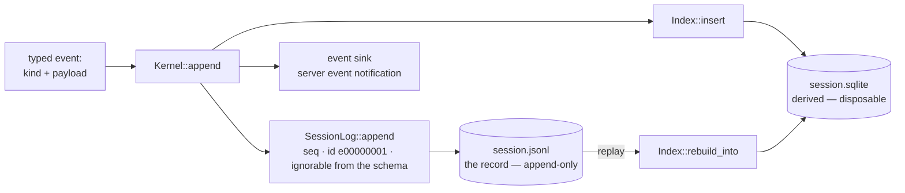
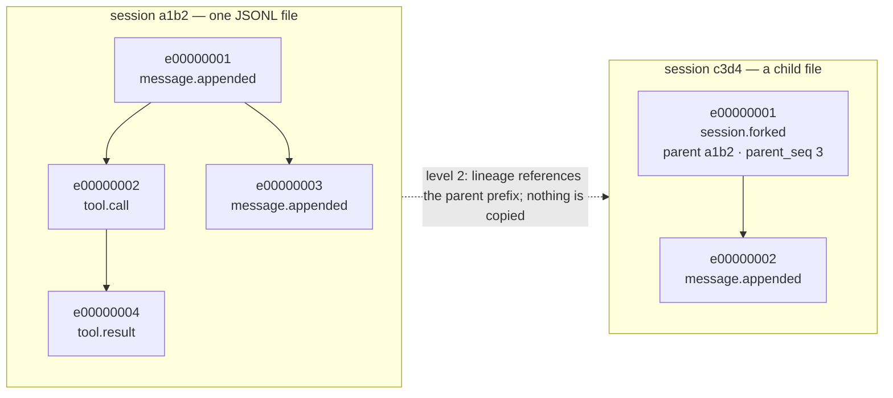

# Events and storage: one schema, one log, one derived index

- **Up:** [design/README.md](README.md) · [04 System overview](../04-system-overview.md)
- **Authority:** [ADR-0002](../decisions/0002-json-rpc-wire-protocol.md) · [ADR-0003](../decisions/0003-jsonl-truth-sqlite-index.md) · [ADR-0015](../decisions/0015-two-tree-levels.md)
- **Code:** `crates/schema/protocol.toml`, `crates/protocol/src/lib.rs`, `crates/eventlog/src/lib.rs`, `crates/index/src/lib.rs`
- **Verify:** `cargo test -p loong-schema -p loong-protocol -p loong-eventlog -p loong-index` · `./scripts/check.sh`

Every durable fact about a session is an **event**, and an event's shape is decided once, in
`crates/schema/protocol.toml`. The kernel writes events to one append-only JSONL file — the
record — and the SQLite index is a disposable view of that file. The wire carries the same
schema as JSON-RPC requests and `event` notifications. This document describes what the code
does today, including the parts of ADR-0003 and ADR-0015 that are vocabulary rather than a
running mechanism.

## 1. The schema is the source of truth

`crates/schema/protocol.toml` declares aliases, enums, structs, JSON-RPC methods, event kinds
and transient notifications. `scripts/gen-schema.py` is the only writer of four generated
files:

| Generated file | What it holds |
|---|---|
| `crates/schema/src/generated.rs` | Rust types, `SCHEMA_VERSION`, `method` / `event` / `notification` constants, and `EVENT_KINDS` / `is_ignorable_event` |
| `crates/schema/tests/generated_roundtrip.rs` | one round-trip test per struct, one per event payload, and the event / `ignorable` table assertion |
| `clients/ts/protocol.generated.ts` | the TypeScript mirror: types, `METHODS`, `EVENTS`, `NOTIFICATIONS`, `IGNORABLE_EVENTS` |
| `clients/ts/protocol.samples.json` | example payloads for every struct, plus the method, event and notification tables |

The generator validates before it writes: duplicate type, enum wire value or struct field
names; unknown referenced types; method params/results and event payloads that are not
structs; a notification that is not `transient = true`; and a wire name containing a space.
Generated files are never edited by hand. `scripts/gen-schema.py --check` fails the gate when
they are stale, and `./scripts/check.sh` runs it.

`SCHEMA_VERSION` is `"0.1.0"`. The file declares 17 event kinds, 9 methods and one
notification (`model.delta`). Adding a type, a method or an event is one entry here; the Rust
and TypeScript sides are regenerated, not hand-maintained.

## 2. The wire is JSON-RPC on top of the schema

`crates/protocol/src/lib.rs` holds the envelopes, not the schema. `Request` is
`{jsonrpc, id?, method, params?}`, `Response` is `{jsonrpc, id, result?, error?}` and
`Notification` is `{jsonrpc, method, params}`. `JSONRPC` is `"2.0"`. `Request::parse` turns
invalid JSON into a `-32700` response, and a wrong shape or version into `-32600`;
`params_as` turns bad params into `-32602` naming the method. `Request` and `Response` have
`to_line` and `parse`; `Notification` has `to_line`. The framing is **one JSON object per
line**: a request is one line in, and a response or notification is one line out.

The server pushes two kinds of line. An **event** notification (`method: "event"`, payload
the `EventEnvelope`) is sent after the event has been written to the log; a **delta**
notification (`model.delta`) is sent while the model is writing and is never logged. The
schema keeps that distinction: every `[[notifications]]` entry must declare `transient =
true`, while anything durable belongs in `[[events]]`.

The transport the server implements is stdio (`Server::run_stdio`, `loongagent server
--stdio`). The browser surface carries the same lines over a WebSocket in front of that stdio
server (`crates/web`, `crates/cli/src/web.rs`). ADR-0002 names unix socket and stdio locally;
only stdio is implemented. `run_stdio` is the only server loop today, and the CLI refuses
`server` without `--stdio` ("only `--stdio` is implemented for now"). That is a transport gap,
not a schema gap: the envelopes are transport-independent.

## 3. JSONL is the durable truth

`SessionLog` is the writer. `SessionLog::create` uses `create_new`, so it cannot silently
clobber an existing session. `open` replays the file first to learn `next_seq` and the
`seq → id` table, then appends. Each `append` assigns the next `seq` from 1, an `id` of the
form `e00000001`, `time_ms` in Unix milliseconds, the `kind`, the payload as `data`, and the
`ignorable` marker the schema declares for a known kind. `append_with_parent` also stores a
`parent_id`, but only after checking that the parent id exists in this log.

The file is one JSON object per line, flushed after every append. That is what makes it
readable with `cat`, diffable, and replayable on a restart. It is also what "append-only"
means here: no code rewrites a line, and `session.new` keeps the old file rather than deleting
it.

`replay` is the strict reader: sequence numbers must be `1, 2, 3, …`, a known kind's
`ignorable` must agree with the schema, and an unknown non-ignorable kind is
`UnknownCoreEvent`. `replay_lenient` differs in one arm: it skips an unknown *ignorable* kind
and reports it as `Skipped` instead of returning it. In both readers a malformed line, a
sequence gap and an envelope that contradicts the schema are errors. `SessionLog::open`,
`Kernel::events_since` and `Index::fill` read strictly; `Kernel::replay_history` and
`Kernel::lineage` read leniently, as does a surface replaying a session.

A session is a file, and its file name is its id: `session.jsonl` is the first session and
answers to `default`; later sessions are `<id>.jsonl` under
`~/.loongagent/projects/<project-slug>/`. The server owns the open log for the session it
serves, and `events_since` reads the log again rather than trusting a mirror, so the stream
cannot drift from the record.

## 4. SQLite is a derived index

`crates/index/src/lib.rs` opens SQLite through `rusqlite` and creates one table:
`events(seq INTEGER PRIMARY KEY, id TEXT UNIQUE, parent_id TEXT, kind TEXT, ignorable
INTEGER, time_ms INTEGER, data TEXT)`, with indexes on `kind` and `parent_id`. `insert` adds
one event; `count`, `kinds`, `search` (a `LIKE '%needle%'` over `data`) and `children` (a
`parent_id` query) are the queries it serves. `rebuild` builds a fresh in-memory index from a
log, and `rebuild_into` deletes the rows and refills an on-disk index. The kernel calls
`rebuild_into` when it builds, then `insert`s each event after writing it to the JSONL. A
failed insert does not fail the turn: the kernel records the reason in `index_stale`, and
`search` / `event_children` refuse to answer until `rebuild_index`.

The index can be deleted at any time. A test removes the file and rebuilds it from the log
alone; another appends an event after the index was built and asserts the index still holds
the old count until `insert` is called. That is the contract: an index that trails the log is
correct; an index that disagrees with the log is not consulted.

## 5. Two tree levels, never conflated

ADR-0015 separates the tree **inside** a session from the relation **between** sessions. The
code implements the second level and only the field for the first.

**Level 1 — the event tree inside a session.** `EventEnvelope.parent_id` exists,
`SessionLog::append_with_parent` validates and stores it, and `Index::children` can read a
parent's children. Nothing in production sets it: the kernel's `append` always passes `None`,
and the only callers of `append_with_parent` are tests. A **path** (a root-to-leaf chain) and
a **head** (the path being continued) are vocabulary with no implementation; `fork --at`
selects a sequence number, not a path.

**Level 2 — session lineage.** A child session's first event is
`session.forked {origin, parent_session, parent_seq}`. Only `origin: "fork"` is produced
today; the schema also names `delegation` and `import`, which nothing writes. `parent_seq` is
inclusive: the child continues from that event. A child lives beside its parent, in the same
project directory, so the reference is a file name: `dir/<id>.jsonl`, with the legacy
`session.jsonl` answering to `default`.

`Kernel::lineage` walks that chain, oldest ancestor first. A missing ancestor is refused with
the whole chain named; a cycle is refused with the session that repeated, though not the chain.
Either way a child without its prefix is not merely unexplained, it is inoperable.
`Kernel::replay_history` replays the ancestor prefix up to `parent_seq`, then the session's own
events, and labels inherited ledger entries `user from <ancestor>`, `assistant from <ancestor>`
and `tool:<call_id> from <ancestor>`. `loongagent delete` removes the whole branch for the same
reason: a surviving child would refuse to open.

## 6. The envelope and `ignorable`

`EventEnvelope` is the record's only shape: `seq`, `id`, `parent_id?`, `kind`, `ignorable`,
`time_ms`, `data`. `data` is opaque JSON in the envelope; the typed payload
(`MessageAppended`, `ToolCall`, …) lives beside it in the schema and is decoded by the code
that reads that kind.

`ignorable` is a **per-kind promise to older readers**. It is two-sided:

- **Readers** may skip an unknown kind when its `ignorable` is true, and must fail loudly
  when it is false. `replay_lenient` does exactly that; `replay` keeps unknown ignorable
  events rather than dropping them.
- **Writers** must classify every event they add. `EVENT_KINDS` is generated from the
  schema, and `SessionLog::append` takes the marker from `is_ignorable_event(kind)` for a
  known kind, so a caller cannot mislabel `message.appended`.

Today every one of the 17 declared events is `ignorable = false`: the conversation, tool,
approval, policy, cost, compaction and provenance events are all core. The rule is
implemented and tested in `crates/eventlog/src/lib.rs`; no module has yet declared an
ignorable event.

## 7. What is append-only, what is rebuilt

| Thing | Rule |
|---|---|
| JSONL event line | append-only; `create` never overwrites; `seq` strictly increasing; no code rewrites a line |
| SQLite index | derived and disposable; `rebuild_into` from the log; trailing is expected, disagreement is not consulted |
| Kernel conversation and ledger | rebuilt by `replay_history` from the log (ancestor prefix, then own events); compaction replayed from its recorded counts |
| Session replay over the wire | `session.replay` reads the log, not the index |
| Ancestor prefix | immutable by construction; a child references `parent_seq`, it does not copy it |

A child session's own log is also append-only. Deleting a session deletes the branch — the
session and its descendants — because a child that has lost its ancestor is inoperable.
Rebuilding the index loses nothing; losing the JSONL loses the session, because there is no
other record to rebuild it from.

## 8. Known gaps

- **The event tree is a field, not a mechanism.** `parent_id` is written only by tests, so
  retry-in-the-same-session does not yet create a path or a new head.
- **No event is ignorable yet.** The reader rule is implemented and tested, but the schema
  has not used it. `gen-schema.py` defaults an omitted marker to `true`, and
  `SessionLog::append` treats an unknown kind as ignorable
  (`is_ignorable_event(kind).unwrap_or(true)`), so a future event that forgets to state
  `ignorable = false` would be silently skippable by old readers — the opposite of ADR-0003's
  "writers classify every event type".
- **Payloads are not validated on append.** `SessionLog::append` accepts JSON and checks the
  kind's `ignorable` bit, not the payload against its declared struct. The kernel's
  `model.selected` already writes a `step` field that `ModelSelected` does not declare.
- **Durability is `flush`, not `fsync`.** Each line is handed to the OS after an append, but
  there is no `sync_all`. A crash or power loss can lose the tail, and a torn last line makes
  the reader fail rather than truncate.
- **A failed read can look like an empty session.** `session.replay` uses
  `replay_lenient(...).unwrap_or_default()`, so an unreadable log yields an empty event list
  over the wire instead of an error. `Index::rebuild` uses strict `replay` and does fail.
- **Search is a substring.** `Index::search` is `LIKE '%needle%'`; the full-text search and
  statistics layer ADR-0003 imagines is not built. `Index::kinds` is the only aggregate.

## 9. Where to read next

- [ADR-0002](../decisions/0002-json-rpc-wire-protocol.md) — why the wire is JSON-RPC and why
  the schema is versioned.
- [ADR-0003](../decisions/0003-jsonl-truth-sqlite-index.md) — JSONL as truth, SQLite as a
  derived index, and the envelope rule.
- [ADR-0015](../decisions/0015-two-tree-levels.md) — the vocabulary and the boundary between
  an event tree and session lineage.
- `crates/schema/protocol.toml` — the source of truth; `scripts/gen-schema.py --check` proves
  the generated files match it.
- [kernel-loop.md](kernel-loop.md) §3 — where `Kernel::append` sits in a turn.
