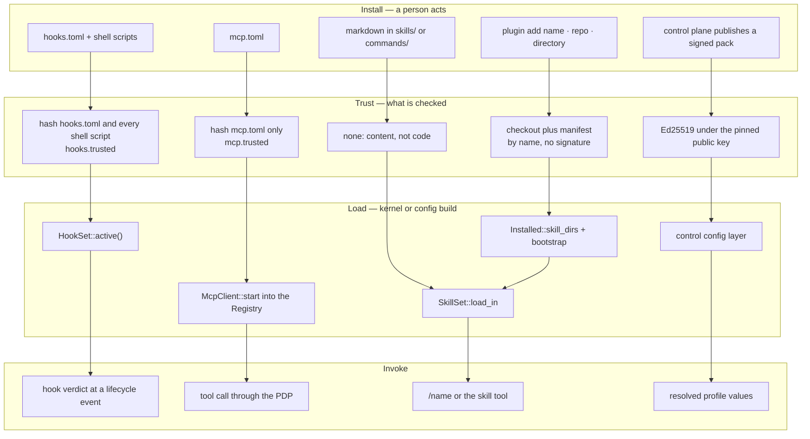

# Extension model: four kinds, one fixed kernel

- **Up:** [design/README.md](README.md) · [04 System overview](../04-system-overview.md)
- **Authority:** [ADR-0004](../decisions/0004-microkernel-extension-model.md) · [ADR-0007](../decisions/0007-permission-sandbox-engine.md) · [ADR-0016](../decisions/0016-pack-distribution.md) · [ADR-0018](../decisions/0018-plugin-install-and-bootstrap.md)
- **Code:** `crates/hooks/src/`, `crates/skills/src/`, `crates/mcp/src/`, `crates/plugin/src/`, `crates/pack/src/lib.rs`
- **Verify:** `cargo test -p loong-hooks -p loong-skills -p loong-mcp -p loong-plugin -p loong-pack` · `./scripts/check.sh`

The kernel is fixed: the model-and-tool loop, the context ledger, the event append and the
policy decision point are not extension points (ADR-0004). Everything around them is. Four
extension kinds exist in the code today. Each reaches a running session through one loader
and one trust question:

| Kind | Shape | Loaded by | Trust gate | May do |
|---|---|---|---|---|
| **Hooks** | shell script, HTTP endpoint, or MCP tool | `Kernel::build` → `HookSet::load` → `HookRunner` | `loongagent hooks trust`; a content hash per file | answer allow / ask / deny at six lifecycle moments |
| **Skills and commands** | markdown plus frontmatter | `Kernel::build` → `SkillSet::load_in` | none — content, not code | enter the catalogue, and the body on invoke |
| **MCP tools** | a stdio server exposing tools and prompts | `Kernel::build` → `attach_mcp` → `Registry` | `loongagent mcp trust`; a hash of `mcp.toml` | be a tool, through the same PDP as a built-in |
| **Plugins and packs** | a checkout with `.loongagent-plugin.toml`; a signed profile envelope | `build_kernel` → `installed_plugins` → `skill_dirs`; `sync_pack` / `cached_pack_state` → config layer | `loongagent plugin add` by name; a pinned Ed25519 key for a pack | add skills and bootstrap bodies; set the locked control layer |

The rest of this document takes the four kinds in turn; plugins and packs get separate
sections because their gates are different in kind. The boundary is the same everywhere: an
extension may propose, constrain or provide; it may not become the loop, the ledger, the log,
or the decision.

## 1. Hooks: the only veto channel

A hook is loaded from `<workspace>/.loongagent/hooks.toml`, with its scripts in the same
directory. `HookSet::load` parses the manifest, resolves each script, and computes the
fingerprint of the manifest plus every shell script it names. The trust record
`hooks.trusted` is written only by `loongagent hooks trust`; `HookSet::active` returns
nothing until the recorded hashes match the files. Editing the manifest or a script re-arms
the question. This is change detection, not a signature: the security comes from the person
answering again, not from the hash.

There are three transports and one verdict contract. A shell hook gets the event payload on
stdin, runs in the workspace, and answers with JSON on stdout or with its exit code
(`0` = allow, `2` = deny, stderr is the reason). An HTTP hook posts the same payload and reads
the same JSON; it is off unless `allow_http_hooks = true`, and the loader accepts only
`http://` URLs. An MCP hook calls a named tool on a named server and expects the same JSON.
Every hook runs; the report's verdict is the strictest (`deny` > `ask` > `allow`), so hooks
can only tighten a turn. A hook that cannot answer falls back to its own `on_error`
(`deny` by default), and the failure is recorded. Default timeout is 5 s, capped at 60 s;
stdout is capped at 8 KiB.

The six events are `session_start`, `user_prompt_submit`, `pre_tool`, `post_tool`,
`permission_requested` and `permission_decided`. The kernel records each outcome as a
`hook.fired` event. The key limit is a design rule, not a gap: **hooks have no channel into
the prompt.** A hook returns a verdict and a reason, never text that becomes context, which
is what makes a repository-shipped hook tolerable at all. The process is not sandboxed by
the tool PEP: a trusted hook is an ordinary child process.

## 2. Skills and commands: content, not code

A skill is a markdown file with `description` frontmatter. Its description enters the
catalogue in the system prompt; its body loads only when invoked, by the person typing
`/name args` or by the model calling the `skill` tool. `$ARGUMENTS` and `$1`…`$9` are
substituted, and arguments are appended rather than dropped when the body names none.

`SkillSet::load_in` reads the workspace's `.loongagent/skills/<name>/SKILL.md` and
`.loongagent/commands/<name>.md`, then every extra root a profile contributes through
`skill_dirs`, then the installed plugins' skill directories. A root that has a `skills/`
directory is read in the workspace shape only; a root that is a directory of skills is read
flat. Duplicate names are a hard error, so `/name` never depends on directory order. `/help`
is built from the final catalogue.

There is no trust gate and nothing executes. That is not an oversight: a skill is content,
and its description is an injection surface, so the audit trail is the control. The kernel
records `skills.loaded` for the catalogue and `skill.invoked` naming the source file (or
`mcp:<server>/<prompt>`), and every catalogue line carries its source. The `skill` tool is an
`Investigate` action because it only reads. `allowed_tools` is parsed and kept but **not
enforced yet**; a skill can describe a narrower tool set, not impose one.

MCP prompts are skills whose body lives on the wire: they are named
`mcp__<server>__<prompt>` so they cannot shadow a workspace skill, and the body is fetched
from the server on invoke. A plugin's `bootstrap` names skills whose bodies are seated in
the pinned system prompt at session build, under a line that says where they came from.

## 3. MCP tools: a server behind the tool interface

`McpSet::load` reads `<workspace>/.loongagent/mcp.toml`. A server entry names a command,
args, env, a default action class and optional per-tool overrides. The default class is
`out_of_bounds`, the cautious one: a tool the kernel knows nothing about asks every time.
A configured server is `required` by default; a server that cannot start or list its tools
fails the session rather than quietly removing a guard rail, and `required = false` opts
into a note instead.

The trust gate is `loongagent mcp trust`, recorded in `mcp.trusted`. Here the known limit is
important and visible in the code: `sources_of` fingerprints **`mcp.toml` and nothing else**.
The command binary, its PATH lookup, and anything it later reads are not hashed. Trust means
"I read this manifest", not "this server is verified".

Only trusted servers are started, by `attach_mcp` during kernel build. The client is stdio,
speaks JSON-RPC 2.0, and has a deadline on every read; dropping it kills the process group.
Tools are registered into the same `Registry` as the built-ins, so `Pdp::decide` runs before
every call and the action class comes from the manifest. Server-initiated requests are not
served, and resources and sampling are not implemented. A server's prompts become commands
in the same catalogue. Like hooks, the server process itself is not inside the tool sandbox;
the trust gate is the barrier, not confinement.

## 4. Plugins: install content by name

A plugin is a directory with `.loongagent-plugin.toml` under
`~/.loongagent/plugins/<name>/` or `<workspace>/.loongagent/plugins/<name>/`. A directory
without the manifest is not a plugin, and a plain `git clone` into the plugins root installs
nothing. `plugin add` is the act: it accepts a built-in catalogue name (`superpowers`),
`owner/repo`, a git URL, or a local directory, fetches, validates, and writes the manifest.
Project scope shadows user scope, and the shadow is reported.

Only skills are installed. Hooks, subagents and MCP servers are not; a plugin that ships a
`hooks/` directory is noted during install, and the note says the hook is a separate
per-repository trust decision. This is the point of the design: installing content must
never be a way around the hook or MCP gate (ADR-0018). The one capability a plugin needs
from the hook layer — putting an instruction in every session — is served natively by
`bootstrap`, which resolves names through the skills catalogue. An install whose skills
collide with the existing catalogue is rolled back; an update that does not parse is put back
on the previous commit.

There is no signature and no marketplace index. The catalogue is compiled into the binary,
one entry per reviewed plugin. Installation is by name, from a checkout a person can read;
that is the trust story.

## 5. Packs: policy that verifies before it applies

`crates/pack` holds one signed envelope, shared by the local agent and the control plane
because the two deploy independently and a duplicated verifier would eventually disagree.
The envelope carries `artifact`, `payload_schema`, `version`, `issuer`, `scope`,
`issued_at_ms`, `key_id`, `payload` and `signature`; Ed25519 over canonical JSON of every
field except `signature`. Verification checks the schema first, then `key_id` against the
pinned key, then the signature. A pack signed by another key is refused even if that
signature is valid; an unknown payload schema is refused before the signature is checked.

The public key is pinned out of band, in the machine configuration. The control plane holds
the signing key and serves the pack; the client fetches, verifies, and only then caches it.
An unreachable control plane falls back to the last verified cache; a pack that fails
verification is never replaced by the cache. The verified payload becomes the `control` config
layer, ranked above `org`, with its keys locked: a lower layer that tries to rewrite one is an
error naming the issuer and version, `narrow-only` keys may still be narrowed, and
`add-only` keys may still be added to. Only profile distribution is built; the payload schema
is `loongagent.profiles/1`, and policy and context packs are named but not written.

## 6. What an extension may and may not do

| May | May not |
|---|---|
| A hook may tighten a tool call or prompt with a verdict and a reason. | A hook may not put text into the prompt, widen a decision, or change a recorded event. |
| An MCP server may expose tools and prompts. | A tool may not skip the PDP; the same `Registry` and `Pdp::decide` cover it. |
| A skill may add instructions to the catalogue or an invoked body. | A skill may not execute anything, and its `allowed_tools` is not enforced. |
| A plugin may add skills and bootstrap bodies. | A plugin may not install hooks, MCP servers or subagents, or run code on install. |
| A verified pack may set the locked control-layer keys. | A pack may not be signed by an unpinned key, use an unknown schema, or be overridden by a lower layer. |

The kernel keeps the loop, the ledger, the context assembly, the event append and the PDP.
No extension is handed a `Kernel` or a `SessionLog`; the seams are a `Tool`, a `Model`, a
`HookRunner`, a `SkillSet` and resolved configuration. That is what makes the boundary
auditable rather than aspirational.

## 7. Install, trust, load, invoke

The plugin lane joins the skills lane at load time; it does not get its own invocation path.
A pack is not invoked at all: it resolves into configuration before the kernel is built.

## 8. Known limits

- **Hooks:** HTTP hooks are `http://` only (no TLS), off by default, and limited to six
  events; LLM and subagent hooks are deferred. A trusted hook is an unsandboxed child.
- **MCP:** the trust record covers `mcp.toml` only, not the command it names. The server
  process is not confined by the tool sandbox. There is no resources or sampling support.
- **Skills:** no trust gate, and `allowed_tools` is not enforced; descriptions enter every
  session's context, so the catalogue is an injection surface with an audit trail, not a
  boundary.
- **Plugins:** no signatures, no index, no per-plugin enable/disable, and only skills are
  installed. `agents/` and `.mcp.json` in a checkout are not flagged yet. The surface is the
  CLI.
- **Packs:** only profiles travel; policy and context payloads are not written. There is no
  expiry or revocation for an offline machine. A local `[[models]]` file remains possible
  for unmanaged installs.

## 9. Where to read next

- [ADR-0004](../decisions/0004-microkernel-extension-model.md) — why the kernel is fixed and
  which edges are future tiers.
- [ADR-0007](../decisions/0007-permission-sandbox-engine.md) §7 — hooks are advisory and
  gated; the event set and the trust rule.
- [ADR-0016](../decisions/0016-pack-distribution.md) — the envelope, the pinned key, and what
  distribution deliberately does not include.
- [ADR-0018](../decisions/0018-plugin-install-and-bootstrap.md) — install by name, only
  skills, and `bootstrap` as the native `SessionStart`.
- [tools-permissions.md](tools-permissions.md) — the PDP and the two enforcers every MCP tool
  also passes through.
- `crates/hooks/src/config.rs`, `crates/mcp/src/config.rs`, `crates/plugin/src/lib.rs` — the
  three trust implementations, each with its own tests.
