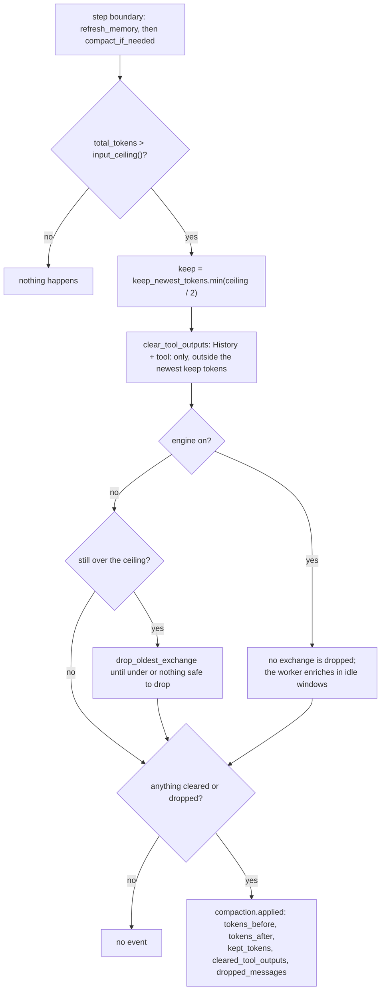

# Flow: context compaction

- **Up:** [context-ledger.md](../context-ledger.md)
- **Authority:** [ADR-0006](../../decisions/0006-context-engine.md) · [ADR-0017](../../decisions/0017-layered-context.md)
- **Code:** `crates/kernel/src/turn/compaction.rs`, `crates/kernel/src/context_engine.rs`, `crates/context/src/`
- **Verify:** `cargo test -p loong-kernel -p loong-context` · `./scripts/check.sh`

`Kernel::compact_if_needed` is the one path that takes content out of the model's
context. This page keeps the sequence and the event at each hop; the ledger's
categories, budgets and eviction are owned by [context-ledger.md](../context-ledger.md),
and the layered store by `crates/context/src/`.

## 1. Trigger

At every step boundary, after `refresh_memory` and `age_tool_outputs`, `compact_if_needed` compares
`ledger.total_tokens()` with `Kernel::input_ceiling()`: the stricter of the budget ×
`compact_at_percent` / 100 (default 80%) and the selected model's window minus
`reserved_context_size` (a reserve larger than half a window is capped at half).
At or under the ceiling it returns without an event. Otherwise `keep =
keep_newest_tokens.min(ceiling / 2)` (20,000 tokens by default) is the newest window
kept verbatim. With no budget and no window there is no ceiling, so compaction never
runs and the CLI says so at startup.

**Aging runs before that, on its own line.** `age_tool_outputs` fires whenever the
uncleared `tool:` entries pass `keep_newest_tokens`, ceiling or not. The line that
**triggers** a pass and the line it **settles to** are different numbers, and the
gap is the point: the trigger is `keep_newest_tokens`, the pass clears down to half
of it, and `compaction.applied.kept_tokens` records the half. Settling at the
trigger line leaves no headroom — the next tool result crosses it again, so one pass
runs per read. That costs far more than the tokens it frees, because a pass rewrites
tool messages *in the middle of* the conversation and a provider's prefix cache is a
byte-for-byte match: every request after that point pays full price for the whole
history again. A recorded session showed the shape — eight passes, most clearing one
or two outputs, each followed by a request that matched only the system prompt.

The gap has a floor: a pass never leaves less than the newest entry, which it must
keep verbatim, so headroom is `keep_newest_tokens` minus that entry. When one output
is a large fraction of the window — 10k against the 20k default is fine, 2.4k against
a 3k window is not — the gap nearly vanishes and aging still fires per read. The
lever there is raising `keep_newest_tokens`, not clearing the newest output.

## 2. Clear, then maybe drop

`Ledger::clear_tool_outputs(keep, marker)` replaces stale tool bodies with the
re-run marker (the criteria and `Entry.cleared` are context-ledger §4). With the
engine on, `may_drop = self.context_engine.is_none()` is false, so no exchange is
dropped. With it off, `drop_oldest_exchange` removes the oldest exchange and
`Ledger::forget`s its entries while still over the ceiling; a single long turn
returns 0 and stops.

## 3. The engine's digests and map

`refresh_memory` does the deterministic `Store::sync`, `Store::digest_pending` and
`Store::digest_domains`; `seat_map` replaces the L4 map in place (`Ledger::replace`,
no event) once per turn and after a clearing pass. The model half, `Store::synthesize_window`, runs on the worker in idle windows,
never on the turn's path. With the engine on the original stays reachable through the
derived store and `recall`. The store methods are `crates/context/src/`; the
engine-on rule is [context-ledger.md](../context-ledger.md) §4; the L4 map is §6.

## 4. The event, or no event

`Kernel::append` writes `compaction.applied` only when a body was cleared or a message
dropped. It carries `tokens_before`, `tokens_after`, `kept_tokens`,
`cleared_tool_outputs`, `dropped_messages` and `summary`. A single long turn with
nothing stale can stay over budget without an event.

Three passes inside five steps that each free under 5% or leave the context over its
ceiling end the turn with a compaction-thrash note: repeating the pass only re-bills
the provider. The note names `budget_tokens` and `keep_newest_tokens`.

## 5. What is reversible

Clearing is recoverable from the log's `tool.result` (re-run, or `recall` with the
engine on); a dropped exchange is not restored by reopening, because
`replay_compaction` reproduces the recorded drop. Pinned entries are never cleared.
The full reversibility table is context-ledger §7.

## 6. One compaction, in a flowchart

## 7. Where to read next

- [context-ledger.md](../context-ledger.md) §3, §4 and §7 — the budget, the phases
  and the reversibility table.
- [ADR-0006](../../decisions/0006-context-engine.md) — the ledger and compaction rules.
- [ADR-0017](../../decisions/0017-layered-context.md) — why the exchange is never
  dropped with the engine on.
- `crates/context/src/lib.rs` — L1 atoms, L2 episodes, L3 domains and the L4 map.
- `crates/kernel/src/turn/tests.rs` —
  `compaction_clears_stale_tool_output_before_dropping_anything`,
  `with_the_engine_on_a_long_session_never_drops_an_exchange`.
