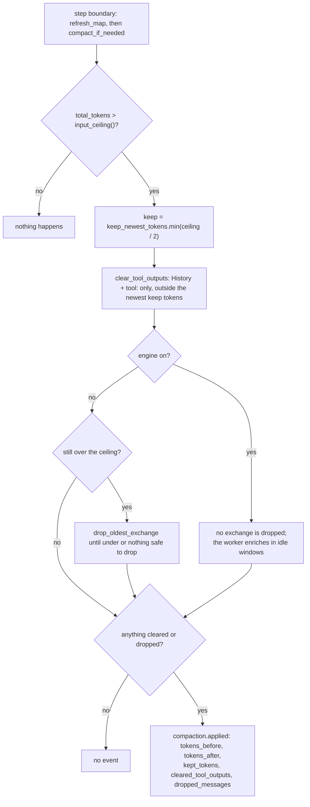

# Flow: context compaction

- **Up:** [context-ledger.md](../context-ledger.md)
- **Authority:** [ADR-0006](../../decisions/0006-context-engine.md) · [ADR-0017](../../decisions/0017-layered-context.md)
- **Code:** `crates/kernel/src/turn/compaction.rs`, `crates/kernel/src/context_engine.rs`, `crates/context/src/`
- **Verify:** `cargo test -p loong-kernel -p loong-context` · `./scripts/check.sh`

`Kernel::compact_if_needed` is the one path that takes content out of the model's
context. This page keeps the sequence and the event at each hop; the ledger's
categories, budgets and eviction are owned by [context-ledger.md](../context-ledger.md),
and the layered store by `crates/context/src/`.

## 1. Trigger

At every step boundary, after `refresh_map`, `compact_if_needed` compares
`ledger.total_tokens()` with `Kernel::input_ceiling()`: the stricter of the budget ×
`compact_at_percent` / 100 (default 80%) and the selected model's window minus
`reserved_context_size` (a reserve larger than half a window is capped at half).
At or under the ceiling it returns without an event. Otherwise `keep =
keep_newest_tokens.min(ceiling / 2)` (20,000 tokens by default) is the newest window
kept verbatim. With no budget and no window there is no ceiling, so compaction never
runs and the CLI says so at startup.

## 2. Clear, then maybe drop

`Ledger::clear_tool_outputs(keep, marker)` replaces stale tool bodies with the
re-run marker (the criteria and `Entry.cleared` are context-ledger §4). With the
engine on, `may_drop = self.context_engine.is_none()` is false, so no exchange is
dropped. With it off, `drop_oldest_exchange` removes the oldest exchange and
`Ledger::forget`s its entries while still over the ceiling; a single long turn
returns 0 and stops.

## 3. The engine's digests and map

`refresh_map` does the deterministic `Store::sync`, `Store::digest_pending` and
`Store::digest_domains`, then replaces the L4 map in place (`Ledger::replace`, no
event). The model half, `Store::synthesize_window`, runs on the worker in idle windows,
never on the turn's path. With the engine on the original stays reachable through the
derived store and `recall`. The store methods are `crates/context/src/`; the
engine-on rule and the L4 map are context-ledger §4.

## 4. The event, or no event

`Kernel::append` writes `compaction.applied` only when a body was cleared or a message
dropped. It carries `tokens_before`, `tokens_after`, `kept_tokens`,
`cleared_tool_outputs`, `dropped_messages` and `summary`. A single long turn with
nothing stale can stay over budget without an event.

## 5. What is reversible

Clearing is recoverable from the log's `tool.result` (re-run, or `recall` with the
engine on); a dropped exchange is not restored by reopening, because
`replay_compaction` reproduces the recorded drop. Pinned entries are never cleared.
The full reversibility table is context-ledger §7.

## 6. One compaction, in a flowchart

## 7. Where to read next

- [context-ledger.md](../context-ledger.md) §3, §4 and §7 — the budget, the phases
  and the reversibility table.
- [ADR-0006](../../decisions/0006-context-engine.md) — the ledger and compaction rules.
- [ADR-0017](../../decisions/0017-layered-context.md) — why the exchange is never
  dropped with the engine on.
- `crates/context/src/lib.rs` — L1 atoms, L2 episodes, L3 domains and the L4 map.
- `crates/kernel/src/turn/tests.rs` —
  `compaction_clears_stale_tool_output_before_dropping_anything`,
  `with_the_engine_on_a_long_session_never_drops_an_exchange`.
