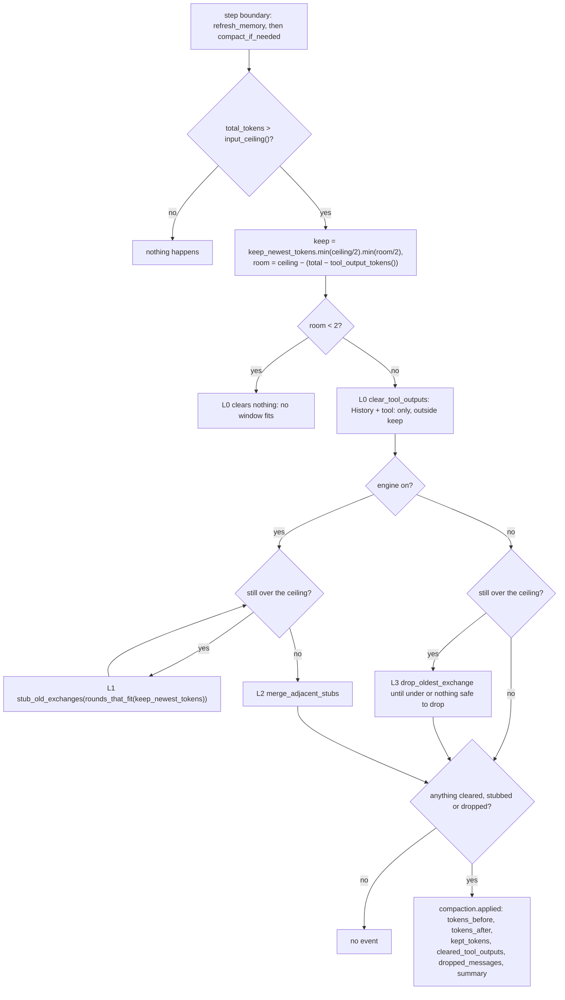

# Flow: context compaction

- **Up:** [context-ledger.md](../context-ledger.md)
- **Authority:** [ADR-0006](../../decisions/0006-context-engine.md) · [ADR-0017](../../decisions/0017-layered-context.md)
- **Code:** `crates/kernel/src/turn/compaction.rs`, `crates/kernel/src/context_engine.rs`, `crates/context/src/`
- **Verify:** `cargo test -p loong-kernel -p loong-context` · `./scripts/check.sh`

`Kernel::compact_if_needed` is the one path that takes content out of the model's
context. This page keeps the sequence and the event at each hop; the ledger's
categories, budgets and eviction are owned by [context-ledger.md](../context-ledger.md),
and the layered store by `crates/context/src/`.

## 1. Trigger

At every step boundary, after `refresh_memory` and `age_tool_outputs`, `compact_if_needed` compares
`ledger.total_tokens()` with `Kernel::input_ceiling()`: the stricter of the budget ×
`compact_at_percent` / 100 (default 80%) and the selected model's window minus
`reserved_context_size` (a reserve larger than half a window is capped at half).
At or under the ceiling it returns without an event. Otherwise the newest window
kept verbatim is `keep = keep_newest_tokens.min(ceiling / 2).min(room / 2)`
(20,000 tokens by default), where `room = ceiling − (total − tool_output_tokens())`
is what the ceiling leaves above the history that cannot be cleared: the prompt,
the assistant messages and the arguments of its tool calls. With no budget and no
window there is no ceiling, so compaction never runs and the CLI says so at startup.

The third term is what keeps a long session working. A window fixed at 20,000
tokens is a wish, not a right: once the running history alone is most of the
ceiling, that window puts the *floor* of clearing above the ceiling, so each pass
clears a sliver, lands over, and the thrash guard stops the turn — and a fresh turn
starts from the same context, so it stops again three passes later. Fitting the
window to the room removes the cause. A session at 67,000 tokens of history under
an 80,000 ceiling leaves 13,000 of room; halved, that is a 6,500-token window with
about three steps of headroom per pass. When `room` is zero the pass is not made at
all: no window can get under the ceiling, so clearing would rewrite the middle of
the conversation, cost a full cache miss and still land over it. The context then
stays as it is and the lever is a larger `budget_tokens` or a new session.

**Aging runs before that, on its own line.** `age_tool_outputs` fires whenever the
uncleared `tool:` entries pass `keep_newest_tokens`, ceiling or not. The line that
**triggers** a pass and the line it **settles to** are different numbers, and the
gap is the point: the trigger is `keep_newest_tokens`, the pass clears down to half
of it, and `compaction.applied.kept_tokens` records the half. Settling at the
trigger line leaves no headroom — the next tool result crosses it again, so one pass
runs per read. That costs far more than the tokens it frees, because a pass rewrites
tool messages *in the middle of* the conversation and a provider's prefix cache is a
byte-for-byte match: every request after that point pays full price for the whole
history again. A recorded session showed the shape — eight passes, most clearing one
or two outputs, each followed by a request that matched only the system prompt.

The gap has a floor: a pass never leaves less than the newest entry, which it must
keep verbatim, so headroom is `keep_newest_tokens` minus that entry. When one output
is a large fraction of the window — 10k against the 20k default is fine, 2.4k against
a 3k window is not — the gap nearly vanishes and aging still fires per read. The
lever there is raising `keep_newest_tokens`, not clearing the newest output.

## 2. The ladder: clear, stub, merge, and drop only without the engine

**L0 — clear.** `Ledger::clear_tool_outputs(keep, marker)` replaces stale tool
bodies with the re-run marker (the criteria and `Entry.cleared` are
context-ledger §4). Clearing is free and deterministic, so it always goes first.

**L1 — stub.** With the engine on and the context still over the ceiling,
`Kernel::stub_old_exchanges` replaces the oldest whole exchanges with one
`ChatMessage::System` stub carrying their request, changed files, commands,
verdict, clue words and `recall seq a-b`. `rounds_that_fit` keeps the newest
exchange (the turn being answered) and as many more as `keep_newest_tokens`
allows. No model is called: degradation is the moment latency is least
affordable. The loop repeats while over the ceiling, then **L2**,
`merge_adjacent_stubs`, folds stubs that ended up adjacent, so the stub layer is
bounded too.

**L3 — drop, engine off only.** `may_drop = self.context_engine.is_none()`.
With it off, `drop_oldest_exchange` removes the oldest exchange and
`Ledger::forget`s its entries while still over the ceiling; a single long turn
returns 0 and stops. With it on, nothing is dropped: the exchange became a stub
instead, and the original is one recall away.

**Pinned residents** are never selected by any rung: the L4 map and the task
card. The card exists precisely because a constraint does not survive a digest —
it is intent, not a fact that can be recomputed. Its overflow rule (drop
completed detail, then verification, then fold constraints, never the goal) is
context-ledger §4.

**When the provider still refuses** (`ModelError::is_context_overflow`),
`Kernel::complete_with_ladder` retries inside the same turn: rung 1 forces a
compaction at half the context, rung 2 sheds to the minimal request, then the
turn ends in words the person can act on and a `context.degraded` event — never
as an `Err`. Only a size error takes this path; a 500 or a bad key is reported.

## 3. The engine's digests and map

`refresh_memory` does the deterministic `Store::sync`, `Store::digest_pending` and
`Store::digest_domains`; `seat_map` replaces the L4 map in place (`Ledger::replace`,
no event) once per turn and after a clearing pass. The model half, `Store::synthesize_window`, runs on the worker in idle windows,
never on the turn's path. With the engine on the original stays reachable through the
derived store and `recall`. The store methods are `crates/context/src/`; the
engine-on rule is [context-ledger.md](../context-ledger.md) §4; the L4 map is §6.

## 4. The event, or no event

`Kernel::append` writes `compaction.applied` only when a body was cleared, a
message was stubbed, or one was dropped. It carries `tokens_before`,
`tokens_after`, `kept_tokens`, `cleared_tool_outputs`, `dropped_messages` and
`summary`; the stub count lives in `summary` (`stubbed N message(s)`) because a
stub is not a drop and `dropped_messages` must keep meaning "lost". A single long
turn with nothing stale can stay over budget without an event.

Three passes inside five steps that each free under 5% or leave the context over
its ceiling end the turn with a compaction-thrash note: repeating the pass only
re-bills the provider. The note names `budget_tokens` and a fresh session. It does
not name `keep_newest_tokens`, which cannot help *here*: the stop means the ceiling
is at or below what cannot be cleared. That key still sets the aging gap above,
which is a different line — the cost of pass frequency, not the reason a turn ends.

With L1 in place this stop should be rare, and a *repeated* stop on the same
session means the rung itself cannot free anything (`room` is zero and every
exchange is already a stub) — the honest answer is a larger budget or a fresh
session, which is exactly what the note says.

## 5. What is reversible

Clearing is recoverable from the log's `tool.result` (re-run, or `recall` with
the engine on); a stub is recovered from its own `recall seq a-b`; a dropped
exchange is not restored by reopening, because `replay_compaction` reproduces the
recorded drop. Stubs are derived rather than recorded, so a resumed session
rebuilds them at its next pass — from a log that still holds every original. Pinned entries are never cleared.
The full reversibility table is context-ledger §7.

## 6. One compaction, in a flowchart

## 7. Where to read next

- [context-ledger.md](../context-ledger.md) §3, §4 and §7 — the budget, the phases
  and the reversibility table.
- [ADR-0006](../../decisions/0006-context-engine.md) — the ledger and compaction rules.
- [ADR-0017](../../decisions/0017-layered-context.md) — why the exchange is never
  dropped with the engine on.
- `crates/context/src/lib.rs` — L1 atoms, L2 episodes, L3 domains and the L4 map.
- `crates/kernel/src/turn/tests.rs` —
  `compaction_clears_stale_tool_output_before_dropping_anything`,
  `old_exchanges_become_stubs_with_an_address`,
  `the_foreground_stops_growing_once_stubs_take_over`,
  `an_overflowing_request_is_compacted_and_retried_instead_of_failing`.
