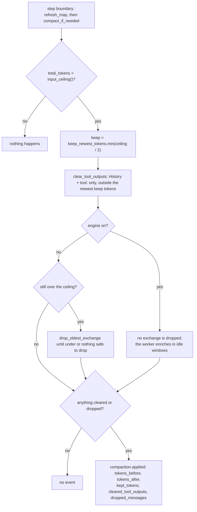

# Flow: context compaction

- **Up:** [context-ledger.md](../context-ledger.md)
- **Authority:** [ADR-0006](../../decisions/0006-context-engine.md) · [ADR-0017](../../decisions/0017-layered-context.md)
- **Code:** `crates/kernel/src/turn/compaction.rs`, `crates/kernel/src/context_engine.rs`, `crates/context/src/`
- **Verify:** `cargo test -p loong-kernel -p loong-context` · `./scripts/check.sh`

`Kernel::compact_if_needed` is the one path that takes content out of the model's
context. This page follows one trigger, from the budget measurement to the event (or
the silence) it leaves. The ledger's categories and budgets are owned by
[context-ledger.md](../context-ledger.md); the layered store is `crates/context/src/`.

## 1. Trigger

Once per step, after `Kernel::refresh_map` and before the request is built:
`Kernel::compact_if_needed` measures `ledger.total_tokens()`.

- `Kernel::input_ceiling()` is the stricter of the budget (`budget_tokens ×
  compact_at_percent / 100`, default 80%) and the selected model's window minus
  `reserved_context_size` (default 16 Ki, capped at half a window).
- At or under the ceiling, nothing happens.
- `keep = keep_newest_tokens.min(ceiling / 2)` (default 20 Ki): the newest window
  that stays verbatim.
- With no budget and no window, there is no ceiling and compaction never runs; the
  CLI says so at startup rather than leaving a silent `None`.

The measure is the ledger's share of the prompt about to be sent, not a cumulative
spend. Twenty calls in one turn are twenty measurements, not twenty terms in a sum.

## 2. Clear stale tool output (both modes)

`Ledger::clear_tool_outputs(keep, marker)` walks back to where the newest `keep`
tokens begin and clears only entries that are `Category::History`, whose source
starts with `tool:`, that are not pinned, not already cleared, and sit outside that
window. It always keeps the newest entry, whatever the arithmetic says: one tool
output larger than the whole window must not be cleared the moment it arrives.

Nothing is removed. `compact_if_needed` rewrites the message body to
`[output of tool:<call_id> cleared to save context — re-run the command if you need
it again]` and `Entry.cleared` becomes true. That marker is the promise that the
output can be obtained again rather than a claim that it was empty.

## 3. Digest and synthesis when the engine is on

`Kernel::refresh_map` runs first and does the **deterministic** half:
`ContextEngine::refresh` calls `Store::sync`, `Store::digest_pending` and
`Store::digest_domains`, then wakes the worker. The resulting L4 map is seated as its
own `ChatMessage::System` and refreshed in place with `Ledger::replace` — one pinned
`CognitiveMap` entry, its id and lifetime kept, no event.

The **model** half (`Store::synthesize_window`) runs on the engine's worker in idle
windows, never on the turn's path. Each episode is enriched from its digest, with
citations; a failed call leaves that episode on its digest and degrades the status
rather than the session. With the engine on, phase 2 never runs
(`let may_drop = self.context_engine.is_none();`): stale tool output is the whole
saving, and the exchange survives because the original stays reachable in the derived
store (`recall` expands a summary to the events it cites).

## 4. Drop the oldest exchanges (engine off)

Only with the engine off, and only while still over the ceiling,
`Kernel::drop_oldest_exchange` drains messages from after the system prompt up to, not
including, the next user message, and calls `Ledger::forget` on their entry ids. A
conversation with no next user message is one turn; dropping it would throw away the
prompt being answered, so the function returns 0 and the loop stops. A drop never
splits an assistant call from its tool result.

## 5. The event, or no event

If nothing was cleared and nothing dropped, `compact_if_needed` returns without an
event: `compaction.applied` means the context actually changed. Otherwise
`Kernel::append` writes it:

| Field | Meaning |
|---|---|
| `tokens_before`, `tokens_after` | `ledger.total_tokens()` around the change |
| `kept_tokens` | the newest window kept verbatim |
| `cleared_tool_outputs` | entries whose body became the marker |
| `dropped_messages` | messages removed (always 0 with the engine on) |
| `summary` | the human-readable counts |

A single long turn with nothing stale can stay over budget without an event, because
there is nothing safe to remove.

## 6. What is reversible

| Action | The model sees after | Where the original is |
|---|---|---|
| Clear a tool output | a marker naming the source | the `tool.result` event; re-run, or `recall` with the engine on |
| Drop an exchange (engine off) | the messages are gone and their entries forgotten | the events are still in the log; reopening calls `replay_compaction` and reproduces the drop |
| Refresh the map | the same entry id, possibly a different size | the events the map was derived from |
| Whole-entry eviction | not on the live path (`Ledger::evict_to_budget` has no kernel caller) | — |

`Ledger::replace` can resize an entry, never reclassify it; pinned entries are skipped
by clearing. `replay_compaction` reads the recorded counts, so a reopened session
does not silently regain the cleared text: recovery is a person re-running a command
or a `recall`, not a free undo.

## 7. One compaction, in a flowchart

## 8. Where to read next

- [context-ledger.md](../context-ledger.md) §3, §4 and §7 — the budget, the phases
  and the reversibility table in detail.
- [ADR-0006](../../decisions/0006-context-engine.md) — the ledger and compaction rules.
- [ADR-0017](../../decisions/0017-layered-context.md) — why the exchange is never
  dropped with the engine on.
- `crates/context/src/lib.rs` — L1 atoms, L2 episodes, L3 domains and the L4 map.
- `crates/kernel/src/turn/tests.rs` —
  `compaction_clears_stale_tool_output_before_dropping_anything`,
  `with_the_engine_on_a_long_session_never_drops_an_exchange`.
