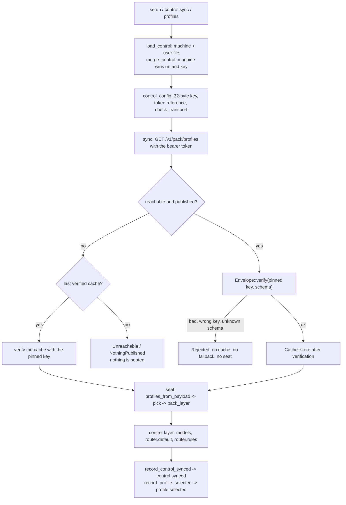

# Flow: pack install

- **Up:** [control-plane.md](../control-plane.md)
- **Authority:** [ADR-0012](../../decisions/0012-control-plane.md) · [ADR-0016](../../decisions/0016-pack-distribution.md)
- **Code:** `crates/cli/src/control.rs`, `crates/control/src/lib.rs`, `crates/pack/src/lib.rs`, `crates/config/src/`
- **Verify:** `cargo test -p loongagent -p loong-control -p loong-pack` · `./scripts/check.sh`

A managed install gets its model endpoints and router from a **signed profile pack**.
This page follows one install: resolve the control plane and its pinned key, fetch,
verify, cache only after verification, seat the pack as the `control` layer, and
record what ran. The service side is [control-plane.md](../control-plane.md); the
envelope, the cache and the layer lock are [config-routing.md](../config-routing.md)
§4–§5.

## 1. Resolve the plane and the pin

`loongagent setup`, `control sync`, `profiles` and `use` all start at `load_control`:

- `system_control_path` (`/etc/loongagent/control.toml`) and `user_control_path`
  (`$LOONGAGENT_HOME/control.toml`, normally `~/.loongagent/control.toml`) are read,
  then `merge_control` lets the machine file win `url` and `public_key`; the user file
  may supply only `token`.
- `control_config` unhexes the key, refuses anything but a 32-byte Ed25519 key,
  requires the token to be a reference (`env:`, `file:`, and the reserved `keychain:`
  and `gateway:` spellings), and runs `ControlConfig::check_transport`: HTTPS, or
  plain HTTP only on loopback.
- The pinned key is the trust anchor. It is written out of band and is never learned
  from the server.

## 2. Fetch

`loong_control::sync(&config, &cache, token, timeout)` calls `fetch`, which is
`GET /v1/pack/profiles` with the bearer token (`loong_http::get_json`), and parses the
body with `Envelope::from_json`.

- `409` or `404` becomes `ControlError::NothingPublished` ("ask your profile
  administrator to publish a pack").
- Any other transport failure becomes `ControlError::Unreachable`.

## 3. Verify against the pinned key

`Envelope::verify(&config.public_key, &[PROFILES_SCHEMA])` checks, in this order:

1. the signature is present and the payload schema is one this build knows
   (`loongagent.profiles/1`), else `Malformed` or `UnsupportedSchema`;
2. `key_id(public_key) == envelope.key_id`, else `WrongKey` — a valid signature under
   a different key is still refused;
3. the Ed25519 signature over `Envelope::signing_bytes`, the canonical JSON of every
   field except `signature` (artifact, schema, version, issuer, scope, issue time,
   key id and payload). A changed byte is `BadSignature`.

Only after this does `Cache::store` write the envelope, atomically (a unique temporary
file then a rename; the same pack is not rewritten). A failed verification never falls
back to the cache and never caches the bad pack.

## 4. Seat the layer

`profiles_from_payload` parses and validates the payload. `ProfilePack::pick` chooses
the profile: the user's `control.profile`, else the pack's default, else the first;
an unknown choice is an error rather than a silent substitution.

`pack_layer(&profile)` turns the choice into `models`, `router.default` and
`router.rules` for `Layer::Control`. `Args::settings_with_pack` resolves the layers
twice — without the pack to learn `control.profile`, then with the pack in place — so
the pack never sets the choice that selects it. A key set by the control layer is
locked against lower layers; a narrow-only key can still be narrowed.

## 5. Record

At session start, if a pack is in force, `crates/cli/src/server.rs` calls
`Kernel::record_control_synced` (→ `control.synced`: issuer, version, `key_id`,
profile, `from_cache`, note), then `Kernel::record_profile_selected` (→
`profile.selected`: name, description, models). These are provenance events: they
answer "what policy was in force?" for a session that has already run.

## 6. When it goes wrong

| Failure | What happens |
|---|---|
| Bad signature, wrong key, unknown schema | `ControlError::Rejected`; nothing is applied, cached or seated. The message names the key or schema; re-pinning is an administrator's act, not the user's. |
| Plane unreachable, last verified cache exists | `sync` returns the cached envelope after re-verifying it (`from_cache: true`, with a note); the session runs on the last known policy. |
| Plane unreachable, no cache | `ControlError::Unreachable`; session start turns it into "no profile pack has been synced on this machine yet" and names the address, while `control sync` and `setup` report the unreachable error. |
| Nothing published | `NothingPublished`, with the publish instruction. |
| Cached pack no longer verifies | loading it is a hard error ("the cached pack no longer verifies"), not a stale fallback. |

**Expiry.** A pack carries no expiry: `issued_at_ms` is signed but never compared to
the clock. There is therefore no "expired" refusal in this code, and a machine that
never reconnects keeps the last verified pack (ADR-0016 §7). That is a decided
limitation, not a missing check.

## 7. What is cached

Only the verified envelope, as JSON, under the state directory:
`<config>/control/<origin>/profiles.json`, one cache per control-plane origin
(`ControlConfig::origin`). The signing key stays on the control plane; the pinned
public key and the token reference stay in `control.toml`; no session content is sent.
`cached_pack_state` reads the cache without the network and verifies it again before a
surface shows it.

## 8. One install, in a flowchart

The order matters: verification precedes caching, caching precedes seating, and the
record is written by the kernel once the session's layer is resolved.

## 9. Where to read next

- [control-plane.md](../control-plane.md) — the endpoints, the tokens, serve and publish.
- [config-routing.md](../config-routing.md) §4–§5 — the envelope, the cache and the lock.
- [security-trust.md](../security-trust.md) — where the signing key and the pin sit.
- [control-plane.md](../../runbooks/control-plane.md) — the operational sequence.
- `crates/control/src/lib.rs` — `sync`, `fetch`, `Cache`; `crates/pack/src/lib.rs` —
  `Envelope::verify`.
