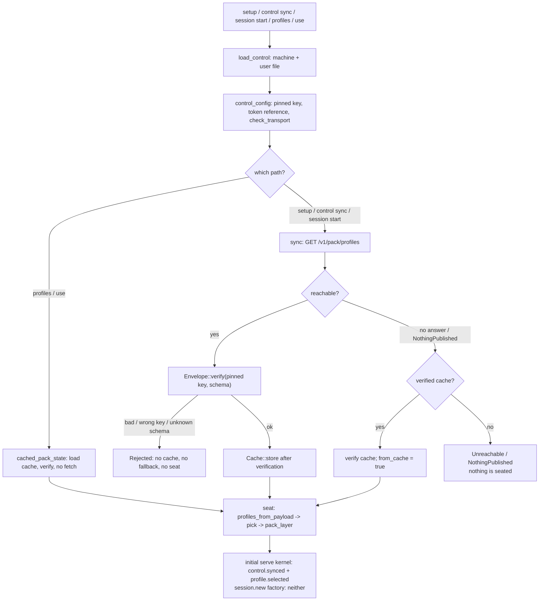

# Flow: pack install

- **Up:** [control-plane.md](../control-plane.md)
- **Authority:** [ADR-0012](../../decisions/0012-control-plane.md) · [ADR-0016](../../decisions/0016-pack-distribution.md)
- **Code:** `crates/cli/src/control.rs`, `crates/control/src/lib.rs`, `crates/pack/src/lib.rs`, `crates/config/src/`
- **Verify:** `cargo test -p loongagent -p loong-control -p loong-pack` · `./scripts/check.sh`

A managed install gets its model endpoints and router from a signed profile pack.
This page keeps the sequence. The service side is
[control-plane.md](../control-plane.md); the envelope, the verify order, the cache
rule and the layer lock are [config-routing.md](../config-routing.md) §4–§5.

## 1. Resolve the plane and the pin

`load_control` reads `system_control_path` (`/etc/loongagent/control.toml`) and
`user_control_path` (`$LOONGAGENT_HOME/control.toml`); `merge_control` lets the
machine file win `url` and `public_key`, and the user file supply only `token`. With
no machine file the install is unmanaged and the user file is the whole
configuration. `control_config` unhexes the 32-byte Ed25519 key, requires a token
reference, and `check_transport` allows HTTPS or loopback HTTP. The pinned key is the
trust anchor, written out of band. The mechanism is config-routing §4.

## 2. Fetch and verify

`loong_control::sync` calls `fetch` (`GET /v1/pack/profiles` with the bearer token),
parses with `Envelope::from_json`, then runs
`Envelope::verify(&config.public_key, &[PROFILES_SCHEMA])`. A missing signature, an
unknown schema, a `key_id` that does not match the pin, or a bad Ed25519 signature is
`ControlError::Rejected`. Only after verification does `Cache::store` write the
envelope (atomically); a `Rejected` pack never falls back to the cache and is never
cached. `409` / `404` is `NothingPublished`; another transport failure is
`Unreachable`. The envelope and the exact verify order are config-routing §4.

## 3. Seat and record

`profiles_from_payload` → `ProfilePack::pick` (the user's `control.profile`, else the
default, else the first) → `pack_layer` → `models`, `router.default`,
`router.rules` on `Layer::Control`. `Args::settings_with_pack` resolves the layers
twice so the pack cannot set the choice that selects it. The **initial `serve`
kernel** records `Kernel::record_control_synced` (`control.synced`) and
`Kernel::record_profile_selected` (`profile.selected`). The `session.new` factory
builds a kernel but does **not** record either event, so a `/new` session has no
`control.synced` or `profile.selected` until a path records them. The layer and its
lock are config-routing §2 and §5.

## 4. When it goes wrong

| Failure | What happens |
|---|---|
| Bad signature, wrong key, unknown schema | `ControlError::Rejected`; nothing is applied, cached or seated. Re-pinning is an administrator's act. |
| Plane unreachable, verified cache exists | `sync` returns the cached envelope after re-verifying it (`from_cache: true`, with a note); the session runs on the last known policy. |
| Plane unreachable, no cache | `ControlError::Unreachable`; session start says no pack has been synced and names the address, while `control sync` and `setup` report the unreachable error. |
| Nothing published | `NothingPublished` with the publish instruction; a verified cache still serves, because this is not a `Rejected` pack and `sync` falls back. With no cache it is an error. |
| Cached pack no longer verifies | the `sync` fallback fails as `Rejected` (the cache is not used); `cached_pack_state` (`profiles`, `use`) says "the cached pack no longer verifies". |

**Expiry.** A pack carries no expiry: `issued_at_ms` is signed but never compared to
the clock. There is no "expired" refusal in this code, and a machine that never
reconnects keeps the last verified pack (ADR-0016 §7). That is a decided limitation,
not a missing check.

## 5. What is cached

Only the verified envelope, as JSON, at
`<config>/control/<origin>/profiles.json`, one cache per control-plane origin
(`ControlConfig::origin`). The signing key stays on the control plane; the pin and the
token reference stay in `control.toml`; no session content is sent. `cached_pack_state`
reads and re-verifies the cache without the network for `profiles` and `use`.

## 6. One install, in a flowchart

Verification precedes caching, caching precedes seating, and only the initial `serve`
kernel writes the provenance pair.

## 7. Where to read next

- [control-plane.md](../control-plane.md) — endpoints, tokens, serve and publish.
- [config-routing.md](../config-routing.md) §4–§5 — the envelope, the cache and the lock.
- [security-trust.md](../security-trust.md) — where the signing key and the pin sit.
- [control-plane.md](../../runbooks/control-plane.md) — the runbook entry: bootstrap, operate, security.
- `crates/control/src/lib.rs` — `sync`, `fetch`, `Cache`; `crates/pack/src/lib.rs` —
  `Envelope::verify`.
