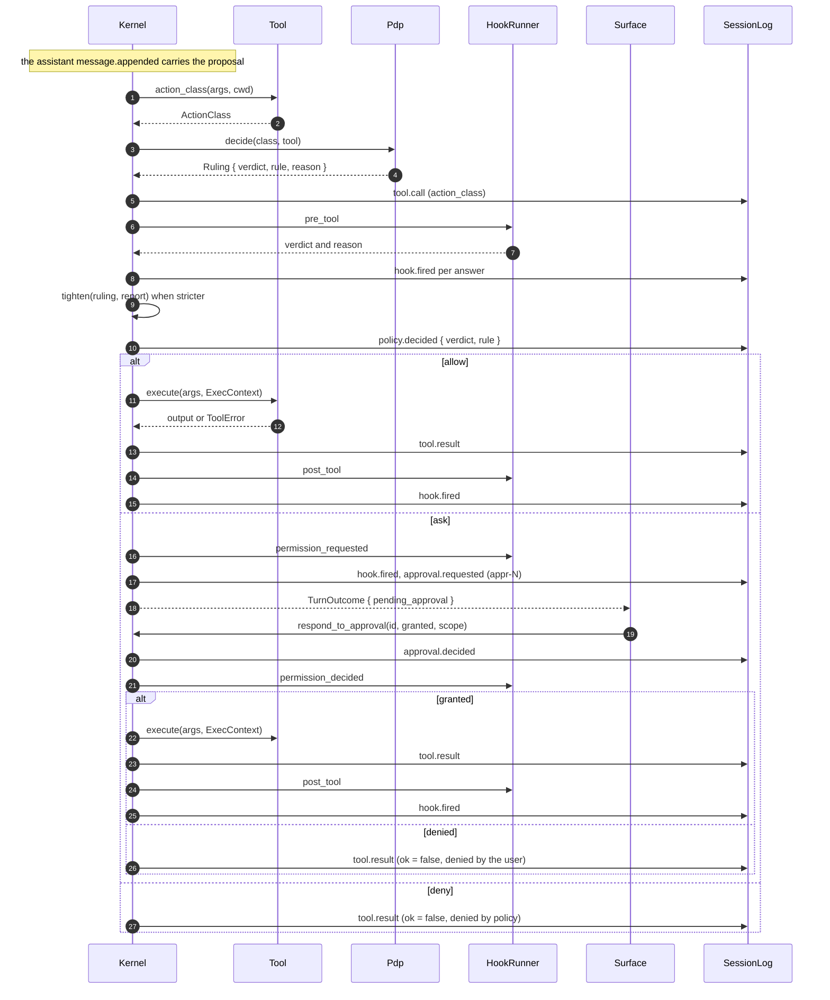

# Flow: one tool approval

- **Up:** [tools-permissions.md](../tools-permissions.md) · [design/README.md](../README.md)
- **Authority:** [ADR-0007](../../decisions/0007-permission-sandbox-engine.md) · [ADR-0004](../../decisions/0004-microkernel-extension-model.md) · [ADR-0019](../../decisions/0019-mid-turn-permissions.md)
- **Code:** `crates/kernel/src/turn/loop.rs`, `crates/tools/src/lib.rs`, `crates/sandbox/`, `crates/tui-app/src/lib.rs`
- **Verify:** `cargo test -p loong-kernel -p loong-tools -p loong-sandbox -p loong-tui-app` · `./scripts/check.sh`

A registry tool call passes one gate: the model proposes, `Kernel::dispatch` asks
`Pdp::decide`, and the verdict decides whether `Kernel::execute` runs the tool. This
page keeps the sequence and the exact event or function at each hop. The interface,
the action classes, the PDP ladder and the two enforcers are owned by
[tools-permissions.md](../tools-permissions.md); the call's place in a turn is
[turn-lifecycle.md](turn-lifecycle.md).

## 1. The sequence in brief

1. **Proposal.** The model's `tool_calls`; `run_inner` has already written the
   assistant `message.appended`, then calls `Kernel::dispatch` once per call.
2. **Class.** `Tool::action_class(args, cwd)` returns the action class. It allocates
   autonomy; it is not the enforcement boundary.
3. **Decision.** `Pdp::decide(class, tool)` returns `Ruling { verdict, rule, reason }`;
   the rule is `builtin:<class>` or `profile:<layer>:<class>`.
4. **Attempt and tighten.** `tool.call`; `pre_tool` hooks (`hook.fired`); a stricter
   hook verdict replaces the ruling and its rule becomes `hook:<ids>`;
   `policy.decided` records the verdict and rule the kernel acts on.
5. **Arm.** Allow: `Kernel::execute` → `tool.result` → `post_tool`. Ask:
   `permission_requested`, `approval.requested` (`appr-N`), the turn parks, and the
   rest of that assistant message gets `tool.result` "not run". Deny: `tool.result`
   with `ok: false` and the rule.
6. **Answer.** `Kernel::respond_to_approval` writes `approval.decided`, fires
   `permission_decided`, then either runs the same `Kernel::execute` with the same
   `ExecContext` or writes `tool.result` "denied by the user". The answer carries a
   scope. `Session` is the one scope the kernel acts on: on a granted answer it stores
   the command's irreversible segment keys in an in-memory set on the kernel, and a
   later `dispatch` whose every irreversible segment is already remembered skips the
   ask. The match is total, so one remembered segment never launders an unapproved
   sibling, and the set dies with the kernel, so a restart asks again (ADR-0020). The
   other scopes are carried for protocol compatibility and behave as `Once`.
7. **`/yolo`.** `Kernel::set_auto_approve` writes `permissions.relaxed`; the ask arm
   executes and records a second `policy.decided` (`yolo:<Class>`) and a second
   `tool.call`. The one class it leaves alone is `Irreversible` — a deletion or a
   payload leaving the machine still parks (ADR-0020).

The same PEPs apply on allow and on a granted approval; they are tools-permissions §4.
`recall` is the one call that skips the gate: `dispatch` answers it before the registry
and the PDP with `tool.call` and `tool.result`.

**`/yolo` on a turn that is already running.** A `permissions.set` request would be
read only after the turn ends, because the turn owns the connection; that is exactly
the wait `/yolo` exists to prevent. The surface therefore carries the request on a
private control channel — a pipe whose write end never leaves the surface process — and
the server leaves it in `Kernel.permissions_request`. The kernel applies it at the next
boundary where nothing is half-done: the top of a step, and `dispatch` before
`Pdp::decide`, so the call that would have asked is allowed instead. The turn still
writes `permissions.relaxed` itself, so the log keeps one writer and one order. The
interface may show the switch at once — that is the point of the command — and the
event is the confirmation that it happened.

## 2. One approval, in sequence

The order is fixed: class, `pdp.decide`, `tool.call`, `pre_tool`, the stricter
`policy.decided`, then execute or ask.

`respond_to_approval` resumes the turn **in front of the surface that answered**: the
decision, the tool's result and the model's words stream as they happen, through the
same sink a new turn uses (`respond_to_approval_with`). The surface that asked is the
surface watching — a resume nobody watches is a click that looks like it did nothing.
The question stays answerable only while the kernel holds it: `session.attach` reports
it as `pending_approval`, so a page refreshed onto a parked turn can still answer, and
a question whose process is gone is a record, not a button (web-surface.md §4).

**The question that cannot be skipped says why.** Under `/yolo` an `irreversible` ask
carries one more line in the TUI panel: the class in words, that the opt-out does not
reach this one, and that「本会话允许」answers the same shape from now on. Turning the
opt-out on says the other half in the transcript — prompts are off, the sandbox still
applies, writes outside the workspace are still refused, deletions and egress still ask
— and the slash menu's one-line description says it before the switch is pressed. A
prompt inside a session that stopped asking otherwise reads as either a defect or the
agent having escaped its box; naming it is the whole of ADR-0020 §2. The words live in
`crates/tui-app/src/lib.rs` (`irreversible_note`, the `Yolo` arm's banner) and
`crates/tui-app/src/commands.rs`; the TUI never decides the class itself, it only reads
`approval.requested`.

## 3. Where to read next

- [tools-permissions.md](../tools-permissions.md) — the interface, the classes, the
  ladder and the two enforcers.
- [ADR-0007](../../decisions/0007-permission-sandbox-engine.md) — the ladder and the rule.
- [ADR-0008](../../decisions/0008-configuration-layering.md) — narrowing only.
- [turn-lifecycle.md](turn-lifecycle.md) — where the proposal and the result sit.
- `crates/kernel/src/turn/tests.rs` —
  `opting_out_of_prompts_allows_the_action_and_says_so_in_the_log`,
  `a_granted_approval_still_cannot_escape_the_workspace`.
