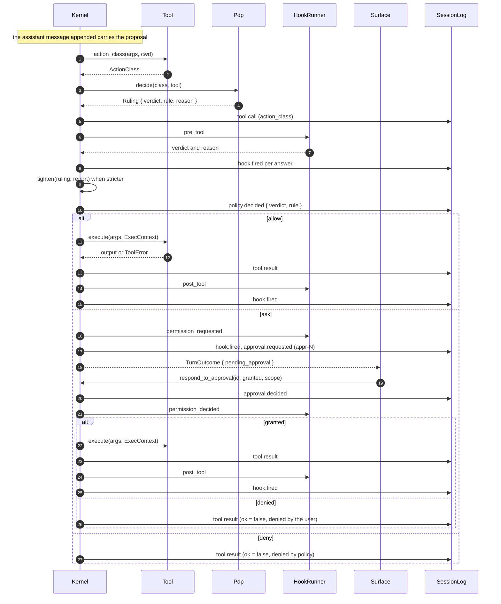

# Flow: one tool approval

- **Up:** [tools-permissions.md](../tools-permissions.md) · [design/README.md](../README.md)
- **Authority:** [ADR-0007](../../decisions/0007-permission-sandbox-engine.md) · [ADR-0004](../../decisions/0004-microkernel-extension-model.md)
- **Code:** `crates/kernel/src/turn/loop.rs`, `crates/tools/src/lib.rs`, `crates/sandbox/`
- **Verify:** `cargo test -p loong-kernel -p loong-tools -p loong-sandbox` · `./scripts/check.sh`

A registry tool call passes one gate: the model proposes, `Kernel::dispatch` asks
`Pdp::decide`, and the verdict decides whether `Kernel::execute` runs the tool. This
page keeps the sequence and the exact event or function at each hop. The interface,
the action classes, the PDP ladder and the two enforcers are owned by
[tools-permissions.md](../tools-permissions.md); the call's place in a turn is
[turn-lifecycle.md](turn-lifecycle.md).

## 1. The sequence in brief

1. **Proposal.** The model's `tool_calls`; `run_inner` has already written the
   assistant `message.appended`, then calls `Kernel::dispatch` once per call.
2. **Class.** `Tool::action_class(args, cwd)` returns the action class. It allocates
   autonomy; it is not the enforcement boundary.
3. **Decision.** `Pdp::decide(class, tool)` returns `Ruling { verdict, rule, reason }`;
   the rule is `builtin:<class>` or `profile:<layer>:<class>`.
4. **Attempt and tighten.** `tool.call`; `pre_tool` hooks (`hook.fired`); a stricter
   hook verdict replaces the ruling and its rule becomes `hook:<ids>`;
   `policy.decided` records the verdict and rule the kernel acts on.
5. **Arm.** Allow: `Kernel::execute` → `tool.result` → `post_tool`. Ask:
   `permission_requested`, `approval.requested` (`appr-N`), the turn parks, and the
   rest of that assistant message gets `tool.result` "not run". Deny: `tool.result`
   with `ok: false` and the rule.
6. **Answer.** `Kernel::respond_to_approval` writes `approval.decided`, fires
   `permission_decided`, then either runs the same `Kernel::execute` with the same
   `ExecContext` or writes `tool.result` "denied by the user".
7. **`/yolo`.** `Kernel::set_auto_approve` writes `permissions.relaxed`; the ask arm
   executes and records a second `policy.decided` (`yolo:<Class>`) and a second
   `tool.call`.

The same PEPs apply on allow and on a granted approval; they are tools-permissions §4.
`recall` is the one call that skips the gate: `dispatch` answers it before the registry
and the PDP with `tool.call` and `tool.result`.

## 2. One approval, in sequence

The order is fixed: class, `pdp.decide`, `tool.call`, `pre_tool`, the stricter
`policy.decided`, then execute or ask.

## 3. Where to read next

- [tools-permissions.md](../tools-permissions.md) — the interface, the classes, the
  ladder and the two enforcers.
- [ADR-0007](../../decisions/0007-permission-sandbox-engine.md) — the ladder and the rule.
- [ADR-0008](../../decisions/0008-configuration-layering.md) — narrowing only.
- [turn-lifecycle.md](turn-lifecycle.md) — where the proposal and the result sit.
- `crates/kernel/src/turn/tests.rs` —
  `opting_out_of_prompts_allows_the_action_and_says_so_in_the_log`,
  `a_granted_approval_still_cannot_escape_the_workspace`.
