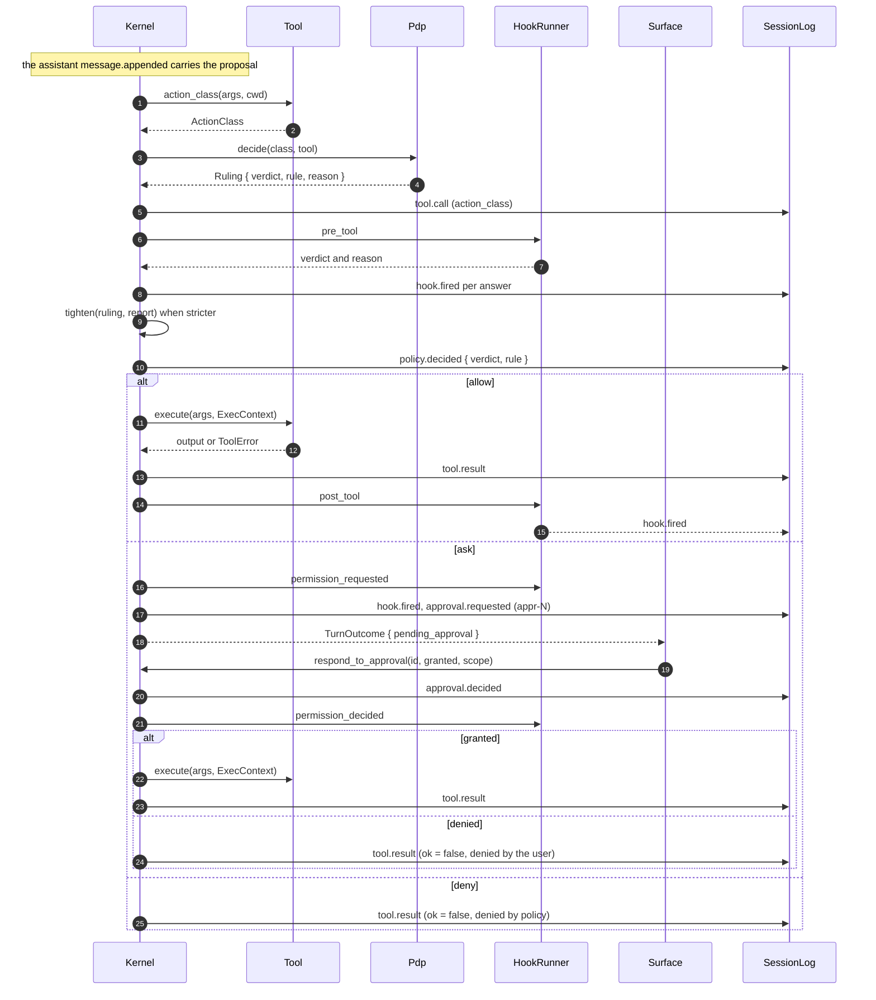

# Flow: one tool approval

- **Up:** [tools-permissions.md](../tools-permissions.md) · [design/README.md](../README.md)
- **Authority:** [ADR-0007](../../decisions/0007-permission-sandbox-engine.md) · [ADR-0004](../../decisions/0004-microkernel-extension-model.md)
- **Code:** `crates/kernel/src/turn/loop.rs`, `crates/tools/src/lib.rs`, `crates/sandbox/`
- **Verify:** `cargo test -p loong-kernel -p loong-tools -p loong-sandbox` · `./scripts/check.sh`

A registry tool call passes one gate: the model proposes, `Kernel::dispatch` asks
one policy decision point (PDP) for allow / ask / deny plus the rule, and only then
does `Kernel::execute` run the tool. This page follows one call from proposal to
result. The interface, the action-class rules and the trust boundaries are owned by
[tools-permissions.md](../tools-permissions.md); where the call sits in a turn is
[turn-lifecycle.md](turn-lifecycle.md).

## 1. Proposal

The model's assistant message carries `tool_calls`. `Kernel::run_inner` records the
assistant `message.appended` once, then calls `Kernel::dispatch(call, &mut events)`
for each call in order. The proposal is not a decision: nothing has run yet.

## 2. Action class

`Tool::action_class(&call.args, &self.config.cwd)` computes the `ActionClass` from
the arguments:

| Class | Meaning | Default ruling |
|---|---|---|
| `Investigate` | read-only, no side effects | allow |
| `WriteWorkspace` | edits inside the workspace | allow |
| `OutOfBounds` | network, outside the workspace, destructive, credentials | ask |

`read_file` uses `classify_read_path`; `write_file` and `edit` use `classify_path`;
`shell` uses `classify_command`; MCP tools use the class declared in
`.loongagent/mcp.toml` (default `out_of_bounds`). The class is a claim by the tool,
not a security boundary: it allocates autonomy, and the PEPs in §7 still enforce.

## 3. The decision and the rule

`Pdp::decide(class, tool_name)` returns `Ruling { verdict, rule, reason }`. The rule
names the layer that set the slot: `builtin:<class>` or
`profile:<layer>:<class>` (for example `profile:org:out_of_bounds`). A lower layer
can only tighten, so the slot already holds the strictest configured verdict.

`Kernel::dispatch` then appends `tool.call` with the class, fires the `pre_tool`
hooks (`hook.fired` per answer), and lets `tighten(&ruling, &report)` replace the
ruling only when the hook report is **stricter**; that rule becomes `hook:<ids>`.
`policy.decided` records the verdict the kernel will act on and the rule that fired:
`{ action_class, verdict, rule }`.

## 4. The three arms

- **Allow** — `Kernel::execute(&call.tool, &call.args)`, then
  `Kernel::record_tool_result` writes `tool.result` with `ok: true` (or `ok: false`
  if the tool itself refused or failed), then the `post_tool` hooks fire.
- **Ask** — the `permission_requested` hooks fire, then `approval.requested` is
  written with `request_id: appr-N`, the action class and the PDP's reason;
  `Kernel::dispatch` returns `Dispatch::Pending` and `Kernel::run_inner` parks the
  turn with `TurnOutcome.pending_approval`. The other calls in the same assistant
  message get `tool.result` "not run" events.
- **Deny** — `tool.result` with `ok: false` and
  `denied by policy (<rule>): <reason>`. The model reads it and continues; a denial
  is not an error.

## 5. Approval: request and response

The surface asks the person, then calls `Kernel::respond_to_approval(request_id,
granted, scope, reason)`. Nothing pending, or a wrong id, is
`KernelError::OutOfOrder`. The answer appends `approval.decided` (`request_id`,
`granted`, `scope`, optional `reason`) and fires the `permission_decided` hooks.

- **Granted**: `Kernel::execute` runs the same call with the same `ExecContext` —
  the approval buys permission, not a different confinement. `tool.result` and the
  `post_tool` hooks follow.
- **Denied**: no execution. `tool.result` is `ok: false` with
  `denied by the user: <reason>` (or `denied by the user`).

Then `Kernel::run` resumes the same turn so the model sees the decision as history.
`scope` is recorded on the event; today the kernel answers the one parked call, and
nothing persists a grant beyond it.

## 6. `/yolo`

`Kernel::set_auto_approve(true)` appends `permissions.relaxed` and flips
`Kernel.auto_approve`. In the ask arm the call then executes instead of parking, and
the log says why: a second `policy.decided` (`verdict: allow`, `rule:
yolo:<Class>`) and a second `tool.call` are written before execution. The sandbox is
a different axis and still applies.

## 7. Confinement: the two PEPs

`Kernel::execute` builds `ExecContext::new(&self.config.cwd,
self.confinement.as_ref())` and calls `Tool::execute`. Two enforcers back the
decision:

- **The tool runner.** `write_file` and `edit` re-check `classify_path` and refuse a
  target outside the workspace, even if the action class claimed otherwise.
- **The OS sandbox.** Children spawn through `loong_proc` with
  `ctx.confinement.confine`; on Linux `LandlockConfinement` installs a `pre_exec`
  hook that applies `WorkspacePolicy` in the forked child: read-only `/`,
  read-write workspace, `PR_SET_NO_NEW_PRIVS`. When Landlock is unavailable the
  kernel uses `NoConfinement` and reports `unconfined: …` from
  `Kernel::confinement_note()`.

`/yolo` relaxes the ask arm only; this axis is untouched. `recall` is the one bypass:
`Kernel::dispatch` answers it before the registry and the PDP, with a `tool.call`
(`Investigate`) and a `tool.result`.

## 8. One approval, in sequence

The order is fixed: the class, `pdp.decide`, `tool.call`, the `pre_tool` hooks, the
stricter `policy.decided`, and only then an execution or a question.

## 9. Where to read next

- [tools-permissions.md](../tools-permissions.md) — the interface, the classes, the
  PDP ladder and the two enforcers in full.
- [ADR-0007](../../decisions/0007-permission-sandbox-engine.md) — the ladder and the rule.
- [ADR-0008](../../decisions/0008-configuration-layering.md) — narrowing only.
- [turn-lifecycle.md](turn-lifecycle.md) — where the proposal and the result sit.
- `crates/kernel/src/turn/tests.rs` —
  `opting_out_of_prompts_allows_the_action_and_says_so_in_the_log`,
  `a_granted_approval_still_cannot_escape_the_workspace`.
