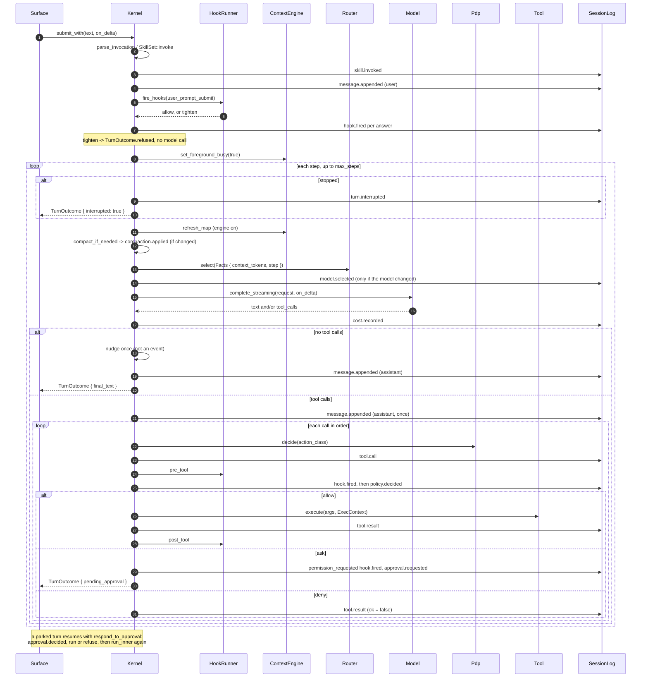

# Flow: one turn

- **Up:** [kernel-loop.md](../kernel-loop.md) · [design/README.md](../README.md)
- **Authority:** [ADR-0004](../../decisions/0004-microkernel-extension-model.md) · [ADR-0006](../../decisions/0006-context-engine.md)
- **Code:** `crates/kernel/src/turn/loop.rs`, `crates/kernel/src/turn.rs`
- **Verify:** `cargo test -p loong-kernel` · `./scripts/check.sh`

A **turn** is one `Kernel::submit_with` call. This page is the end-to-end sequence:
the intent, the context put in front of the model, the tool calls, the approval
seam, and the event that ends it. The step loop and the endings are owned by
[kernel-loop.md](../kernel-loop.md); the tool gate is
[tool-approval.md](tool-approval.md). Event kinds are declared in
`crates/schema/protocol.toml`.

## 1. Intent, command and the first events

`Kernel::submit_with` (`crates/kernel/src/turn/loop.rs`) clears the stop flag, refuses
while an approval is still pending (`KernelError::OutOfOrder`), and expands the text:

- **A command** — `parse_invocation` recognises `/name args`, `SkillSet::invoke`
  returns the expansion, and an MCP prompt with no local body is fetched by
  `Kernel::fetch_mcp_prompt`. A successful expansion appends `skill.invoked`; an
  unknown name or a failed fetch appends `skill.invoked` with `error` and returns
  `TurnOutcome.refused` before any model call.
- **Plain text** — used as written.

Then `Kernel::record_user` appends `message.appended` (`role: user`) and pushes the
same text into the ledger and `Kernel.messages` in lockstep. The `user_prompt_submit`
hooks fire through `Kernel::fire_hooks`; each answer is a `hook.fired` event, and a
report that tightens the ruling ends the turn with `refused: Some(...)` — there is no
approval seam for a prompt, so an unanswered `ask` fails closed. Only then does
`Kernel::run` start: it sets the context engine's foreground busy, calls
`Kernel::run_inner`, and clears the flag on every return path.

## 2. Context, routing, model call

Each iteration is one model completion:

1. **Stop check.** If `Kernel.interrupted` is set, `run_inner` appends
   `turn.interrupted` and returns at once. The check is at the step boundary, so a
   tool that has begun finishes.
2. **Context preparation.** `Kernel::refresh_map` refreshes the L4 map in place when
   the engine is on (`Ledger::replace`, no event). `Kernel::compact_if_needed` clears
   stale tool output and, with the engine off, drops the oldest exchanges; it appends
   `compaction.applied` only when something changed. The trigger and the saving are
   [context-ledger.md](../context-ledger.md) §4.
3. **Request.** `CompletionRequest` carries `self.messages.clone()` and
   `Kernel::tool_specs()`; `recall` joins the specs only when the engine is on.
4. **Route.** `Router::select(&Facts { context_tokens, step })` returns a model and a
   rule; a model this session does not have falls back to `selected_model`. A change
   appends `model.selected` through `Kernel::record_model_selected`.
5. **Model call.** `Model::complete_streaming(&request, on_delta)` answers with text,
   tool calls, or both; a provider error is `KernelError::Model` and ends the turn.
   `Kernel::record_cost` appends `cost.recorded` for every completion.

## 3. A tool proposal, and the next step

When the response has **no tool calls**, `run_inner` first offers one nudge: a
`leaked_tool_call` or a `looks_like_pasted_file` reply (the latter only while nothing
has run) gets one correction pushed into `Kernel.messages` and another step. That
correction is not a `message.appended` event and adds no ledger entry. Otherwise
`Kernel::record_assistant` appends the assistant `message.appended` and the turn
returns `final_text`.

With **tool calls**, `run_inner` records the assistant message once, then calls
`Kernel::dispatch` for each call in order. Each dispatch is the gate described in
[tool-approval.md](tool-approval.md): `tool.call`, any `pre_tool` `hook.fired`,
`policy.decided`, then `tool.result` and any `post_tool` `hook.fired`. The loop feeds
the results back and takes the next step.

A dispatch that **parks** returns `Dispatch::Pending`: the kernel stores the
`PendingCall`, answers every later call in the same assistant message with a
`tool.result` saying `not run: the turn stopped to ask about appr-N first`, and
returns `pending_approval`. A provider requires one result for every call it was
shown, so those "not run" events are not optional.

## 4. Approval resumes the same turn

The surface answers through `Kernel::respond_to_approval(request_id, granted, scope,
reason)`. A mismatched id, or nothing pending, is `KernelError::OutOfOrder`. A grant
appends `approval.decided`, fires the `permission_decided` hooks, runs the same
`Kernel::execute` PEP, records `tool.result`, fires `post_tool`, and calls
`Kernel::run` again. A refusal records `approval.decided` and a `tool.result` with
`ok: false` and `denied by the user`, then resumes the loop so the model sees the
decision as ordinary history. The stop flag is deliberately not cleared here: a stop
asked while the question was open still belongs to this turn.

## 5. The endings

| Ending | What the log shows | `TurnOutcome` |
|---|---|---|
| Answered | the final assistant `message.appended` | `final_text`, `steps` |
| Asked | `approval.requested`, plus the "not run" results | `pending_approval` |
| Stopped | `turn.interrupted` | `interrupted: true` |
| Step limit | an assistant `message.appended` with the limit note | `final_text`, `steps = max_steps` |
| Refused | `skill.invoked` with `error`, or a tightening `hook.fired` | `refused`, `steps: 0` |
| Error | whatever was written before the failure | `Err(KernelError)` |

A tool that fails, or a `policy.decided` that denies, is not a failed turn: the
result is `ok: false`, the model reads it, and the loop continues. Only a model
transport error, a log write, an encode failure, or an out-of-order API call ends
the turn with `Err`.

## 6. One turn, in sequence

`Kernel::run` clears the foreground-busy flag on every path, including the error and
approval paths. The surface answers a parked turn with `approval.respond`, and the
kernel resumes the same turn rather than starting a new one.

## 7. Where to read next

- [kernel-loop.md](../kernel-loop.md) §2, §5 and §6 — the step loop, the approval
  seam, and the endings in detail.
- [tool-approval.md](tool-approval.md) — the gate from proposal to `tool.result`.
- [context-ledger.md](../context-ledger.md) §4 — what `compact_if_needed` changes.
- [events-storage.md](../events-storage.md) — the envelope every event is written in.
- `crates/kernel/src/turn/tests.rs` — the endings above, pinned.
