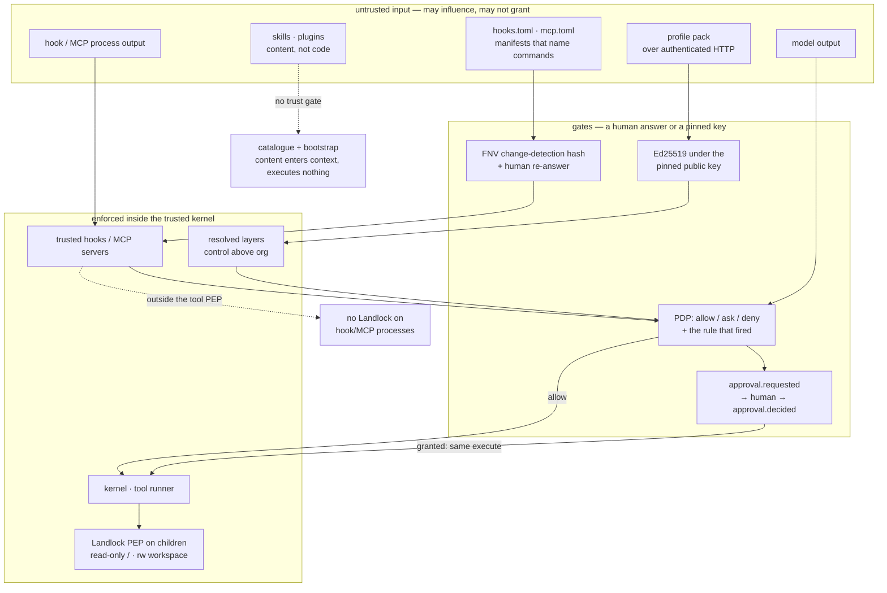

# Security and trust: what is trusted, and what enforces it

- **Up:** [design/README.md](README.md) · [04 System overview](../04-system-overview.md)
- **Authority:** [ADR-0007](../decisions/0007-permission-sandbox-engine.md) · [ADR-0016](../decisions/0016-pack-distribution.md) · [ADR-0018](../decisions/0018-plugin-install-and-bootstrap.md)
- **Code:** `crates/sandbox/`, `crates/manifest/`, `crates/pack/`, `crates/config/src/secret.rs`, `crates/hooks/src/config.rs`
- **Verify:** `cargo test -p loong-sandbox -p loong-manifest -p loong-pack` · `./scripts/check.sh`

Trust here is not "where a byte came from". It is the pair of questions this repository keeps
asking: **what does this thing have to prove before it can affect a session, and what mechanism
makes the proof hold when the thing is wrong?** The map below is the trust face of the same
architecture [tools-permissions.md](tools-permissions.md) describes from the decision side: the
PDP chooses, the PEPs enforce, and the kernel is not extensible at that seam.

## 1. The boundaries

| Boundary | What is trusted | Who signs / owns it | What enforces it |
|---|---|---|---|
| **Generated schema** | The wire contract and event names, generated from `crates/schema/protocol.toml` and compiled into the server and Rust clients. | The repository; generated output is a build artifact, not a trust root. | `scripts/gen-schema.py --check` and the generated roundtrip test; `session.attach` returns a version signal, not a negotiation. |
| **Local org layer** | `/etc/loongagent/profile.toml` (`%PROGRAMDATA%\loongagent\profile.toml` on Windows): administrator-owned policy. | The machine's administrator. **Unsigned**; file ownership is the whole protection. | Layer precedence: `control` ranks above `Org`; the order and the unsigned-file claim are owned by [config-routing.md](config-routing.md) §1 and §5. Never call it tamper-resistant. |
| **Profile pack** | A payload that verified under the public key this install pinned out of band. | Signed by the control plane's Ed25519 key; the client holds only the public key. | `Envelope::verify` before it can become the locked `control` layer; fields, verify order, cache and lock are owned by [config-routing.md](config-routing.md) §4–§5. |
| **Manifest: `hooks.toml` / `mcp.toml`** | Repository content that names commands; inert until a human trusts it. | Repository author; the record is a human trust decision, not a signature. | `HookSet::active` / `McpSet::active` gate every load; hash coverage and the trust commands are owned by [config-routing.md](config-routing.md) §6 and [extension-model.md](extension-model.md) §1. |
| **Hooks** | Three kinds may answer allow / ask / deny only; HTTP is off unless opted in. | Repository author or MCP server; the manifest trust record is the gate. | `tighten` accepts only a stricter verdict; aggregation, `on_error` and the unconfined-child limit are owned by [extension-model.md](extension-model.md) §1. |
| **Sandbox / PDP / PEP** | Fixed kernel code decides; the OS enforces. Not a plugin, model or config file. | Repository; not signed at runtime. | `Pdp::decide` / `tighten_from`, `Kernel::execute` and Landlock are owned by [tools-permissions.md](tools-permissions.md) §4. |
| **Secrets** | A reference to a credential, not the value; a pack may carry a literal visibly. | Person or machine holding the value; a pack literal is administrator-owned. | `check_secret_reference` / `resolve_reference` at load and use; forms, warnings and the plaintext cache are owned by [config-routing.md](config-routing.md) §5 and §9. |
| **Approval** | A human answer to one `approval.requested`, with a scope and an optional reason. | The person at the surface; recorded as an event, not signed. | `Kernel::respond_to_approval` checks the request id and records `approval.decided`; the seam and the same-execute rule are owned by [kernel-loop.md](kernel-loop.md) §5. |

## 2. The shape of the boundary

Three things are load-bearing and easy to miss in the table.

**The decision is not the enforcement.** A PDP bug can return `allow` for an out-of-bounds
action; it cannot by itself make Landlock permit a write outside the workspace. Conversely, an
enforcement bug still leaves the recorded `policy.decided` showing what should have happened.
That is why the decision and the OS rule are separate components (ADR-0007 §1–§2).

**A lower layer narrows, never widens.** The monotonic rule is checked in the PDP itself, so a
session or hook cannot undo an org `deny`. Hooks add a second, independent narrowing: their
report is aggregated deny-first and can only replace a ruling with a stricter one
([extension-model.md](extension-model.md) §1).

**The untrusted inputs are many, the gates are few.** Repository manifests, skills and plugin
content, a pack on the wire, model output and hook/MCP responses can all influence a session.
Only a human trust decision, a pinned-key signature, the PDP (narrowed by trusted hooks) and an
approval turn influence permission. Content entering context is not permission; a hook verdict
is a narrowing input, not a grant.

Skills and plugins are content, not code: a plugin install executes nothing (ADR-0018), and
the skills catalogue has no signature or trust record — its risk is the context it enters, not
execution ([extension-model.md](extension-model.md) §2 and §4).

## 3. The honest gaps

These are the places where the boundary is weaker than a reader of the ADRs would assume. Each
is a property of the code today, not a future plan.

- **HTTP hooks are repo-trust-only.** `run_http` posts directly, so the gates are repository
  trust plus `allow_http_hooks`; the ADR's network action class and org pin are absent. Detail:
  [extension-model.md](extension-model.md) §1 and §8.
- **MCP servers and hooks are outside the tool PEP.** They start at kernel build or as ordinary
  children; their tool calls still reach `Kernel::dispatch`, but the process itself is
  unconfined. Detail: [extension-model.md](extension-model.md) §1 and §3, and
  [tools-permissions.md](tools-permissions.md) §4.
- **A tool's own in-process I/O is unconfined.** `Tool::execute` runs in the server process, so
  a custom tool's `Command::spawn` or in-process write is outside both the sandbox and the
  built-in guards ([tools-permissions.md](tools-permissions.md) §5).
- **The pack can still carry a literal secret.** A non-reference value is accepted with a
  warning and then sits in the pack and every cache; [config-routing.md](config-routing.md) §9
  owns the trade.
- **The approval scope is recorded, not honoured.** `approval.decided` carries `once`,
  `action_class` or `project`, but no persistent grant store exists, so the wider scopes have no
  effect beyond the audit trail (the seam itself is [kernel-loop.md](kernel-loop.md) §5).
- **OS confinement is Linux-only and can be absent.** Landlock is the implemented PEP; without
  it the kernel falls back to `NoConfinement` with a warning. Detail:
  [tools-permissions.md](tools-permissions.md) §4.
- **The installed binary has no signature check.** ADR-0009 §6 says update artifacts are
  verified like packs, but there is no updater or binary verifier in the tree
  ([ADR-0009](../decisions/0009-surfaces.md) §6).
- **The client verifier does not check `artifact` or `scope`.** [config-routing.md](config-routing.md)
  §9 owns the verifier gap.
- **The local org file is unsigned by design.** [config-routing.md](config-routing.md) §5 owns
  the distinction; a root user can edit it, the cached pack or the binary.
- **The shared client token is not identity.** [control-plane.md](control-plane.md) §7 names the
  unbuilt identity job.

## 4. Where to read next

- [tools-permissions.md](tools-permissions.md) — the PDP, the two enforcers, and why a tool
  cannot widen the confinement.
- [extension-model.md](extension-model.md) — hooks, MCP, skills and plugins: what each may do
  and what its trust gate covers.
- [config-routing.md](config-routing.md) — the layers, the signed pack, the local org file and
  the pre-gateway router.
- [control-plane.md](control-plane.md) — where the signing key lives and what the control plane
  can and cannot mint.
- [ADR-0007](../decisions/0007-permission-sandbox-engine.md), [ADR-0016](../decisions/0016-pack-distribution.md),
  [ADR-0018](../decisions/0018-plugin-install-and-bootstrap.md) — the decisions behind the
  boundaries.
- `crates/kernel/src/turn/loop.rs` — `dispatch`, `respond_to_approval` and `set_auto_approve`,
  where the decisions and the approval seam are recorded; `crates/sandbox/src/sandbox.rs` — the
  self-test that proves denial instead of reporting availability.
