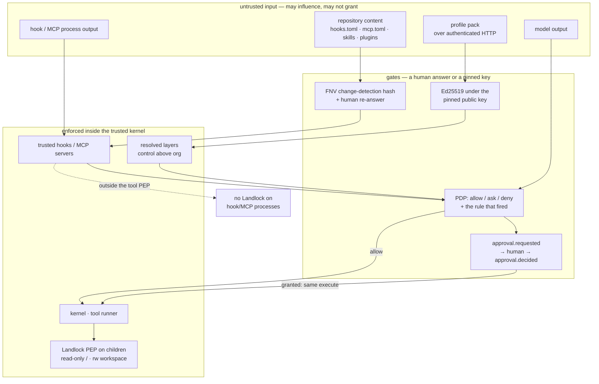

# Security and trust: what is trusted, and what enforces it

- **Up:** [design/README.md](README.md) · [04 System overview](../04-system-overview.md)
- **Authority:** [ADR-0007](../decisions/0007-permission-sandbox-engine.md) · [ADR-0016](../decisions/0016-pack-distribution.md) · [ADR-0018](../decisions/0018-plugin-install-and-bootstrap.md)
- **Code:** `crates/sandbox/`, `crates/manifest/`, `crates/pack/`, `crates/config/src/secret.rs`, `crates/hooks/src/config.rs`
- **Verify:** `cargo test -p loong-sandbox -p loong-manifest -p loong-pack` · `./scripts/check.sh`

Trust here is not "where a byte came from". It is the pair of questions this repository keeps
asking: **what does this thing have to prove before it can affect a session, and what mechanism
makes the proof hold when the thing is wrong?** The map below is the trust face of the same
architecture [tools-permissions.md](tools-permissions.md) describes from the decision side: the
PDP chooses, the PEPs enforce, and the kernel is not extensible at that seam.

## 1. The boundaries

| Boundary | What is trusted | Who signs / owns it | What enforces it |
|---|---|---|---|
| **Generated schema** | The wire contract and event names: `crates/schema/protocol.toml` generates the Rust types compiled into the server and the Rust clients, plus the TypeScript types and samples. | The repository. Not signed; generated output is a build artifact, not a distributed trust root. | `scripts/gen-schema.py --check` in `./scripts/check.sh`, the generated roundtrip test in `cargo test -p loong-schema`, and `schema_version` returned by `session.attach` (a version signal, not a negotiation). |
| **Local org layer** | `/etc/loongagent/profile.toml` (`%PROGRAMDATA%\loongagent\profile.toml` on Windows): administrator-owned policy. | The machine's administrator. **Unsigned** — file ownership is the whole protection. | Layer precedence: the verified `control` layer ranks immediately above `Org`, so a stale org file cannot shadow a pack; lower layers may narrow but not widen. Never call it tamper-resistant ([config-routing.md](config-routing.md) §1, §5). |
| **Profile pack** | A payload that has verified under the public key this install pinned out of band. | Signed by the control plane's Ed25519 key; authored by a profile administrator; the client holds only the public key. | `Envelope::verify`: known payload schema, `key_id` matches the pinned key, Ed25519 signature over the canonical envelope. The cache is written only after verification; a rejected pack never falls back to the cache. `control` keys are locked. Client verification does **not** check `artifact` or `scope` ([config-routing.md](config-routing.md) §9). |
| **Manifest: `hooks.toml` / `mcp.toml`** | Repository content that names commands, so it can execute. | The repository author; the human records trust in `hooks.trusted` / `mcp.trusted`. **Unsigned**; the record is FNV-1a change detection, not a signature. | `HookSet::active` / `McpSet::active` return nothing until every source's recorded hash matches. Hooks hash `hooks.toml` plus every shell script it names; MCP hashes **`mcp.toml` only**. `loongagent hooks trust` / `mcp trust` write the record; editing a byte re-arms the question. |
| **Hooks** | The three hook kinds: shell script, HTTP endpoint, MCP tool. They may answer allow / ask / deny, never more. | The repository author (shell/HTTP) or an MCP server; the trust record above is the gate. HTTP is additionally off unless `allow_http_hooks = true`. | `tighten` accepts only a stricter verdict (`deny > ask > allow`), so a hook cannot widen the PDP; `on_error` is deny by default; a failure is recorded. A shell hook is an ordinary child process with **no Landlock confinement**; an HTTP hook is `http://` only and repo-trust-only ([extension-model.md](extension-model.md) §1). |
| **Sandbox / PDP / PEP** | The fixed kernel code that decides, and the OS mechanism that enforces. Not a plugin, not a model, not a config file. | The repository; the binary is not signed at runtime. The PDP's ladder is resolved configuration, never model output; hooks may only narrow it. | `Pdp::decide` returns allow / ask / deny **plus the rule**; `tighten_from` refuses to widen. `Kernel::execute` is the tool-runner PEP; a write tool re-checks its path. `LandlockConfinement` installs a `pre_exec` rule (read-only `/`, read-write workspace, no new privileges) on children a built-in spawns through `loong_proc` with `ctx.confinement`; `sandbox self-test` proves the boundary before the first tool call ([tools-permissions.md](tools-permissions.md) §4). |
| **Secrets** | The *reference* to a credential — `env:NAME`, `file:PATH`, `file:PATH#KEY`, `keychain:…`, `gateway:…` — not the value. | The person or machine that holds the value; a pack may carry a literal, visibly. | `check_secret_reference` refuses a literal or a malformed reference in local configuration; `resolve_reference` reads the value at use. A pack's literal is accepted with a recorded warning (publish, load and `GET /v1/health` show it). `keychain:` and `gateway:` are reserved spellings with no store behind them. |
| **Approval** | A human's answer to one `approval.requested`, with a scope and an optional reason. | The person at the surface; the decision is recorded as an event, not signed. | `Kernel::respond_to_approval` refuses an unknown or stale `request_id`, writes `approval.decided` either way, and runs the **same** `Kernel::execute` and confinement on a grant. `/yolo` relaxes only the ask arm and records `permissions.relaxed`. |

## 2. The shape of the boundary

Three things are load-bearing and easy to miss in the table.

**The decision is not the enforcement.** A PDP bug can return `allow` for an out-of-bounds
action; it cannot by itself make Landlock permit a write outside the workspace. Conversely, an
enforcement bug still leaves the recorded `policy.decided` showing what should have happened.
That is why the decision and the OS rule are separate components (ADR-0007 §1–§2).

**A lower layer narrows, never widens.** The monotonic rule is checked in the PDP itself, so a
session or hook cannot undo an org `deny`. Hooks add a second, independent narrowing: their
report is aggregated deny-first and can only replace a ruling with a stricter one.

**The untrusted inputs are many, the gates are few.** Repository manifests, skills and plugin
content, a pack on the wire, model output and hook/MCP responses can all influence a session.
Only a human trust decision, a pinned-key signature, the PDP (narrowed by trusted hooks) and an
approval turn influence permission. Content entering context is not permission; a hook verdict
is a narrowing input, not a grant.

## 3. The honest gaps

These are the places where the boundary is weaker than a reader of the ADRs would assume. Each
is a property of the code today, not a future plan.

- **HTTP hooks are repo-trust-only.** `run_http` posts the event payload directly. The gates are
  the trust record on the repository and `allow_http_hooks = true` in the manifest; the ADR's
  "network action class under the PDP, org-pinnable" is not implemented, and the loader accepts
  only `http://`, so the payload can leave the machine in the clear. An HTTP hook is the one
  **hook** kind that sends data off the machine, and its only trust question is "did you trust
  this repository?" ([extension-model.md](extension-model.md) §1).
- **MCP servers and hooks are outside the tool PEP.** An MCP server is started by
  `McpClient::start` at kernel build, not from a tool call, so `ExecContext` confinement never
  reaches it; a trusted shell hook is an ordinary child of the server. Their *tool calls* still
  go through `Kernel::dispatch` and the PDP, and an MCP hook call goes direct through
  `KernelMcp`, not the PDP. The barrier is the trust gate, not confinement
  ([tools-permissions.md](tools-permissions.md) §4).
- **A tool's own in-process I/O is unconfined.** `Kernel::execute` runs `Tool::execute` in the
  server process. A built-in `write_file`/`edit` re-checks its path, and any child spawned
  through `loong_proc` with `ctx.confinement` is confined — but a custom tool that calls
  `Command::spawn` itself, or writes outside the workspace in-process, is caught by neither the
  sandbox nor the built-in guard. The interface cannot prevent it; the tool contract forbids it
  ([tools-permissions.md](tools-permissions.md) §5).
- **The pack can still carry a literal secret.** `check_pack_secret` accepts a value that is
  not a reference and records a warning; the value then sits in the signed payload, the control
  plane's `profiles.json` and every install's cache. Local configuration refuses a literal
  outright; the pack is the deliberate, visible exception ([config-routing.md](config-routing.md)
  §9).
- **The approval scope is recorded, not honoured.** `approval.decided` carries `once`,
  `action_class` or `project`, but there is no persistent grant store: the next matching call
  asks again. A `once` scope does not need one; the wider scopes currently have no effect
  beyond the audit trail.
- **OS confinement is Linux-only and can be absent.** Landlock is the implemented PEP; seatbelt
  and Windows Job Objects are decided, not built. Without Landlock the kernel falls back to
  `NoConfinement` and the startup log says so; `sandbox self-test` reports `UNAVAILABLE` or
  `Broken` rather than a comfortable "present". `bubblewrap` is detected and named, not applied.
- **The installed binary has no signature check.** ADR-0009 §6 says update artifacts are
  verified like packs; there is no updater or binary verifier in the tree. Installation is
  trusted out of band, and the pack signature protects policy, not the executable that reads it.
- **The client verifier does not check `artifact` or `scope`.** The control plane refuses to
  publish a wrong artifact, but `Envelope::verify` alone would accept another artifact id
  carrying the profiles schema; scope is covered by the signature but not compared to the
  intended audience.
- **The local org file is unsigned by design.** A root user can edit it, the cached pack, or the
  binary. The signature protects the wire and the repository, not a machine whose administrator
  is the attacker.
- **The shared client token is not identity.** Every install can read the same pack; there is no
  per-user authentication or authorisation. That is [control-plane.md](control-plane.md)'s
  unbuilt identity job, not a hidden property of the pack.

## 4. Where to read next

- [tools-permissions.md](tools-permissions.md) — the PDP, the two enforcers, and why a tool
  cannot widen the confinement.
- [extension-model.md](extension-model.md) — hooks, MCP, skills and plugins: what each may do
  and what its trust gate covers.
- [config-routing.md](config-routing.md) — the layers, the signed pack, the local org file and
  the pre-gateway router.
- [control-plane.md](control-plane.md) — where the signing key lives and what the control plane
  can and cannot mint.
- [ADR-0007](../decisions/0007-permission-sandbox-engine.md), [ADR-0016](../decisions/0016-pack-distribution.md),
  [ADR-0018](../decisions/0018-plugin-install-and-bootstrap.md) — the decisions behind the
  boundaries.
- `crates/kernel/src/turn/loop.rs` — `dispatch`, `respond_to_approval` and `set_auto_approve`,
  where the decisions and the approval seam are recorded; `crates/sandbox/src/sandbox.rs` — the
  self-test that proves denial instead of reporting availability.
