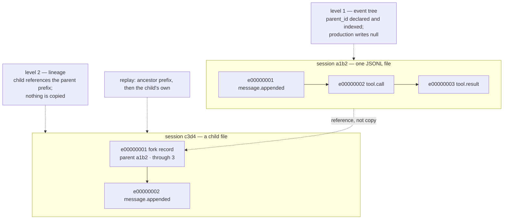

# Sessions and lineage: one file, one event tree, one parent edge

- **Up:** [design/README.md](README.md) · [04 System overview](../04-system-overview.md)
- **Authority:** [ADR-0003](../decisions/0003-jsonl-truth-sqlite-index.md) · [ADR-0014](../decisions/0014-session-export-import.md) · [ADR-0015](../decisions/0015-two-tree-levels.md)
- **Code:** `crates/server/src/lib.rs`, `crates/kernel/src/turn/session.rs`, `crates/eventlog/src/lib.rs`
- **Verify:** `cargo test -p loong-server -p loong-kernel -p loong-eventlog` · `./scripts/check.sh`

A **session** is one append-only JSONL file and one unit of work: attach, write token, cost,
permission binding, and listing all belong to it (ADR-0015). Inside the file, events carry
`id` and `parent_id`, which makes an **event tree** possible. Between files, a session may
name a parent, which makes **lineage** (ADR-0015). The code keeps those two levels apart by
building the second and only declaring the first. This document is the lifecycle view; the
record itself is owned by [events-storage.md](events-storage.md).

## 1. A session is its file

The file's name is the session's id. A fresh project mints `<id>.jsonl`; the legacy first
name `session.jsonl` is kept and answers to `default`, and later sessions are `<id>.jsonl`
in `~/.loongagent/projects/<project-slug>/`. A new id is eight characters from a clock and
the process, in an alphabet with the easily confused pairs removed. A project is a directory
and its slug carries a hash, so two checkouts do not share a conversation by accident.

The server owns the open log for the session it serves. `session.new` asks the CLI's factory
for a fresh id and a fresh kernel, swaps `Server.kernel`, and resets `last_sent` and `turns`
so the new session's events are not streamed as the old session's past. The old log is kept.
`session.attach` reports the current id, schema version and `existing_events` (the log's
`last_seq`); `session.replay` reads the log again with `replay_lenient`, so a client that
joins late can render the past. The derived SQLite index is rebuilt from the log when the
kernel opens; it is never the thing the wire replays.

## 2. Inside: the event tree

Level 1 is **declared, validated and indexed, and production writes none of it**: `parent_id`
exists on the envelope and is checked when set, but `Kernel::append` always passes `None`, and
only tests pass a parent. A real session is a flat sequence — no path, no head, no retry
branch. The tree mechanics are owned by [events-storage.md](events-storage.md) §5.

## 3. Between: lineage

A child session references its parent instead of copying it, and `Kernel::lineage` plus
`Kernel::replay_history` stitch the ancestor prefix to the child's own events. The reference,
the replay, and the labels that mark inherited history are owned by
[events-storage.md](events-storage.md) §5. What this document owns is the lifecycle: only
`fork` produces a child today; the schema also names `delegation` and `import`, and neither
has a writer. A missing ancestor is fatal — the session names the chain and refuses to open,
because without its prefix it is inoperable (ADR-0014, ADR-0015).

## 4. Fork semantics

`loongagent fork [ID] [--at SEQ]` is a CLI command, not a wire method. With no id it takes the
project's newest session. The fork point defaults to the parent's last event; `--at` accepts
an earlier `seq` and refuses zero or a number past the end. The child is created with
`create_new` in the parent's directory and receives exactly one event recording the parent
and the point. Nothing is copied: the child's effective context is the ancestor prefix plus
its own events, assembled by `replay_history`.

`loongagent delete ID` removes the whole **branch** — the session and every descendant —
because deleting a parent alone would leave children that refuse to open. It prints the
branch first, refuses a multi-session branch without `--force`, and by default refuses while
another process holds a session open (`--force` overrides; the check reads `/proc` and is
Linux-only), since unlinking a file a writer is appending to loses the conversation silently.

## 5. Resume, retry, steer

| Action | What the code does | Session boundary |
|---|---|---|
| **Resume** | `loongagent resume [ID]` opens the existing log (`Kernel::open`), `replay_history` rebuilds the conversation, attach/replay refill the surface. | Same session. |
| **Retry** | In the TUI, `Alt+R` resends the last prompt to the model selected now. The history is kept: a resend is a new turn, not a rewind. | Same session, no new path. |
| **Steer** | Not implemented. There is no channel that delivers a message to a running turn; the only mid-turn control is interrupt (`Ctrl-C`), which ends it. | — |

**Resume** is a disk read, not a process resume. A parked approval lives only in
`Kernel.pending` in memory, so a restarted process does not resume the question; the person
starts a new turn. `session.replay` is lenient by design, and the kernel's own replay drives
the conversation.

**Retry** keeps history because the evidence about what failed is the useful part. It sends
`PromptSubmit` again in the same session and adds a new user `message.appended`; it does not
create a path, a head, or a child session. ADR-0015's "retry creates a new path in the same
session" is vocabulary the code has not implemented. In the TUI, `Alt+R` refuses while a turn
is running.

**Steer** has no implementation. The TUI lets a person type and send while a turn runs, but
the worker loop is busy in `client.submit_with`, so the next command waits in the channel and
runs as the **next turn** afterwards. That is a follow-up, not steering: the running model
never sees it. `interrupt` is the only control that reaches a turn already in progress.

## 6. Export and import: decided, not built

ADR-0014 decides file-based continuity: `loongagent session export <id>` would write one
bundle containing the session's **complete** event tree, its **ancestor sessions** (required,
because a child references its parent's prefix), a manifest (schema version, ids, export
time, source workspace, git revision and dirty state, profiles, the plugin/MCP/skill
inventory), and optionally file-history snapshots. Import would verify the bundle, re-bind
the workspace, report dependency and revision mismatches, and grant nothing: approvals,
policy, credentials and resolved configuration never travel.

None of that exists in the code. `loongagent`'s usage lists no `session export` or
`session import`, the protocol declares no such method, and the fork record's schema names
`import` as an origin but nothing writes it. `docs/04-system-overview.md` names export/import
in its "decided, not yet built" list for the same reason. Copying a JSONL file by hand works
because the format is readable, but it is not the feature: there is no bundle, no checksum,
no manifest, no collision handling, and no import-time warning. The local index is rebuilt
from whatever log is opened, so a copied log remains usable; a copied **child** still needs
its ancestors.

## 7. The shape

## 8. Known gaps

- **Level 1 has no production writer.** `parent_id` is declared and indexed, but production
  appends `None`; the tree mechanics are [events-storage.md](events-storage.md) §5, and
  paths, heads and retry branches do not exist.
- **Only fork creates a child session.** `delegation` and `import` are named in the
  schema and unused; subagents are not built.
- **Fork is CLI-only.** There is no `session.fork` wire method, so a remote surface cannot
  branch a session.
- **Export/import is a decision.** No command, no bundle format, no checksum, no import
  path; the only continuity today is moving the file by hand.
- **Resume does not restore a parked approval.** `Kernel.pending` is in memory only.

## 9. Where to read next

- [ADR-0003](../decisions/0003-jsonl-truth-sqlite-index.md) — why the JSONL log is the truth
  and SQLite is derived.
- [ADR-0014](../decisions/0014-session-export-import.md) — the bundle, its required
  ancestors, and why authority never travels.
- [ADR-0015](../decisions/0015-two-tree-levels.md) — the two levels and the vocabulary
  ("path", "head", "branch").
- [events-storage.md](events-storage.md) — the envelope, the append path, the index, and the
  storage-side account of both levels.
- `crates/kernel/src/turn/session.rs` — `lineage` and `replay_history`, the two functions
  that make a child runnable.
- `crates/cli/src/session.rs` — `fork`, `delete`, `resume`, and the branch arithmetic. The flow is [resume-fork.md](flows/resume-fork.md).
