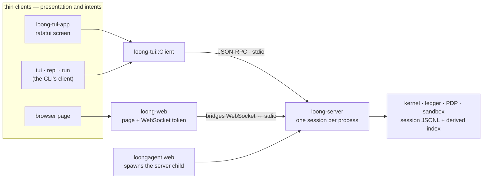

# Surfaces: one server, many thin clients

- **Up:** [design/README.md](README.md) · [04 System overview](../04-system-overview.md)
- **Authority:** [ADR-0001](../decisions/0001-one-binary-client-server.md) · [ADR-0002](../decisions/0002-json-rpc-wire-protocol.md) · [ADR-0009](../decisions/0009-surfaces.md) · [ADR-0019](../decisions/0019-mid-turn-permissions.md)
- **Code:** `crates/cli/src/main.rs`, `crates/server/src/lib.rs`, `crates/tui/src/lib.rs`, `crates/tui-app/src/lib.rs`, `crates/tui-app/src/history.rs`, `crates/tui-app/src/mark.rs`, `crates/tui-app/src/commands.rs`, `crates/web/src/lib.rs`
- **Verify:** `cargo test -p loongagent -p loong-server -p loong-tui -p loong-tui-app -p loong-web` · `./scripts/check.sh`

The architecture is one local agent server and thin clients that render its event stream and send
intents. The implementation is narrower than the decision in two places: the server speaks
**stdio**, not the unix socket ADR-0001 describes, and a surface **spawns its own server child**
instead of attaching to a per-user daemon — so TUI, web, line mode and headless all speak JSON-RPC.

## 1. The server owns the session while it runs

`loongagent server --stdio` is the only implemented server transport. It builds one kernel,
reads one JSON-RPC line at a time, and writes the events a request produced **before** the
response. `Server::run_stdio` is the loop; `loong_protocol` owns the envelopes; the kernel owns
the log, the ledger, the PDP and the tools.

A session is not a resident object the server holds forever: **the session's JSONL log is the
source of truth**, and the server opens it when it starts. A process that ends leaves the log
behind — plus whatever derived index and memory it built — and the next surface reopens them.
That is what makes "reopen a session" work even though there is no long-lived daemon.

The consequence: two surfaces started at once would open the same log, so the log takes a write
lock and the second is refused with `LogError::Locked` (events-storage.md §3). There is no observer
mode and no takeover event, so the safe shape stays one attached surface per session.

## 2. The CLI is the composition root and the command surface

The single `loongagent` binary contains the server and every command. `main.rs` parses the
arguments and dispatches; the command modules are the only place where the run is assembled:

- **Resolve** the layered configuration (`Args::settings_with_pack`) — local mode or the
  managed layers, then the verified pack as the `control` layer.
- **Build** the kernel: models, tools, hooks, MCP clients, skills, plugins, the PDP and the
  sandbox choice (`serve` and `build_kernel` in `crates/cli/src/server.rs`).
- **Run** the chosen surface: spawn the server child (`tui`, `repl`, `run`, `web`) or run the
  server itself (`server --stdio`); bare `loongagent` (or `tui`) starts fresh; `--session` opens an old one.

So the CLI is not "another surface" in the thin-client sense. It is the composition root that
turns a user's files and flags into one configured server. A surface crate below it receives a
connected client; a form may collect a value, but resolving it and writing it is the CLI's job.

The command surface, grouped by what it does:

| Group | Commands | Talks to a server? |
|---|---|---|
| Session | `server`, `tui`, `resume`, `repl`, `web`, `run`, `sessions`, `fork`, `delete` | yes, or reads the logs |
| Setup | `setup`, `local`, `local semantic`, `profiles`, `use`, `control` | no; writes or shows configuration and the control-plane cache |
| Inspection | `config show`, `config explain`, `context status / verify / rebuild`, `skills list`, `hooks list`, `mcp list`, `plugin list` | some read the logs or the layer files directly |
| Trust | `hooks trust`, `mcp trust`, `plugin add / update / remove` | no; the human decision, recorded on disk |
| Proof | `sandbox self-test`, `sandbox probe` | no |

`loongagent-control` is a separate binary and a different job; [control-plane.md](control-plane.md)
owns it.

## 3. The TUI: two crates, one screen

`loong-tui` is the protocol client and holds **no terminal dependency**. `Client` sends
`session.attach`, `session.replay`, `session.new`, `prompt.submit`, `approval.respond`,
`permissions.set`, `model.list`, `model.select` and `context.explain`, and renders the `event`
and `model.delta` notifications it gets back. `PendingDecision` is assembled from those events,
not from a second source: the approval panel can say which tool and arguments are waiting
because the client already saw the `tool.call` and `approval.requested`.

`loong-tui-app` is the ratatui screen over that client. A turn blocks on I/O, so the client
lives on a worker thread and the screen talks to it over channels; the key handler and drawing
are driven from ratatui's `TestBackend` in the tests. It adds only presentation and intents:
the model picker, context panel, folds, `/yolo`, `/new`, and interrupt (a signal, not a
protocol method); `Ctrl+←`/`Ctrl+→` reorder the model slots (`/left`, `/right` are the typed fallbacks). Local mode writes the new order back to `local.toml`'s `[[models]]`, so the next session starts with it and its first block is the default; a managed profile keeps the order for the run only. A paste arrives as one block; enter during a turn refuses a new prompt; `/yolo` still reaches the control channel. The mouse is captured by default: the wheel scrolls, and a left-drag selects the conversation and copies it on release — see [tui-selection.md](tui-selection.md); `/mouse` hands the mouse back for a terminal-native selection, and Shift-drag stays the terminal's. Server stderr becomes notes in the transcript, and a long note wraps to the page width instead of being clipped.

The prompt keeps a per-project history: ↑/↓ walk the prompts this project asked
(`~/.loongagent/projects/<slug>/history.jsonl`, newest 200, multi-line intact); ↓ past the
newest restores the draft. The arrows belong to the prompt, so the transcript scrolls with
PageUp/PageDown and the wheel. While the walk is live the `@` picker and command menu stay
closed (a recalled `/` or `@` prompt would take the arrows back), the title says `历史 n/m`,
and the file is written best effort — a read-only home costs history, never a prompt.

The screen's slash commands are offered while they are typed: `/` opens a menu above the
input, narrowed by the prefix, one line each; ↑/↓ walks it, enter runs an exact name and only
*completes* a prefix, esc puts it away. The menu sits above the input so a running turn's
status and the command being typed are both visible — `/yolo` is what someone reaches for
during a turn. Menu and dispatcher read one table (`crates/tui-app/src/commands.rs`), so a
spelling the menu offers is always one the dispatcher knows. Anything else still goes to the
agent, where `/help` and the workspace's skills live, and the menu says so.

Two rules keep the prompt title honest. The turn's status always wins it — working,
interrupting, waiting, finished — with the YOLO warning as a mark in front, never a
replacement: a session that stops asking must still look alive. And a question is **paused,
not finished**: no `✓ 完成`, and the clock keeps running because it measures the turn.

`/yolo` must not wait for a turn to end: the launcher gives the server a private control
channel, so it reaches the running kernel at its next boundary and the screen flips at
once (`permissions.relaxed` confirms). Unix: a socketpair; Windows keeps the queued path.

### The TUI's marks and colour

The interface speaks Chinese. Names stay as they are — commands (`/logo`), keys (`enter`),
tools (`read_file`), paths, model output — because a translated name no longer matches what
you type. Everything the screen says in its own voice is Chinese.

The transcript is painted by classification, not by the sender: `classify` reads the line's own
vocabulary (the prefixes `loong-tui` writes) and `style_for` turns that into one palette. It
also accepts the older English vocabulary, so scrolling back into an old session keeps its colour.

| Line | Colour | Why |
|---|---|---|
| `你：…` | the label in cyan, the words plain | where a prompt began when scrolling back; the words themselves stay readable |
| `→ tool …` | teal | the agent is doing something |
| `← 成功 …` | green, dim | a result is evidence, not news |
| `← 失败 …` | red | it did not work |
| `! 需要确认 …` | yellow, bold | the person has to answer |
| `! …` | red, bold | something went wrong |
| `· 规则：…` | violet | a decision about permission, worth finding later |
| `· …` | the terminal's own foreground, dimmed | bookkeeping: skills, tokens, compaction |
| anything else | default | the model's own answer, left alone |

The palette names colours and never invents RGB, because a fixed tone is picked for one
background and unreadable on the other. The same rule is why the quiet lines are the
**terminal's own foreground, dimmed**, and not `DarkGray`: bright black *is* the background
on a dark theme, so the bookkeeping lines were drawn into the wall (`MARK_QUIET`). The
answers not chosen in a decision menu are `default` too; the highlighted one is coloured.

The screen is one page above one fixed prompt. The status line, the keys and the usage row
are the only bars; between them the mark and conversation scroll, while the question, menus,
prompt and usage row stay put, so what is typed and what the session spent stay visible.

    ╔═════════༺ ᛭ ༻═════════╗   ← the mark, scrolled away by the conversation
    ║  ▀█▀▀█▀  ██╗  ██████╗  ║
    ╚═════════༻ ᛭ ༺═════════╝
    ┌ 输入 ─────────────────┐   ← fixed: the page scrolls above it
    └───────────────────────┘
     用量  入 1,053 · 出 5 · 缓存 80% · 上下文 62%

The mark frames the character 龍 — a 16×16 bitmap in half blocks, not a glyph, which at
this size is one square of foreground — and the wordmark: five rows of block letters from
90 columns, the plain word below that. An empty session opens on the favicon instead,
gone with the first line; `/logo` puts both away, and under 52 columns by 26 rows there
is no mark. The character is ANSI red and the frame ANSI magenta — never an absolute RGB.

Scrolling is anchored to the page, not its end: away from the bottom, new output is appended
below the window, so a long block stays selectable and the prompt's caret stays put. While the
reader is away, a dimmed bar on the page's right edge shows where the transcript's window sits
(`self.scroll` drives ratatui's `ScrollbarState`); it paints over the margin, it vanishes at the
bottom, and an open fold has no bar, because the fold's rows are not the transcript's coordinates.

## 4. The web: a bridge, not a second agent

`loongagent web` spawns the same server child, then `loong-web` serves one embedded page and
bridges WebSocket messages to the child's stdio lines. It is deliberately ignorant of the
protocol — a line in, lines out — so the browser speaks what the TUI speaks, with no routing,
ledger, policy or second loop. Two properties are local:

- **A token on the handshake.** A loopback bind is not authorisation on its own; any page can
  open a WebSocket to `127.0.0.1`. The token is 16 bytes from `/dev/urandom`, printed in the URL
  fragment (never sent to a server) and presented as a query parameter on the socket. A wrong
  token is refused.
- **The bind address.** Loopback by default; `--bind` changes it and the token is the only gate.

**One portal, several surfaces.** `Router` (`prefix`, `answer`) plus `serve_with` send a
connection under a mounted prefix to that surface, keep `/ws` the portal's token-checked socket,
and answer the rest with the chat page; `serve` is `serve_with(..., None)`, so `web` is unchanged.
The reverse study surface is the first tenant: `/` is chat, `/reverse` is its tab, one socket for
both — a later mode adds a prefix and a tab, not a port ([reverse.md](reverse.md) §4).

## 5. ACP: decided, not built

ADR-0002 makes ACP a dialect of this protocol over JSON-RPC; ADR-0009 places the adapter after
the TUI and web, and its control-plane URL is not built either. There is no `acp` command, crate or adapter in the tree. The only trace is the
`"acp"` label the schema allows in `SessionAttachParams.client`. The VS Code panel is a
separate Webview client: [vscode-surface.md](vscode-surface.md).

## 6. What a surface may do, and what it may not

| May | Must not |
|---|---|
| Render events (`message.appended`, `tool.call`, `tool.result`, `approval.requested`, `cost.recorded`, …) and show `model.delta` as a preview. | Append an event, write the session log, or edit the ledger. |
| Send the intents the server implements: attach, replay, new session, prompt, approval, permissions, model list/select, context explain. | Decide a permission, route a model, assemble context, or build a prompt. |
| Do presentation work: diffs, highlighting, layout, keybindings, file pickers, fold/expand, an approval or setup form. | Hold agent state that the log does not have, or expose a capability no server implements. |
| Read the session's own log through `session.replay` (a read that records nothing). | Treat a surface-local cache as policy, or let the browser page be the place a rule lives. |

The rule behind the right column is ADR-0009 §3: a capability is implemented once, in the
server. A surface may lag in exposing it; the gap should be an explicit unsupported marker, not
a divergent local implementation.

## 7. The protocol they share

Every surface speaks newline-delimited **JSON-RPC 2.0** from [`crates/protocol`](../../crates/protocol/src/lib.rs):

- a **request** carries `jsonrpc: "2.0"`, `id`, `method` and `params`; the server answers once
  with `result` or a JSON-RPC `error`;
- an **event** is a server-to-client notification with `method: "event"` and one event
  envelope in `params`; it is written to the log first, then announced, so a surface cannot see
  a decision the record does not have;
- `model.delta` is the one transient notification: a preview of text being written, never the
  record.

The method and event names live in [`crates/schema/protocol.toml`](../../crates/schema/protocol.toml),
which is the one source for the Rust types, the TypeScript client and the samples. `session.attach`
returns `schema_version` and the number of existing events; there is no capability negotiation.
The event stream and its storage are owned by [events-storage.md](events-storage.md); session
lifecycle and lineage by [sessions-lineage.md](sessions-lineage.md).

## 8. Known limits

- **No unix socket and no shared daemon.** ADR-0001's per-user server and ADR-0009's
  multi-surface attach are not implemented; the transport is stdio and each surface starts its own
  child, which the log's write lock refuses when the session is already open in another one.
- **`session.attach` is a handshake, not a takeover.** It returns the session id, schema version
  and event count; it does not hand over a write token or register an observer.
- **ACP is not built.** Only the schema's optional client label exists.
- **The team web path is not built.** There is no control-plane relay, and the browser page is
  served by the local binary.
- **The web token is the whole authentication.** The server has no user identity; a non-loopback
  bind relies on the token and on the operator's network. `random_token` reads `/dev/urandom`,
  so `loongagent web` is effectively Unix-only today.
- **The TUI is the widest surface.** Trust and plugin commands are CLI-only; the TUI has no
  `/plugin`, `/hooks` or `/mcp` page. That is a surface gap, not a second implementation.
- **No capability inventory.** The unsupported marker ADR-0009 asks for is a convention, not a
  checked list.

## 9. Where to read next

- [ADR-0001](../decisions/0001-one-binary-client-server.md) — one binary, always client/server.
- [ADR-0002](../decisions/0002-json-rpc-wire-protocol.md) — JSON-RPC 2.0, schema-first, ACP as
  a dialect.
- [ADR-0009](../decisions/0009-surfaces.md) — thin-client rule, build order, one-writer attach.
- [events-storage.md](events-storage.md) — the event stream every surface renders.
- [sessions-lineage.md](sessions-lineage.md) — what attach, replay and fork mean.
- [control-plane.md](control-plane.md) — the other binary and the remote/team story that is not
  built.
- `crates/server/src/lib.rs` — the request loop and the streaming event sink;
  `crates/cli/src/tui.rs` — the child transport and the TUI's composition.
