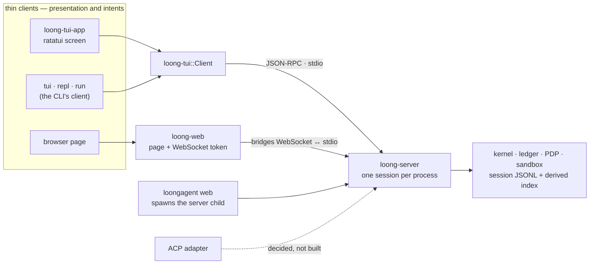

# Surfaces: one server, many thin clients

- **Up:** [design/README.md](README.md) · [04 System overview](../04-system-overview.md)
- **Authority:** [ADR-0001](../decisions/0001-one-binary-client-server.md) · [ADR-0002](../decisions/0002-json-rpc-wire-protocol.md) · [ADR-0009](../decisions/0009-surfaces.md) · [ADR-0019](../decisions/0019-mid-turn-permissions.md)
- **Code:** `crates/cli/src/main.rs`, `crates/server/src/lib.rs`, `crates/tui/src/lib.rs`, `crates/tui-app/src/lib.rs`, `crates/tui-app/src/commands.rs`, `crates/web/src/lib.rs`
- **Verify:** `cargo test -p loongagent -p loong-server -p loong-tui -p loong-tui-app -p loong-web` · `./scripts/check.sh`

The architecture is one local agent server and thin clients that render its event stream and
send intents. The implementation is narrower than the decision in two places, and they are
stated up front: the server speaks **stdio**, not the unix socket ADR-0001 describes, and a
surface **spawns its own server child** rather than attaching to a shared per-user daemon. The
TUI, web, line mode and headless run all speak the same JSON-RPC protocol over that child.

## 1. The server owns the session while it runs

`loongagent server --stdio` is the only implemented server transport. It builds one kernel,
reads one JSON-RPC line at a time, and writes the events a request produced **before** the
response. `Server::run_stdio` is the loop; `loong_protocol` owns the envelopes; the kernel owns
the log, the ledger, the PDP and the tools.

A session is not a resident object the server holds forever: **the session's JSONL log is the
source of truth**, and the server opens it when it starts. A process that ends leaves the log
behind — plus whatever derived index and memory it built — and the next surface reopens them.
That is what makes "reopen a session" work even though there is no long-lived daemon.

The consequence deserves its own sentence: two surfaces started at once each spawn their own
server on the same log. There is no write token, no observer mode and no takeover event, so
ADR-0009 §5's one-writer/many-observers rule is a decision the code has not implemented. Today
the safe shape is one attached surface per session.

## 2. The CLI is the composition root and the command surface

The single `loongagent` binary contains the server and every command. `main.rs` parses the
arguments and dispatches; the command modules are the only place where the run is assembled:

- **Resolve** the layered configuration (`Args::settings_with_pack`) — local mode or the
  managed layers, then the verified pack as the `control` layer.
- **Build** the kernel: models, tools, hooks, MCP clients, skills, plugins, the PDP and the
  sandbox choice (`serve` and `build_kernel` in `crates/cli/src/server.rs`).
- **Run** the chosen surface: spawn the server child (`tui`, `repl`, `run`, `web`) or run the
  server itself (`server --stdio`).

So the CLI is not "another surface" in the thin-client sense. It is the composition root that
turns a user's files and flags into one configured server. A surface crate below it receives a
connected client; a form may collect a value, but resolving it and writing it is the CLI's job.

The command surface, grouped by what it does:

| Group | Commands | Talks to a server? |
|---|---|---|
| Session | `server`, `tui`, `resume`, `repl`, `web`, `run`, `sessions`, `fork`, `delete` | yes, or reads the logs |
| Setup | `setup`, `local`, `local semantic`, `profiles`, `use`, `control` | no; writes or shows configuration and the control-plane cache |
| Inspection | `config show`, `config explain`, `context status / verify / rebuild`, `skills list`, `hooks list`, `mcp list`, `plugin list` | some read the logs or the layer files directly |
| Trust | `hooks trust`, `mcp trust`, `plugin add / update / remove` | no; the human decision, recorded on disk |
| Proof | `sandbox self-test`, `sandbox probe` | no |

`loongagent-control` is a separate binary and a different job; [control-plane.md](control-plane.md)
owns it.

## 3. The TUI: two crates, one screen

`loong-tui` is the protocol client and holds **no terminal dependency**. `Client` sends
`session.attach`, `session.replay`, `session.new`, `prompt.submit`, `approval.respond`,
`permissions.set`, `model.list`, `model.select` and `context.explain`, and renders the `event`
and `model.delta` notifications it gets back. `PendingDecision` is assembled from those events,
not from a second source: the approval panel can say which tool and arguments are waiting
because the client already saw the `tool.call` and `approval.requested`.

`loong-tui-app` is the ratatui screen over that client. A turn blocks on I/O, so the client
lives on a worker thread and the screen talks to it over channels; the key handler and the
drawing are driven from ratatui's `TestBackend` in the tests. The full-screen surface adds only
presentation and intents: the model picker, the context panel, fold/expand of long tool output,
`/yolo`, `/new`, and interrupt. The interruption is a signal to the server process, not a
protocol method.

The slash commands that belong to the screen are offered while they are typed: a `/` opens a
menu above the input, narrowed by the prefix, one line saying what each command does. ↑/↓ walks
it, enter runs an exact name and only *completes* a prefix, esc puts it away. The menu sits
above the input rather than in the prompt title so that a running turn's `working …` status and
the command being typed are both visible; that matters because `/yolo` is exactly the command
someone reaches for during a turn. The menu and the dispatcher read one table
(`crates/tui-app/src/commands.rs`), so a spelling the menu offers cannot be one the dispatcher
does not know — the drift that made `/qui` look like a command while enter sent it to the
model. Everything not in that table still goes to the agent, where `/help` and the workspace's
skills live, and the menu says so instead of pretending the word does not exist.

Two rules keep the prompt title honest. The turn's status always wins it — working, waiting,
finished — and the YOLO warning is a red mark in front of that status, never a replacement: a
session that stops asking is dangerous, but a title that says only that is a session nobody can
tell is alive. And a turn that stops for a question is **paused, not finished**: the question is
the state, no `✓ 完成` is recorded, and the turn's clock keeps running across the pause, because
it measures the turn rather than the work.

`/yolo` must not wait for a turn to end: the launcher gives the server a private control
channel, so it reaches the running kernel at its next boundary and the screen flips at
once (`permissions.relaxed` confirms). Unix: a socketpair; Windows keeps the queued path.

### The TUI's marks and colour

The transcript is painted by classification rather than by the sender: `classify` reads the
line's own vocabulary (the prefixes `loong-tui`'s renderer writes) and `style_for` turns that
into a style, so there is one palette for the whole surface.

| Line | Colour | Why |
|---|---|---|
| `you: …` | the label in cyan, the words plain | the label marks where a prompt began when scrolling back; the person's own words stay readable |
| `→ tool …` | teal | the agent is doing something |
| `← ok …` | green, dim | a result is evidence, not news |
| `← failed …` | red | it did not work |
| `! approval required …` | yellow, bold | the person has to answer |
| `! …` | red, bold | something went wrong |
| `· policy: …` | violet | a decision about permission, which is worth finding later |
| `· …` | the terminal's own foreground, dimmed | bookkeeping: skills, tokens, compaction |
| anything else | default | the model's own answer, left alone |

The palette names colours and never invents RGB, because a fixed tone is picked for one
background and unreadable on the other. The same rule is why the quiet lines are the
**terminal's own foreground, dimmed**, and not `DarkGray`: bright black *is* the background
on a dark theme, so the bookkeeping lines were drawn into the wall (`MARK_QUIET`). The
answers that were not chosen in a decision menu are `default` too; the highlighted one is
the one that is coloured and bold.

The mark is the owner's, kept verbatim:

```
╭───────༺ ᛭ ༻────────────╮
╞═══════【 龍 】════════════╡
╰───────༻ ᛭ ༺────────────╯
```

When the terminal has room (at least 52 columns by 22 rows) the five-row frame is used
instead, with the owner's ornaments and inscription:

    ╔═══════════════༺ ᛭ ༻═══════════════╗
    ║                                   ║     loongagent
    ║               【 龍 】              ║
    ║                                   ║     ⟬ ᛭ 兴云吐雾 ⋄ 隐介藏形 ᛭ ⟭
    ╚═══════════════༻ ᛭ ༺═══════════════╝

The rules are **built** from the interior width (`MARK_INNER`), so the sides line up even
when a rune measures differently; `/logo` puts it away, and under 48 columns by 18 rows
there is no mark. `龍` and the wordmark are the terminal's own foreground in bold, the frame
is ANSI magenta, and the transcript's accents are ANSI cyan and magenta — nothing is an
absolute RGB or a literal white, because the owner runs a light background.

## 4. The web: a bridge, not a second agent

`loongagent web` spawns the same server child, then `loong-web` serves one embedded page and
bridges WebSocket messages to the child's stdio lines. The crate is deliberately ignorant of the
protocol: it carries a line in and lines out, so the browser speaks exactly what the TUI speaks.
The page has no routing, no ledger, no policy and no second loop.

Two properties are local to this surface:

- **A token on the handshake.** A loopback bind is not authorisation on its own; any page can
  open a WebSocket to `127.0.0.1`. The token is 16 bytes read from `/dev/urandom`, printed in the
  URL fragment (which browsers do not send to a server), and presented as a query parameter on
  the socket. A wrong token is refused.
- **The bind address.** Loopback by default; `--bind` can change it, and then the token is the
  only gate. There is no user identity behind it.

ADR-0009's "web via the firm control-plane URL, relaying to the user's local server" is not
built. `loongagent web` is the localhost path only.

## 5. ACP: decided, not built

ADR-0002 makes ACP a dialect of this protocol over JSON-RPC; ADR-0009 places the adapter after
the TUI and web. There is no `acp` command, crate or adapter in the tree. The only trace is the
`"acp"` label the schema allows in `SessionAttachParams.client`. The VS Code panel is a
separate Webview client: [vscode-surface.md](vscode-surface.md).

## 6. What a surface may do, and what it may not

| May | Must not |
|---|---|
| Render events (`message.appended`, `tool.call`, `tool.result`, `approval.requested`, `cost.recorded`, …) and show `model.delta` as a preview. | Append an event, write the session log, or edit the ledger. |
| Send the intents the server implements: attach, replay, new session, prompt, approval, permissions, model list/select, context explain. | Decide a permission, route a model, assemble context, or build a prompt. |
| Do presentation work: diffs, highlighting, layout, keybindings, file pickers, fold/expand, an approval or setup form. | Hold agent state that the log does not have, or expose a capability no server implements. |
| Read the session's own log through `session.replay` (a read that records nothing). | Treat a surface-local cache as policy, or let the browser page be the place a rule lives. |

The rule behind the right column is ADR-0009 §3: a capability is implemented once, in the
server. A surface may lag in exposing it; the gap should be an explicit unsupported marker, not
a divergent local implementation.

## 7. The protocol they share

Every surface speaks newline-delimited **JSON-RPC 2.0** from [`crates/protocol`](../../crates/protocol/src/lib.rs):

- a **request** carries `jsonrpc: "2.0"`, `id`, `method` and `params`; the server answers once
  with `result` or a JSON-RPC `error`;
- an **event** is a server-to-client notification with `method: "event"` and one event
  envelope in `params`; it is written to the log first, then announced, so a surface cannot see
  a decision the record does not have;
- `model.delta` is the one transient notification: a preview of text being written, never the
  record.

The method and event names live in [`crates/schema/protocol.toml`](../../crates/schema/protocol.toml),
which is the one source for the Rust types, the TypeScript client and the samples. `session.attach`
returns `schema_version` and the number of existing events; there is no capability negotiation.
The event stream and its storage are owned by [events-storage.md](events-storage.md); session
lifecycle and lineage by [sessions-lineage.md](sessions-lineage.md).



## 8. Known limits

- **No unix socket and no shared daemon.** ADR-0001's per-user server and ADR-0009's
  multi-surface attach are not implemented; the transport is stdio, and each surface starts its
  own child. Two surfaces on one log are not coordinated.
- **`session.attach` is a handshake, not a takeover.** It returns the session id, schema version
  and event count; it does not hand over a write token or register an observer.
- **ACP is not built.** Only the schema's optional client label exists.
- **The team web path is not built.** There is no control-plane relay, and the browser page is
  served by the local binary.
- **The web token is the whole authentication.** The server has no user identity; a non-loopback
  bind relies on the token and on the operator's network. `random_token` reads `/dev/urandom`,
  so `loongagent web` is effectively Unix-only today.
- **The TUI is the widest surface.** Trust and plugin commands are CLI-only; the TUI has no
  `/plugin`, `/hooks` or `/mcp` page. That is a surface gap, not a second implementation.
- **No capability inventory.** The unsupported marker ADR-0009 asks for is a convention, not a
  checked list.

## 9. Where to read next

- [ADR-0001](../decisions/0001-one-binary-client-server.md) — one binary, always client/server.
- [ADR-0002](../decisions/0002-json-rpc-wire-protocol.md) — JSON-RPC 2.0, schema-first, ACP as
  a dialect.
- [ADR-0009](../decisions/0009-surfaces.md) — thin-client rule, build order, one-writer attach.
- [events-storage.md](events-storage.md) — the event stream every surface renders.
- [sessions-lineage.md](sessions-lineage.md) — what attach, replay and fork mean.
- [control-plane.md](control-plane.md) — the other binary and the remote/team story that is not
  built.
- `crates/server/src/lib.rs` — the request loop and the streaming event sink;
  `crates/cli/src/tui.rs` — the child transport and the TUI's composition.
