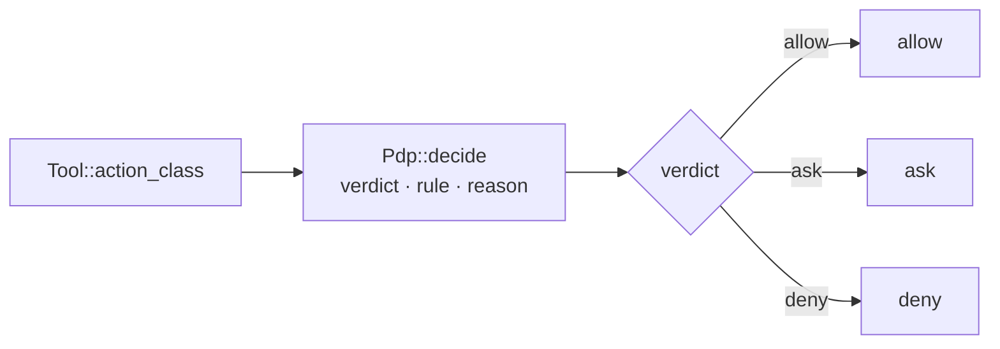

# Tools and permissions: one gate, two enforcers

- **Up:** [design/README.md](README.md) · [04 System overview](../04-system-overview.md)
- **Authority:** [ADR-0004](../decisions/0004-microkernel-extension-model.md) · [ADR-0007](../decisions/0007-permission-sandbox-engine.md)
- **Code:** `crates/tools/src/lib.rs`, `crates/sandbox/src/`, `crates/kernel/src/turn/confinement.rs`, `crates/proc/src/lib.rs`
- **Verify:** `cargo test -p loong-tools -p loong-sandbox` · `./scripts/check.sh`

Every **registry** tool — all built-ins included — is behind one interface; §6
names the one exception. That is what gives permissions, hooks and cost metering
a single chokepoint: the kernel computes an action class for each call, asks one
policy decision point (PDP) for allow / ask / deny plus the rule that fired, and
only then runs the tool. Enforcement does not trust that decision alone — a
write guard inside the tool and an OS sandbox on its children are the enforcers.
This is the "prompts are not permissions" promise of [04](../04-system-overview.md)
§5 in code.

## 1. One interface, built-ins included

```rust
pub trait Tool: Send + Sync {
    fn name(&self) -> &str;
    fn description(&self) -> &str;
    fn parameters(&self) -> Json;
    fn action_class(&self, args: &Json, cwd: &Path) -> ActionClass;
    fn execute(&self, args: &Json, ctx: &ExecContext<'_>) -> Result<String, ToolError>;
}
```

`Registry` holds every tool by name; `Registry::with_builtins` is what a fresh
session starts with. `ExecContext` is deliberately small — `cwd` plus
`confinement: &dyn Confinement` — because a tool needs to know where it runs and
how its children are restricted, and nothing else about the session. A tool
reports `ToolError::Refused` (bad arguments, outside its remit) or
`ToolError::Failed` (it ran and failed); both become a `tool.result` with
`ok: false`, never a failed turn.

One trait, not a built-in fast path: the same code gates and records every tool.

## 2. The action class comes from the arguments

Autonomy is allocated per **action**, not per tool (ADR-0007 §4). `ActionClass`
has three values:

| Class | Meaning | Default ruling |
|---|---|---|
| `Investigate` | read-only, no side effects | allow |
| `WriteWorkspace` | edits inside the workspace | allow |
| `OutOfBounds` | network, outside the workspace, destructive, credentials | ask |

`Tool::action_class(args, cwd)` computes it before anything runs, which is what
makes "investigate free, write gated" true rather than nominal:

- `classify_read_path` — a read inside the workspace is `Investigate`; a path
  outside it is `OutOfBounds`.
- `classify_path` — resolve lexically against `cwd` (no filesystem access, so a
  write target may not exist yet); inside is `WriteWorkspace`, outside is
  `OutOfBounds`.
- `classify_command` — a shell tool has no single class, so the command string
  is read: known read-only verbs with no redirection are `Investigate`, but
  their arguments are not resolved (`cat /etc/passwd` is `Investigate`); network,
  privilege and destructive patterns are `OutOfBounds`; a mutating verb whose
  *absolute* path tokens leave the workspace is `OutOfBounds`; anything else,
  unknown or mutating, is `WriteWorkspace` — including `touch ../x`, which only
  the OS sandbox stops.

The shell classifier is a **heuristic for allocating autonomy, never a security
boundary** — the boundary is the PDP plus the confinement. `ReadFile`,
`WriteFile`, `Edit` and `Shell` return `OutOfBounds` when the deciding argument
is missing, rather than guessing; `Grep` and `Glob` default to the workspace and
are `Investigate` when no path is given. MCP tools declare their class in
`.loongagent/mcp.toml` instead: a per-server default with per-tool overrides,
defaulting to `out_of_bounds` because the kernel cannot know what a tool does.

## 3. The decision: allow, ask, deny — plus the rule



The end-to-end sequence — `tool.call`, `pre_tool`, `policy.decided`, the three arms,
`approval.requested` and `respond_to_approval` — is
[flows/tool-approval.md](flows/tool-approval.md).

`Pdp` is a three-slot `Ladder` with a rule string per slot. Its defaults are
junior-proof: investigate and workspace writes allowed, out of bounds asked.
Configuration narrows the ladder before the first decision
(`Pdp::tighten_from(class, verdict, source)` in `Kernel::build`), and only
narrows: the severity order is allow < ask < deny, and a request that would
widen is `PolicyError::WouldWiden`. The slot's rule names the layer that won —
`builtin:<class>` or `profile:<layer>:<class>` — so every `policy.decided` event
carries both the verdict and who decided it.

`Kernel::dispatch` is the chokepoint. It records `tool.call`, fires the
`pre_tool` hooks, and lets a hook **tighten** the ruling via `tighten`: a hook
can only replace a ruling with a stricter one, and the rule becomes
`hook:<ids>`. The stricter verdict is what `policy.decided` records and what the
kernel acts on (ADR-0008: lower layers narrow, never widen).

The three arms:

- **Allow** — execute, record `tool.result`, fire `post_tool` hooks.
- **Ask** — fire `permission_requested`, write `approval.requested` with an
  `appr-N` id, and park the turn. `Kernel::respond_to_approval` later writes
  `approval.decided` and either runs the call or records a refusal. `/yolo`
  (`Kernel::set_auto_approve`) turns an ask into an allow, and says so with a
  second `policy.decided` and a second `tool.call`. The sequence is [tool-approval.md](flows/tool-approval.md).
- **Deny** — record `tool.result` with `ok: false` and the rule and reason. The
  model reads it and continues; a denial is not an error.

## 4. Where enforcement happens

The PDP decides; two other layers enforce, and neither can be talked out of it.

**The tool runner.** `Kernel::execute` is the PEP for the call: it builds
`ExecContext::new(&self.config.cwd, self.confinement.as_ref())` from the kernel
and hands it to the tool. `WriteFile` and `Edit` re-check `classify_path`
themselves and refuse a target outside the workspace — the shell classifier may
be a heuristic, but a write tool that disagrees with it still refuses.

**The OS sandbox.** `Kernel.confinement` is chosen once, when the kernel is
built: `WorkspacePolicy::new(&config.cwd)` becomes a `LandlockConfinement`,
whose `confine` installs a `pre_exec` hook. In the forked child, before exec,
`WorkspacePolicy::apply` adds a read-only rule for `/`, a read-write rule for the
workspace and for `/dev/null` (ordinary tools open it read-write at startup, and
it stores nothing), sets `PR_SET_NO_NEW_PRIVS`, and restricts itself. The
restriction is irreversible and inherited — it lands on the child and never on
the server.
When Landlock is unavailable the kernel falls back to `NoConfinement` and
records why in `Kernel::confinement_note()` (`unconfined: …`) for diagnostics
and tests. The startup log does not read that string; it reports the sandbox
self-test's own result — `[sandbox] WARNING: unconfined — …` when no mechanism
exists.

Every child a built-in spawns from a tool call goes through `loong_proc`:
`RunSpec` carries the program, cwd, timeout, output limit and a `confine`
callback, and `run` applies that callback to the `Command` after setting up
scratch files and its own process group, just before `spawn`. The shell tool
passes `ctx.confinement.confine` through, so the kernel's policy is the child's.
`sandbox self-test`
(`crates/sandbox/src/sandbox.rs`) proves the mechanism by having a confined
child attempt one allowed write, one forbidden write and a `/dev/null` open; a
mechanism that cannot demonstrate denial is reported as `Broken`, not as
present. `bubblewrap` is
detected and named, not applied.

The process-level seam is worth stating: an **MCP server process** is started by
`McpClient::start` when the kernel is built, not from a tool call, so the
`ExecContext` confinement does not cover it. Its gate is the declared action
class plus the trust gate on `.loongagent/mcp.toml`, and its tool calls still go
through `Kernel::dispatch`; but the server and every process it spawns (an
`npx` → `node` tree, for example) are outside the Landlock policy. The
direct-spawn case is §5; the `recall` bypass is §6.

## 5. Why a tool cannot widen the confinement

A tool receives `&dyn Confinement`; it can call `confine` on a child, and there
is no method that replaces the policy, changes `cwd`, or returns a different
confinement. The PDP is not in `ExecContext` at all. So:

- A tool cannot run a child unconfined *through the interface*: the only
  policy-bearing thing it is given is the one the kernel chose.
- A tool can make a cheaper *claim*, not a cheaper *gate*: `action_class` is the
  tool's own return value and `Kernel::dispatch` passes it straight to
  `pdp.decide`, so a too-cheap class gets an allow. What catches a wrong claim is
  the built-in write guard (for the built-ins), or the OS sandbox on a *child*
  that writes outside the workspace.
- A granted approval does not buy a different policy: `respond_to_approval`
  runs the same `Kernel::execute`, with the same `ExecContext`.
- `/yolo` relaxes only the ask arm. The sandbox is a different axis and still
  applies — `Shell::execute` states it in the comment beside the call: the
  restriction is irreversible and must not leak into the server.

The honest limit: the kernel hands a tool the confinement and the built-ins use
`loong_proc` so it is applied, but nothing in the type system stops a tool from
calling `Command::spawn` itself. A tool that ignores `ExecContext` is a trust
failure and a bug, not a supported shape; that is why the tool contract is to
spawn children through `loong_proc` with `ctx.confinement`. The same goes for the
tool's own I/O: `Kernel::execute` runs `Tool::execute` in the unconfined server
process, so a custom tool that writes outside the workspace in-process is caught
by neither the sandbox nor the built-in guards.

## 6. The built-in tools, and the one exception

| Tool | Class | Notes |
|---|---|---|
| `read_file` | `Investigate` inside the workspace, `OutOfBounds` outside | plain UTF-8 read |
| `write_file` | `WriteWorkspace` | refuses outside the workspace |
| `edit` | `WriteWorkspace` | exact-string replace; refuses a missing or ambiguous `old_string` and names the lines, because guessing corrupts a file |
| `grep`, `glob` | `Investigate` | read-only by construction, bounded output |
| `shell` | `classify_command` | bounded output, timeout, whole process tree killed on timeout |
| `skill` | `Investigate` | loads a skill's instructions by name |
| `mcp__<server>__<tool>` | from `mcp.toml` | a server process the kernel starts at build; not covered by `ExecContext` confinement (§4) |

**`recall` is the exception.** It is not in the `Registry` and it never reaches
`Pdp::decide`: `Kernel::dispatch` answers it before the registry lookup,
recording `tool.call` with `ActionClass::Investigate` and then `tool.result`.
That is defensible only because of what it is — read-only queries against the
session's own derived memory, which is data the model has already been given in
full, so there is nothing to gate. It is offered only when a memory exists
behind it (`Kernel::tool_specs`), and `Kernel::execute` has a matching arm, so
the answer is produced by the same function however the call is reached. The
context side of it is [context-ledger.md](context-ledger.md) §5.

## 7. What a tool author must declare

- **Name, description and JSON schema.** The description is what the model
  reads to decide whether to call it; the schema is what a provider validates.
- **`action_class`, computed from the arguments.** Conservative by default:
  when the arguments do not settle the question, `OutOfBounds`. A tool that
  claims `Investigate` for a write is a policy bug: the built-in `write_file`
  and `edit` re-check the path and refuse, but a custom tool carries no such
  guard, so it must refuse what it should not do itself.
- **`execute`, and its refusals.** Bad arguments are `ToolError::Refused`, not
  a panic; a failed command is `ToolError::Failed`; both are recorded as
  results. Output should say where it was truncated, because a silently short
  answer reads as "that is all there was".
- **Confinement on every child.** Spawn through `loong_proc::RunSpec` and pass
  `ctx.confinement`; never run repository content without it.
- **No side channels.** A tool returns a string; the kernel records the
  `tool.result` and its ledger entry. It does not append events, write ledger
  entries or talk to the model.

## 8. Where to read next

- [ADR-0004](../decisions/0004-microkernel-extension-model.md) — why tools are
  edges and the loop is fixed.
- [ADR-0007](../decisions/0007-permission-sandbox-engine.md) — the ladder, the
  rule that fired, approvals, and why enforcement is at the OS.
- [ADR-0008](../decisions/0008-configuration-layering.md) — narrowing only.
- [04 System overview](../04-system-overview.md) §3 item 4 and §5 — the PDP and
  "prompts are not permissions".
- `crates/kernel/src/turn/tests.rs` —
  `a_granted_approval_still_cannot_escape_the_workspace`,
  `the_pep_still_allows_a_workspace_write_through_the_shell`,
  `the_pep_stops_an_escape_the_classifier_cannot_see`,
  `opting_out_of_prompts_allows_the_action_and_says_so_in_the_log`.
